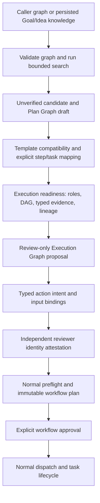
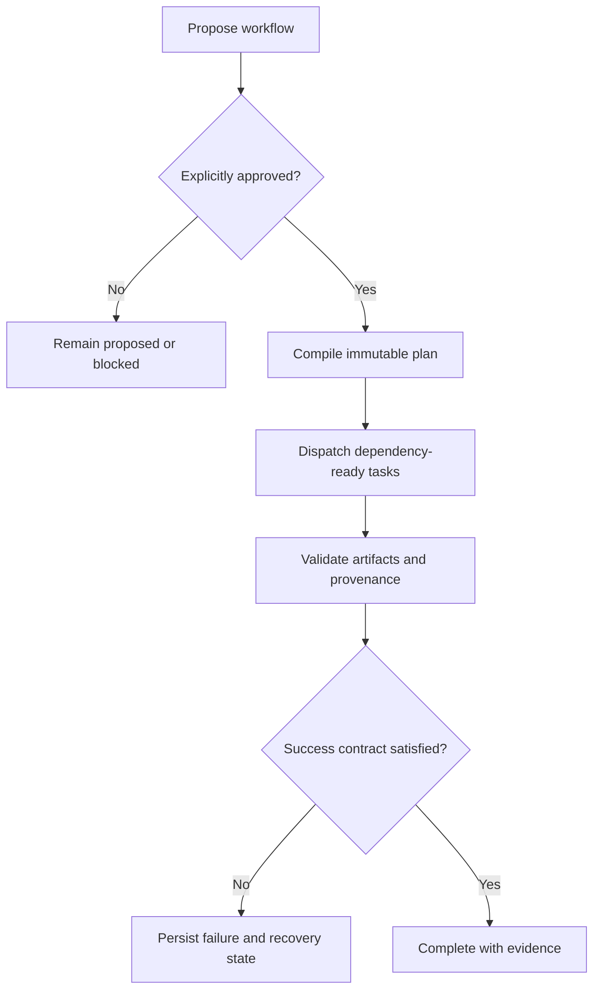

<p align="center">
  
</p>

<p align="center">
  <a href="https://github.com/nplongx/runalith/actions/workflows/ci.yml"></a>
  <a href="https://github.com/nplongx/runalith/actions/workflows/pages.yml"></a>
  <a href="https://github.com/nplongx/runalith/releases"></a>
  <a href="LICENSE"></a>
  <a href="https://nodejs.org/"></a>
</p>

<p align="center">
  <a href="https://nplongx.github.io/runalith/">Website</a> ·
  <a href="https://github.com/nplongx/runalith/releases">Releases</a> ·
  <a href="docs/README.md">Docs</a> ·
  <a href="CONTRIBUTING.md">Contribute</a> ·
  <a href="SECURITY.md">Security</a>
</p>

> [!WARNING]
> **Testing pre-release — not production-certified.** The strict Phase 2 readiness gate remains `BLOCKED_NOT_READY` (`execution_permitted=false`). Read the [latest RC.11 release notes](https://github.com/nplongx/runalith/releases/tag/v1.0.9-rc.11), the [RC.11 acceptance record](docs/goal-plan-execution-acceptance-rc11-20261026.md), and the [release policy](docs/RELEASE_POLICY.md) before evaluating or installing a candidate.

Runalith turns multi-step agent work into an explicit, inspectable workflow: approved immutable plans, dependency-aware tasks, typed evidence, durable SQLite state, bounded local execution, and recovery records.

Runalith is a runtime, not a hosted model or remote execution service. Reasoning is supplied by the MCP client/assistant; supported deterministic commands run locally under a plan-bound contract. The installable `.mcpb` is a standard bundle container for compatible clients, not a proprietary Runalith-only format.

## Contents

- [Why Runalith](#why-runalith)
- [Capabilities](#capabilities)
- [Adaptive Goal Graph (AGG)](#adaptive-goal-graph-agg)
- [Workflow lifecycle](#workflow-lifecycle)
- [Quick start](#quick-start)
- [Connect an MCP client](#connect-an-mcp-client-directly)
- [How a workflow runs](#how-a-workflow-runs)
- [Documentation](#documentation)
- [Development commands](#development-commands)
- [Security and project status](#security-and-project-status)

## Why Runalith

Agent reasoning can be flexible; execution should still be reviewable. Runalith separates the assistant's reasoning from the runtime's persisted plans, approvals, task execution, and evidence checks.

| Principle | Runtime behavior |
|---|---|
| **Approval before execution** | A proposal is not authorization. Dispatch requires an explicitly approved, immutable plan. |
| **Durability by default** | Workflow state, task transitions, artifacts, and audit events are persisted in SQLite for inspection and recovery. |
| **Evidence over assertion** | Completion gates examine supported success predicates, artifact schemas, hashes, and producer lineage—not narrative claims alone. |
| **Local-first boundaries** | The stdio MCP server does not open an HTTP listener; deterministic local commands run under plan-bound contracts. |

## Capabilities

- **Dependency-aware orchestration:** tasks become eligible only when planned dependencies and required evidence are satisfied.
- **Reusable workflow policy:** versioned policy packs can pin supported constraints and success predicates before approval.
- **Adaptive Goal Graph (AGG):** bounded graph search, append-only Goal/Idea knowledge, source/artifact evidence resolution, review-only Plan/Execution Graph proposals, and separate trust/approval gates. AGG does not bypass the standard workflow runtime.
- **Local observability:** an optional loopback-only dashboard provides read-only inspection of workflow state.
- **MCP-native integration:** connect compatible clients over stdio or install the `.mcpb` bundle in a client that supports it.

## Adaptive Goal Graph (AGG)

AGG is Runalith's graph-based planning and evidence subsystem. It is not a general-purpose autonomous agent, a hosted model, or an independent execution engine. It proposes and validates pathways, then hands any approved work to Runalith's existing workflow templates, immutable plans, task contracts, and lifecycle.



Every stage can stop with an explicit blocker. A graph hash establishes content identity, not that a claim is true. A signed Goal/Idea snapshot verifies only the exact snapshot and the external verifier's adjudication; it does not by itself verify a proposed plan, authorize actions, approve a workflow, or permit dispatch. Plan Graph and Execution Graph records are review artifacts until the distinct downstream checks pass. The detailed [AGG system guide](docs/adaptive-goal-graph.md) documents the contracts and [MCP Reference](docs/MCP_REFERENCE.md) lists the exact tool schemas.

### Main subsystems

| Subsystem | Purpose and current boundary |
|---|---|
| Deterministic graph search (Phase 1) | Validates a caller-supplied schema-v1 graph, applies bounded beam search over nominal transitions, keeps an audit trace, and projects complete candidates into review-only Plan Graph drafts. Search is bounded/heuristic, not an optimality proof. |
| Persistent Goal/Idea knowledge | Stores stable cross-goal nodes, immutable revisions, memberships, typed edges and provenance in SQLite. Save/capture operations do not mark claims verified or make them executable. |
| Source/evidence verification | Resolves source-byte identity and durable artifact/result/attempt/completion lineage. Hashes and lineage do not alone establish claim truth or evidence independence. |
| External trust | A verifier signs the exact snapshot/evidence-manifest decision; a separate reviewer identity provider attests an exact action candidate/plan binding. The two trust domains require different provider identities and disjoint Ed25519 roots. Human approval remains a separate step. |
| Plan/Execution Graph integration | Checks mapping against existing workflow templates, typed role/artifact contracts, DAG ancestry and current evidence; may persist review-only proposals and candidates before the normal workflow compiler/preflight/approval path. Those records are not executable or authorized. It is not a standalone arbitrary-command executor. |
| Shadow learning/reuse (Phases 2–4) | Learned-discriminator search, MCTS search and workflow-outcome capture are opt-in/experimental paths. The shadow searches do not authorize or execute; capture records bounded, unverified lessons/metadata. These are not production acceptance evidence. |
| Observability | Planner invocation telemetry is recorded separately from graph/trust/acceptance semantics; the optional Dashboard reads telemetry/workflow state and does not make approval or execution decisions. |

**Current operational status (2026-10-26): testing pre-release only; production rollout remains BLOCKED.** The RC.11 package is not installed in the recorded target host, which remains on RC.8. Host-owned verifier/reviewer trust configuration and the independently protected external checkpoint are not verified. A read-only reconciliation observed 60 `EXECUTING` jobs and 61 running tasks without lease rows; those records require per-owner/provider reconciliation. A missing lease does not prove a worker is dead. See [RC.11 acceptance](docs/goal-plan-execution-acceptance-rc11-20261026.md), [Known issues](docs/KNOWN_ISSUES.md), and [trust provisioning](docs/agg-production-trust-provisioning-runbook.md). The published pre-release is not a production certification.

## Workflow lifecycle



The `workflow_coordinator_step` API can drive much of this lifecycle one high-level step at a time, but it does not bypass approval or replace the client assistant's reasoning. See the [workflow lifecycle and recovery guide](docs/workflow-lifecycle.md).

## Quick start

### Requirements

- Node.js **22.13 or newer** and npm.
- `tmux` only when exercising deterministic local execution tasks.
- An MCP-compatible client for stdio integration. Clients that support MCPB can install the `.mcpb` bundle using their own installation flow.

### Check out and test

```bash
git clone https://github.com/nplongx/runalith.git
cd runalith
npm ci
npm test
```

### Build an MCP bundle

```bash
npm run pack:runalith-mcpb
```

The packer creates a uniquely named candidate under `dist/`, validates the archive, smoke-tests the extracted MCP runtime, checks tool schemas, and runs the local acceptance suite. Use the exact path and SHA-256 printed by the command. A candidate is not automatically a release or production approval.

### Connect an MCP client directly

A client that supports stdio MCP can launch the versioned entrypoint named by this checkout's package metadata directly. For the RC.11 source in this repository, that is `server/index-v1.0.9-rc.11.js` (not the historical `server/index.js` compatibility input). Configure its MCP server entry with an absolute path, for example:

```json
{
  "mcpServers": {
    "runalith": {
      "command": "node",
      "args": ["/absolute/path/to/runalith/server/index-v1.0.9-rc.11.js"],
      "env": {
        "RUNALITH_DATA_DIR": "/absolute/path/to/private/runalith-data",
        "RUNALITH_WORKSPACE": "/absolute/path/to/workspace"
      }
    }
  }
}
```

The exact configuration syntax varies by client. Keep the data directory private and choose a dedicated workspace. The MCP entrypoint uses newline-delimited JSON-RPC on stdin/stdout and does not open an HTTP listener.

## How a workflow runs

1. **Propose:** `workflow_create` records a proposal without authorizing execution.
2. **Review and approve:** inspect the proposal, then call `workflow_approve` to authorize and compile its immutable plan.
3. **Dispatch and execute:** `workflow_dispatch` starts the approved workflow. Tasks are released in dependency order; deterministic commands must come from plan-bound execution contracts.
4. **Inspect and recover:** use workflow, event, artifact and diagnosis tools to inspect durable state. Failed or incomplete work remains failed or blocked until it is actually resolved.
5. **Synthesize:** `workflow_complete_synthesis` applies reviewer, artifact, provenance and success-contract gates before terminalizing the workflow.

See the [documentation index](docs/README.md) for architecture, tool schemas, policies, and operational guides.

## Documentation

| I want to… | Read |
|---|---|
| Build, connect and verify the MCP runtime | [Quickstart](docs/quickstart.md) |
| Understand AGG from graph search through evidence and execution gates | [Adaptive Goal Graph system guide](docs/adaptive-goal-graph.md) |
| Provision verifier/reviewer trust and understand blockers | [AGG trust provisioning runbook](docs/agg-production-trust-provisioning-runbook.md) and [RC.11 acceptance](docs/goal-plan-execution-acceptance-rc11-20261026.md) |
| Understand AGG benchmark methodology and what has/has not been demonstrated | [AGG empirical evaluation](docs/research/agg-empirical-evaluation/README.md) and [Phase 1 benchmark methodology](docs/agg-phase1-benchmark-methodology.md) |
| Understand approval, execution, recovery and synthesis | [Workflow lifecycle and recovery](docs/workflow-lifecycle.md) |
| Understand runtime and trust boundaries | [Architecture](docs/architecture.md) |
| Understand deterministic batch execution | [Durable batch execution](docs/batch-execution.md) |
| Look up MCP tool inputs and schemas | [MCP tool reference](docs/MCP_REFERENCE.md) |
| Understand names and compatibility identifiers | [Terminology guide](docs/TERMINOLOGY.md) |
| Use custom roles and Agent Skills | [Agent Skills](docs/agent-skills.md) |
| Combine specialist reasoning with deterministic execution | [Hybrid engineering workflow](docs/hybrid-engineering-workflow.md) |
| Define and attach reusable workflow policies | [Workflow policies](docs/workflow-policies.md) |
| Run the read-only local dashboard | [Dashboard guide](docs/local-dashboard.md) |
| Contribute code or documentation | [Contributing](CONTRIBUTING.md) and [documentation workflow](docs/DOCUMENTATION_WORKFLOW.md) |
| Understand known issues and release limits | [Known issues](docs/KNOWN_ISSUES.md) |
| Read the testing-vs-production release standard | [Release policy](docs/RELEASE_POLICY.md) |

## Development commands

| Command | Purpose |
|---|---|
| `npm start` | Start the MCP stdio server for local development. |
| `npm test` | Run the local acceptance and regression suite. |
| `npm run test:protocol` | Test the structured execution protocol. |
| `npm run test:workflow-m4` | Test workflow-plan, role-input, artifact and orchestrator contracts. |
| `npm run dashboard` | Start the optional read-only dashboard, normally at `http://127.0.0.1:8318`. |
| `npm run test:dashboard` | Run dashboard integration and security regression tests. |
| `npm run pack:runalith-mcpb` | Build and verify a local MCPB candidate. |
| `npm run docs:check` | Check local Markdown links and documentation constraints. |

## Security and project status

Runalith is designed for controlled local development and testing; it is **not certified for production use**. Structured execution and filesystem checks are defense-in-depth, not an operating-system sandbox. The dashboard is a loopback-only read-only view, not an authenticated remote admin service, and output redaction cannot guarantee that every secret is detected.

Published packages are experimental testing candidates, not production certifications. Use the [Releases page](https://github.com/nplongx/runalith/releases) for available packages, verify the checksum, and read the corresponding notes before installation. Formal production/frozen-release gates remain separate from the minimum standard for a testing pre-release; see [release policy](docs/RELEASE_POLICY.md) and [known issues](docs/KNOWN_ISSUES.md).

Runalith is distributed under the [MIT license](LICENSE). Security issues should follow [SECURITY.md](SECURITY.md).
