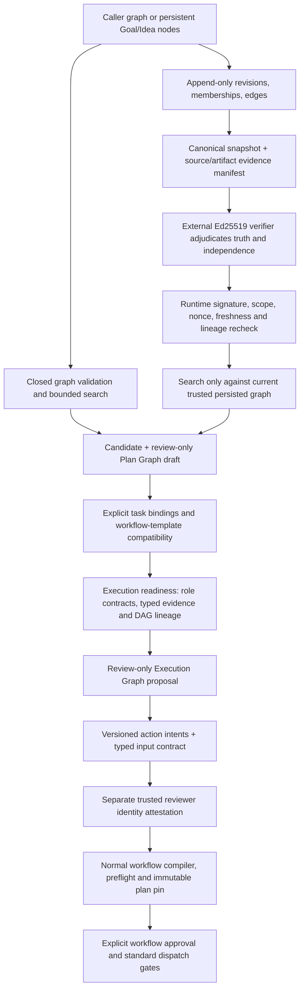

# Adaptive Goal Graph (AGG)

## Purpose and boundary

Adaptive Goal Graph (AGG) includes deterministic graph search, a shared append-only SQLite-backed Goal/Idea Graph, content-addressed source-byte checks, outcome-conditioned recovery recommendations, a bounded audit trace, a trusted external graph-verifier contract, and Plan/Execution Graph review workflows. The source graph's signed verification state is distinct from a search candidate's semantic/action verification: a source attestation does not make a candidate executable and does not grant permission, approval, or dispatch authority. Caller-supplied shadow graphs remain unverified. Every selected candidate still requires a separately validated action-intent envelope, trust-root-verified reviewer identity, current approval over the exact immutable plan, and a fresh dispatch gate.

The planner is exposed through `adaptive_goal_graph_search`; compatibility assessment is exposed through `adaptive_goal_plan_compatibility_check`. The persistent knowledge interface includes `adaptive_goal_knowledge_node_save`, `adaptive_goal_knowledge_capture_workflow_outcome`, `adaptive_goal_knowledge_edge_add`, `adaptive_goal_knowledge_search`, `adaptive_goal_knowledge_node_get`, and `adaptive_goal_knowledge_node_history`. The verifier interface is `adaptive_goal_knowledge_snapshot_get` → external signature provider → `adaptive_goal_knowledge_snapshot_attest`; `adaptive_goal_knowledge_graph_search` then rebuilds a graph from current persisted rows only if the current snapshot, full revision history, membership/edge provenance, evidence manifest, trust root, signature, nonce and expiry all verify. `adaptive_goal_recovery_resolve` remains review-only. `adaptive_goal_plan_proposal_create` accepts either a caller-supplied shadow graph or the verified-store identifiers/hash; those modes are exclusive. The legacy shadow path is never allowed to grant mapped-action authority.

Verified store snapshots and trusted attestations are durable facts only about the exact graph revision and external verifier decision. Candidate status remains separately unverified; a verifier cannot replace current typed producer artifacts, result/attempt/completion lineage, role/action semantics, trusted reviewer identity, human approval, immutable plan pinning or dispatch revalidation. A source edit does not change an installed plugin package until its `.mcpb` is rebuilt and that package is separately installed.

## Current system map (RC.11 source, 2026-10-26)

This guide documents both the AGG search experiments and the trusted Goal/Idea → Plan Graph → Execution Graph integration. They are related but not interchangeable: the search algorithms rank candidate routes; the persistent knowledge layer stores revisions and provenance; the external verifier judges a specific knowledge snapshot/evidence manifest; the reviewer provider verifies a specific action candidate; and the standard workflow runtime alone owns immutable plans, approvals, dispatch and task lifecycle.



### Implemented surfaces and their status

| Area | Implemented behavior | What it does not prove or do |
|---|---|---|
| Phase 1 graph search | Strict schema-v1 graph validation; bounded beam search over nominal transitions; prerequisite/conflict handling; deterministic audit/pruning trace; complete candidates projected to review-only Plan Graph drafts. | Not exhaustive when bounded/pruned; heuristic scores are not calibrated truth; candidates are not verified or executable. |
| Persistent Goal/Idea graph | Shared SQLite-backed stable node identities, cross-goal memberships, append-only revisions, canonical hashes, typed/provenanced edges and history/retrieval APIs. | Saving an idea, adding an edge, cross-goal reuse, or declaring an evidence reference does not verify a claim or authorize planning. |
| Source and artifact evidence | Exact source-byte identity checks and resolution of durable artifacts to schema, hash, producer result/attempt and completion-event lineage. | Hash/lineage proves identity/integrity within its scope, not factual truth, source authority, or independent evidence. |
| External knowledge verification | A trusted external Ed25519 provider signs the current canonical snapshot/evidence-manifest decision; runtime checks exact hashes/IDs, scope, root/provider, nonce and expiry, then resolves lineage again. | Local validation, a self-hash, caller-provided `verified` fields or test-generated key cannot replace the external verifier. |
| Plan Graph integration | Explicit step-to-task bindings, existing workflow-template compatibility, proposal persistence/readback and stale-input revalidation. | A Plan Graph review wrapper is not a pinned immutable execution plan and its approval does not itself authorize an AGG action. |
| Execution Graph readiness/proposal | Checks role/capability/output schemas, dependency ancestry, typed evidence and durable producer lineage; proposals are read-only/review-only until later gates. | Readiness does not by itself create executable contracts, child tasks, dispatch permission or an independent action runner. |
| Action-intent candidate and reviewer | Closed typed action-intent vocabulary, typed evidence/ancestor inputs, semantic checks, exact hash binding, compiler/preflight revalidation, external reviewer identity proof. | A `reviewerId`, timestamp, acknowledgement or caller hash is not identity proof. Reviewer attestation is not normal workflow approval. |
| Phase 2/3 search | Hashed logistic discriminator and bounded seeded UCT/MCTS implementations plus offline runners/verifiers. | Experimental shadow paths, opt-in in MCP, model self-hash is not trusted provenance, no execution/acceptance authority. |
| Phase 4 outcome capture | Opt-in capture of bounded terminal workflow metadata and optional caller lesson into the persistent graph. | It does not automatically copy terminal workflow state, independently adjudicate lesson truth, or enable a captured node for planning. |
| Planner telemetry and dashboard | Source runtime records invocation lifecycle, graph snapshot/candidate summaries and bounded audit events; dashboard queries are read-only. | `completed` telemetry means the MCP call returned, not goal success, acceptance, verified truth or executed action. |
| Sandbox executor | One fixed fixture-only action with exact prerequisites, trust, approved plan, a one-shot claim and verifiable receipt. | Not a general executor, not arbitrary command/script execution, and not an approved production path. It does not provide an OS-level network/CPU/memory sandbox. |

### Current release and operational status

- Published package: [`v1.0.9-rc.11`](https://github.com/nplongx/runalith/releases/tag/v1.0.9-rc.11), source commit `ffee0815b8dfcac21d15d8eaeaf1d309aab2b7e2`, package SHA-256 `37c1d418f743190e1d1843995346c9e3296dafd29e47de1e42afb47b6f2870fd`. Later documentation-only commits on `main` do not change the already published package.
- Tool discovery: the source/manifest and generated MCP reference describe 74 tool definitions in this candidate. The runtime hides the Phase 2 discriminator, Phase 3 MCTS and Phase 4 capture tools by default, so ordinary `tools/list` exposes 71; a packaged smoke test that deliberately sets opt-in flags can observe the full 74. Visibility is not a claim that a tool is authorized or usable for every workflow state.
- Default exposure: Phase 2 discriminator tool, Phase 3 MCTS tool, and Phase 4 workflow-outcome capture tool are disabled/hidden unless their specific `AGG_PHASE2_SHADOW_TOOL_ENABLED`, `AGG_PHASE3_MCTS_TOOL_ENABLED`, or `AGG_PHASE4_KNOWLEDGE_CAPTURE_TOOL_ENABLED` process environment flag is set to `1`. These flags enable testing surfaces; they do not promote model/evidence trust or open execution gates.
- Trust status: host-owned verifier/reviewer JSON trust configurations have not been independently confirmed effective in the active host; the source-verifier and reviewer trust domains must use different provider IDs and disjoint Ed25519 public roots. The local anti-rollback ledger is not a substitute for an independently protected external monotonic checkpoint.
- Live-workflow status at the latest recorded read-only reconciliation: 60 `EXECUTING` jobs and 61 running tasks, zero lease rows; every flagged task requires owner/provider/runtime reconciliation. No inference of worker death or lifecycle permission may be made from missing lease rows.
- Activation status: production remains `BLOCKED`; RC.11 was not installed/activated in the recorded target host, which remained on RC.8. Consult the [RC.11 acceptance record](goal-plan-execution-acceptance-rc11-20261026.md), [trust runbook](agg-production-trust-provisioning-runbook.md), and [recovery guidance](goal-plan-execution-recovery-guidance-rc11-followup.md) for current operator handoff.

### Distinguish AGG algorithm phases from the release-readiness gate

“Phase 2” has two meanings in this repository. **AGG algorithm Phase 2** is the experimental learned discriminator and shadow beam search described later in this guide. **Formal Phase 2 readiness/deployment** is a separate release and host-authorization gate, currently `BLOCKED_NOT_READY` / `execution_permitted=false`. Passing a Phase 2 model/benchmark test, tool call, or integrity verifier does not satisfy the formal deployment gate. Phase 3 MCTS results and Phase 4 reuse/capture results are likewise scoped experiment evidence, not operational acceptance.

### Tool families and recommended end-to-end call order

The public MCP schemas are maintained in the [MCP Reference](MCP_REFERENCE.md). The current tool families are:

| Family | Tools | Contract boundary |
|---|---|---|
| Graph search | `adaptive_goal_graph_search`, `adaptive_goal_recovery_resolve` | Bounded caller-graph search, candidate ranking, audit/pruning trace and review-only drafts. Does not write workflow/job/task state. |
| Persisted knowledge CRUD/retrieval | `adaptive_goal_knowledge_node_save`, `adaptive_goal_knowledge_edge_add`, `adaptive_goal_knowledge_search`, `adaptive_goal_knowledge_node_get`, `adaptive_goal_knowledge_node_history`, `adaptive_goal_knowledge_recovery_resolve` | Appends/reads versioned nodes, memberships, edge contracts and history; saved knowledge remains unverified. |
| Snapshot and trust | `adaptive_goal_knowledge_snapshot_get`, `adaptive_goal_knowledge_snapshot_attest`, `adaptive_goal_knowledge_graph_search`, `adaptive_goal_trust_configuration_status` | Builds a canonical current snapshot, validates an externally signed exact-snapshot decision, and permits stored-graph search only while the attestation and evidence lineage remain current. |
| Plan Graph | `adaptive_goal_plan_compatibility_check`, `adaptive_goal_plan_proposal_create`, `adaptive_goal_plan_proposal_get` | Maps the candidate to a supported workflow template and persists/revalidates a review wrapper; no dispatch authorization. |
| Execution Graph and action candidate | `adaptive_goal_execution_readiness_check`, `adaptive_goal_execution_graph_proposal_create`, `adaptive_goal_execution_graph_proposal_get`, `adaptive_goal_execution_plan_candidate_create`, `adaptive_goal_execution_plan_candidate_get` | Checks typed inputs/evidence, role capability/output contracts, dependency ancestry, action semantics, source freshness and the exact compiled-plan binding. The outputs are still review artifacts until the normal authorization chain completes. |
| Experimental/shadow surfaces | `adaptive_goal_phase2_shadow_search`, `adaptive_goal_phase3_mcts_shadow_search`, `adaptive_goal_knowledge_capture_workflow_outcome`, `adaptive_goal_sandbox_action_execute` | The first three are hidden/disabled by default and require their documented environment flag; sandbox execution is fixture-only test behavior. None is a general production executor or an acceptance shortcut. |

Use one of two entry routes, then converge on the same review and workflow gates:

1. **Exploratory caller graph:** call `adaptive_goal_graph_search` with a schema-v1 graph. Inspect `auditTrace`, termination/exhaustiveness, `planGraphDrafts`, `unprojectableCandidates`, and `candidateEvidenceAssessments`. Treat the whole response as a hypothesis for review; unresolved evidence and model/metric estimates remain unverified.
2. **Persisted trusted knowledge:** append nodes/edges with the knowledge tools; call `adaptive_goal_knowledge_snapshot_get`; send the canonical snapshot/evidence manifest to the independently operated verifier for claim-truth and evidence-independence adjudication; pass the resulting signed attestation to `adaptive_goal_knowledge_snapshot_attest`; then call `adaptive_goal_knowledge_graph_search` with the exact current snapshot hash and persisted start/goal IDs. Any changed content, membership, edge, evidence lineage, nonce or expiry requires a fresh decision or blocks search.
3. **Plan Graph review:** use `adaptive_goal_plan_proposal_create` with a current candidate and explicit `task_bindings`, then `adaptive_goal_plan_proposal_get`. The selected built-in workflow's mandatory children remain in the plan; AGG nodes do not replace runtime role/task contracts. Structural compatibility is not proof that an action is safe or semantically correct.
4. **Execution Graph readiness:** run `adaptive_goal_execution_readiness_check` against the draft and exact mapping; address both contract and evidence blockers. Only then create/read the persisted review-only Execution Graph proposal with `adaptive_goal_execution_graph_proposal_create` / `adaptive_goal_execution_graph_proposal_get`.
5. **Action intent and reviewer proof:** create/read the versioned candidate using `adaptive_goal_execution_plan_candidate_create` / `adaptive_goal_execution_plan_candidate_get`. The independent reviewer provider must attest the precise candidate fingerprint, semantic proof, typed inputs, role contract and immutable plan hash. Caller-entered reviewer names/times or locally calculated hashes are not an identity attestation.
6. **Normal workflow lifecycle:** re-run the regular workflow preflight/compiler path, review the exact immutable plan, explicitly approve through the normal workflow API, and use standard dispatch/task preparation gates. `workflow_approve` is not implied by any AGG tool; a reviewer attestation is not workflow approval; and readiness/candidate creation does not itself create executable task rows.

This is the protocol order, not a claim that the live host currently satisfies it. At the latest recorded observation, absent/unverified production trust and external checkpoint authority block verified planning/activation, and active workflows/tasks still require owner/provider reconciliation. Use the RC.11 acceptance record before considering any host change.

### Runtime modules, persistence and observability

The current implementation is split by trust boundary rather than placed in one search module:

| Concern | Main implementation | Durable/operational boundary |
|---|---|---|
| Graph schema, bounded search, ranking and audit | `src/runtime/adaptive-goal-graph.js` | Pure/derived search result plus invocation telemetry; caller graph is not trusted knowledge. |
| Persistent Goal/Idea nodes, revisions, edges and memberships | `src/runtime/adaptive-goal-knowledge-store.js` | Uses the runtime's workflow SQLite connection; revision history is append-only and content/provenance hashes are separate. |
| Snapshot construction, signature and lineage revalidation | `src/runtime/adaptive-goal-knowledge-verifier.js`, `src/runtime/adaptive-goal-evidence-lineage.js`, `src/runtime/adaptive-goal-source-evidence.js` | Exact snapshot/evidence-manifest binding and re-resolution; no claim-truth inference from hashes alone. |
| Trust configuration parsing and local anti-rollback history | `src/runtime/adaptive-goal-trust-configuration.js` | Uses a separate local `<dataDir>/agg-trust-configuration.db`; this does not provide protection against restoration of the whole DB and is not an external authority. |
| Candidate-to-template mapping | `src/runtime/adaptive-goal-plan-adapter.js`, `src/runtime/adaptive-goal-compatibility.js` | Review wrapper and explicit bindings to compiled built-in workflow templates. |
| Execution Graph readiness and proposal persistence/readback | `src/runtime/adaptive-goal-execution-readiness.js`, `src/runtime/adaptive-goal-execution-graph-proposal.js` | Typed role/input/output and producer-lineage checks; proposals remain review-only. |
| Action semantics, input bindings and reviewer trust | `src/runtime/adaptive-goal-action-intent-policy.js`, `src/runtime/adaptive-goal-reviewed-task-inputs.js`, `src/runtime/adaptive-goal-execution-plan-candidate.js`, `src/runtime/adaptive-goal-reviewer-identity.js` | Binds a reviewed candidate to exact role contracts and compiler plan; normal approval remains separate. |
| Shadow learning and MCTS | `src/runtime/adaptive-goal-discriminator.js`, `src/runtime/adaptive-goal-phase2-search.js`, `src/runtime/adaptive-goal-phase3-mcts.js` | Experiment/search ranking only; model hashes are identity checks, not trusted model provenance. |
| Planner telemetry | `src/runtime/adaptive-goal-planner-telemetry.js` | Observations are stored in workflow SQLite; the Dashboard uses read-only connections and is not an approval authority. |
| Fixture executor | `src/runtime/adaptive-goal-sandbox-executor.js` | One hard-coded test fixture; not a general production action executor or OS sandbox. |

The persistent knowledge rows and planner telemetry share the workflow database, while configuration high-water state is held in the separate local trust DB. The additional external anti-rollback checkpoint is not provisioned/verified in the recorded host. A local SQLite ledger can detect ordinary version rollback only while its history remains intact; it cannot prove that the entire DB was not replaced with an older copy. This is why a separate, independently protected monotonic service and authenticated host-side verifier remain hard requirements.

### What the current evaluation does and does not demonstrate

The checked-in [empirical evaluation summary](research/agg-empirical-evaluation/README.md) consolidates the disclosed benchmark records. The available evidence is useful for testing contracts and comparing algorithms on the defined fixtures, but it is not operational acceptance:

- Phase 1's 700 scored records span 28 task templates within seven **synthetic** task-family clusters. On that catalog, beam width 4 reaches 100% task-outcome accuracy and matches the tree-search baseline; width 1 reaches 40%. Greater width uses more expansions/runtime, and the sample is not a production workload corpus.
- The Phase 2 discriminator's 40/40 synthetic holdout result uses labels that have not been independently adjudicated. In the separate five-case Phase 2 paired search, both methods succeed on every case; that sample shows no success-rate lift and is too small to establish a stable performance advantage.
- Phase 3 Beam/MCTS trials both discover the goal paths in the recorded synthetic paired set; MCTS consumes more expansions and observed runtime and remains non-exhaustive, so it is not a proof that no solution exists.
- Phase 4 shows a cross-goal membership/reuse record, but the node remains unverified and unusable for planning. No downstream time/cost savings are measured.

No prospective operational A/B study demonstrates that the full AGG system improves real workflows. The empirical directory labels its overall result `PARTIAL_NOT_ACCEPTED`; integrity verification, deterministic replay, test coverage, and benchmark outcome are distinct claims and must remain separate.

### Trusted Goal/Idea snapshot attestation

The current configuration contract is `AGG_KNOWLEDGE_VERIFICATION_TRUST_CONFIG_JSON`, configured by the host with the independently approved verifier provider ID and an Ed25519 **public** key under domain `goal_idea_verifier` and scope `agg.goal_idea_graph.verify`. The older `AGG_KNOWLEDGE_VERIFICATION_PROVIDER_ID` plus `AGG_KNOWLEDGE_VERIFICATION_TRUST_ROOT_PUBLIC_KEY_PEM` pair is a migration path only; use the versioned JSON contract for current provisioning and key lifecycle. The private signing key must remain outside this plugin and outside MCP arguments. `adaptive_goal_knowledge_snapshot_get` returns the exact current snapshot, a canonical snapshot hash, the resolved artifact/source evidence manifest and its hash, plus any previous verification status. It does not infer truth or independence from hashes. An external verifier must inspect current, source-grounded claims and determine whether the evidence is independent; only that trusted provider may sign `adaptive_goal_verified_knowledge_graph_attestation` with scope `agg.goal_idea_graph.verify`, `claim_status: "verified"`, `independence_status: "verified"`, the exact node/edge/membership ID sets, snapshot hash and evidence-manifest hash, an Ed25519 signature, nonce, and lifetime of at most 30 minutes. The runtime verifies the signature against its configured trust root and independently resolves artifact/source lineage again inside a serialized SQLite transaction before durable readback. Missing/changed bytes, revisions, history, membership, edge, schema, producer lineage, attempt/completion event, stale/expired signature, nonce reuse, malformed JSON, unsupported scope, or untrusted key fails closed.

An attestation is reusable only while the entire current graph and evidence manifest remain byte-for-byte equivalent and the attestation is fresh. Graph edits create a different snapshot and require a fresh external adjudication/signature. Previous attestation rows are retained for audit. A second current attestation for the same snapshot is rejected; after expiry, a new signature and nonce may refresh the snapshot. The test-only E2E signs disposable fixtures with generated keys; those keys are not production trust roots and those fixture claims are not production evidence.

### Administrator-managed trust configuration and rotation

For production provisioning, prefer the closed JSON trust-config contract over the legacy single-key environment pair. The source verifier reads `AGG_KNOWLEDGE_VERIFICATION_TRUST_CONFIG_JSON`; the action-intent reviewer reads `AGG_REVIEW_IDENTITY_TRUST_CONFIG_JSON`. The host must provide each variable through a supported, administrator-controlled plugin/process environment mechanism. These variables are not MCP arguments and no tool mutates them. The source-verifier and action-reviewer configurations must use distinct `provider_id` values and disjoint Ed25519 public-root fingerprints; a shared root/provider is a hard blocker.

The configuration envelope is exactly `{ schema_version, domain, provider_id, config_version, updated_at, updated_by, change_reference, keys }`. Use `schema_version: 1`, domain `goal_idea_verifier` or `action_intent_reviewer`, a positive monotone integer `config_version`, canonical UTC ISO-8601 timestamps, a non-empty administrative change reference and 1–32 key entries. Each key entry contains exactly `{ key_id, public_key_pem, scopes, not_before, not_after, revoked_at }`. Keys are Ed25519 **public** PEMs only; the source scope must be `agg.goal_idea_graph.verify`, and reviewer scope must be `agg.action_intent.review`. `scopes` has exactly the one expected scope. `not_after` and `revoked_at` may be `null`; timestamps are otherwise canonical UTC. Config JSON is limited to 128 KiB. `updated_by` and `change_reference` are audited administrative metadata, not themselves a cryptographic signature or proof of a ticket approval.

For JSON trust configuration, `trust_root_sha256` in the external signed attestation is the SHA-256 of the key's canonical DER-encoded SubjectPublicKeyInfo (SPKI), not the raw PEM bytes. That canonical fingerprint makes two textual PEM encodings of the same Ed25519 key the same trust root for duplicate detection and source-verifier/reviewer separation. The administrator configuration fingerprint still binds the exact submitted JSON bytes semantically, including the submitted PEM text, so any configuration rotation/edit must increment `config_version`. The legacy single-key migration path temporarily accepts its prior PEM-byte fingerprint for old attestations; this compatibility alias is restricted to that path and must not be used in a versioned JSON trust document.

Validate an operator-provided file before configuring the host. This command does not install it, edit the host environment, or establish trust:

```bash
node scripts/validate-agg-trust-config.mjs --domain goal_idea_verifier --config /secure/admin/source-verifier-trust.json --peer-config /secure/admin/action-reviewer-trust.json
node scripts/validate-agg-trust-config.mjs --domain action_intent_reviewer --config /secure/admin/action-reviewer-trust.json --peer-config /secure/admin/source-verifier-trust.json
```

The CLI's `result: "PASS"` with `pairVerification.status: "SINGLE_CONFIGURATION_ONLY"` means only the selected file passed local schema/key/window validation; it is **not** deployment-pair acceptance. Use `--peer-config` with the other domain's administrator-provisioned file to require the opposite domain, current usable roots, distinct provider IDs, and disjoint canonical Ed25519 SPKI fingerprints in one command. Pair mode fails non-zero on domain/schema mismatch, missing usable roots, provider collision, or root collision and emits file hashes/status only, never PEM material. Neither mode authenticates the administrator, proves the signing service's independence, verifies an external trust-ledger checkpoint, or provisions the host environment.

#### Provisioning and independent verification checklist

The authoritative source is the organization's administrator-controlled configuration/change system plus two independently administered signing services: one verifier for source claims and one reviewer for action intent. This repository, the plugin runtime, benchmark fixtures, workflow artifacts, and test-generated keys are **not** trust authorities. `updated_by` and `change_reference` are audit metadata only; they do not cryptographically authenticate the administrator. Record the change ticket/approval in the external system before deploying either config.

1. Each service generates and retains its own Ed25519 private key outside Runalith. Export only the public PEM, stable `key_id`, and approved scope to its own versioned JSON file. Never copy private key material into the repository, plugin environment, MCP arguments, or workflow artifacts.
2. The source-verifier file uses `domain: "goal_idea_verifier"`, `provider_id` unique to that service, `config_version` greater than its recorded high-water mark, and the single scope `agg.goal_idea_graph.verify`. The reviewer file uses `domain: "action_intent_reviewer"`, a different provider ID and disjoint canonical SPKI fingerprints, and the single scope `agg.action_intent.review`. Use a new config version for every content change; do not reuse a version for different bytes or roll `updated_at` backwards.
3. Validate the pair using `--peer-config` in both domain orders as shown above. Validation is local schema/cryptographic-shape checking only. Preserve each file SHA-256, config version, provider ID, public root fingerprints, and change reference in the external change record. A one-file `PASS` without `--peer-config` is intentionally labelled `SINGLE_CONFIGURATION_ONLY` and must not be used as pair acceptance.
4. Have the host/application administrator confirm the supported plugin environment provisioning mechanism and apply the two JSON values through that mechanism. Do not edit `state/plugins.json`, the live generation directory, or process state directly. A successful file validation does not prove the host passed the values to the active runtime.
5. Run the current non-mutating rollout preflight against the exact candidate and rollback hashes; use the [RC.11 acceptance record](goal-plan-execution-acceptance-rc11-20261026.md) for candidate identity and the current observed gate, not the historical RC.8 candidate report. A future preflight may clear the trust-config blocker only after it observes both approved JSON variables in the host-owned runtime and validates the full configs/separation. After an authorized host-managed change, call `adaptive_goal_trust_configuration_status` over the host-connected MCP client and compare provider IDs, config versions, key IDs/fingerprints, validity windows and ledger high-water marks with the approved change record. Do not expose PEM values in logs or tickets.
6. Before trusting either service, verify its ownership and approval through the organization's independent identity/change-control process and obtain a fresh signature from that service over the exact current snapshot or action candidate. Runtime `configured` status proves configuration validity only; it does not prove provider independence, claim truth, reviewer intent, or production evidence.

For rotation, keep the old and new public roots in an incremented overlap config only for the approved window, then increment again to revoke/expire the old root. Re-run both file validators, cross-domain collision checks, runtime preflight/status checks, and the signature/replay/revocation tests. Never reset the trust ledger to bypass a rejected version.

Only the public trust config belongs in the host process environment. Keep each corresponding signing private key in the independently administered verifier/reviewer system, outside this plugin and outside MCP arguments. For rotation, deploy an incremented `config_version` containing both old and new roots during the overlap window. Then deploy the next incremented version that marks the old root with non-null `revoked_at` (or gives it an expired `not_after`). Revocation invalidates attestations verified under that key immediately under the current policy; obtain a new attestation signed by a still-trusted key. Every root is checked for current validity and for validity at the attestation's `issued_at` time, and nonce replay remains a separate denial.

The runtime maintains `<dataDir>/agg-trust-configuration.db`, a separate local SQLite trust ledger with private file permissions. It records an append-only per-domain configuration high-water mark, fingerprint, provider, change metadata, key ID/root-fingerprint validity manifest and append-only rejection events for trust-version rollback/reuse attempts. A lower version, reusing a version with different content, moving `updated_at` backwards, or trying to use a revoked/out-of-window key fails closed. The ledger is kept out of workflow approval transactions so rollback of a workflow transaction does not roll back the trust-version high-water mark. It stores public-key fingerprints and validity metadata, not private keys. **Scope limit:** this local ledger detects rollback only while its durable history remains intact; deleting or restoring an older copy of the ledger can erase its high-water mark. SQLite triggers and file mode `0600` are not an independent anti-rollback anchor. The host administrator/security owner must name and provision an authority independent of the plugin data directory (preferably a monotonic checkpoint service backed by protected storage/HSM). The checkpoint verification contract must bind both trust domains, approved config versions and canonical root-manifest fingerprints, a strictly increasing checkpoint sequence, current ledger identity/high-water state, issue time and previous-checkpoint digest; its verification key must be provisioned through a separately authenticated host-admin channel. The host must publish a supported provisioning/read API and activation enforcement, then negative tests must prove missing/stale/malformed checkpoints, revoked keys, lower/reused sequences and whole-ledger restore all fail closed. See [the rollout runbook's external-anchor contract](runalith-rollout-rc8.md#external-trust-ledger-anchor-contract-not-yet-implemented-by-the-host). No such supported API, anchor key or host UI contract is currently observed; preflight therefore reports `NOT_CONFIGURED` and blocks. Do not delete/restore the ledger to bypass a blocked verifier; test-local `verified: true` fixtures are not production evidence.

The old single-key pairs (`AGG_KNOWLEDGE_VERIFICATION_PROVIDER_ID` with `AGG_KNOWLEDGE_VERIFICATION_TRUST_ROOT_PUBLIC_KEY_PEM`, and the equivalent `AGG_REVIEW_IDENTITY_*` variables) remain only as migration paths. They have configuration version 0 and no overlap/revocation history. After a legacy configuration has been observed in the ledger, changing its root/provider without moving to a new JSON configuration version is rejected. Move to a schema-validated JSON version 1 or higher for supported rotation.

`adaptive_goal_trust_configuration_status` reports both trust domains without exposing PEMs. It is read-only for workflow, graph and approval state, but records an observed valid configuration version/fingerprint in the separate trust ledger so a subsequent downgrade cannot go unnoticed. A `configured` status only means that local cryptographic configuration parses and passes trust-domain checks. It does not establish that a provider is independent, that a human administrator approved it, that a signed claim is true, or that any production evidence exists. In the present live host generation there is no configured verifier/reviewer root; runtime acceptance with disposable test keys is not production trust readiness.

The verified Plan Graph proposal uses `knowledge_goal_id`, `knowledge_start_node_id`, `knowledge_goal_node_id`, `knowledge_snapshot_hash`, `candidate_plan_id`, `workflow_id`, and explicit `task_bindings` (plus bounded search/projection options). The server rebuilds the graph and revalidates the current signed snapshot instead of trusting a caller graph. It pins snapshot/attestation/evidence-manifest hashes into the draft and proposal fingerprint. A human may approve only the Plan review wrapper; dispatch remains forbidden. Execution Graph readiness re-resolves the nine typed evidence outputs and DAG lineage; candidate creation rechecks source freshness, action semantics and task-input provenance; a separate trusted reviewer attestation binds the exact candidate and immutable compiler plan; only then can workflow approval pin that exact hash and dispatch be authorized.

## API

The module exports:

- `ADAPTIVE_GOAL_GRAPH_SCHEMA_VERSION` (currently `1`).
- `ADAPTIVE_GOAL_GRAPH_NODE_TYPES` and `ADAPTIVE_GOAL_GRAPH_EDGE_TYPES`.
- `validateAdaptiveGoalGraph(input)` to validate and canonicalize graph data.
- `searchAdaptiveGoalGraph(input, options)` to return bounded search results.
- `resolveAdaptiveGoalRecovery(input, context)` to evaluate explicit `recovers_to` outcome/prerequisite conditions and return review-only recommendations.
- `projectAdaptiveGoalCandidateToPlanGraph(graph, candidate, options)` to turn an exact complete candidate into a generic review-only Plan Graph draft. The adapter re-runs the search and requires an exact candidate match before projection.
- MCP tool `adaptive_goal_graph_search`, registered in `server/index-v1.0.9-rc.11.js` for the current RC.11 checkout and represented in the package manifest/tool reference. Its closed input schema limits graphs to 500 nodes and 2,000 edges, and limits search depth/beam width to 100 and expansions to 10,000. It does not write workflow/job/task state.

## Graph shape

A graph uses schema version 1 and the fields `schemaVersion`, `startNodeId`, `goalNodeId`, `nodes`, and `edges`. The validator also accepts an optional `graphHash` input field, but computes the canonical hash from validated content itself.

Node IDs and edge endpoint IDs must be lowercase slug identifiers matching `^[a-z][a-z0-9]*(?:-[a-z0-9]+)*$`. Node types are `goal`, `idea`, `hypothesis`, `candidate`, `experiment`, `capability`, `evidence`, `condition`, and `task`. A node may supply:

- `label` (string, at most 500 characters after trimming).
- `estimatedCost`, `estimatedRisk`, `estimatedSuccessConfidence`, `reusePotential`, and `informationValue`, each numeric within its metric's bound or `null`/omitted when unknown. Unknown is not silently converted to a score.
- Optional `metricProvenance` records `method`, `sourceRefs`, and estimator `confidence` for each supplied metric. Such values are still `caller_estimate_unverified`; Phase 2's learned discriminator is a separately hashed model artifact and does not upgrade these estimates to verified facts.
- `evidenceRefs` (up to 64 unique non-empty strings, each at most 512 characters; values are trimmed and sorted).

Edges contain `from`, `to`, `type`, and (only for `recovers_to`) a closed `condition`. Supported types are `next_step`, `requires_all`, `depends_on`, `supports`, `alternative_to`, `enables`, `tested_by`, `contradicts`, and `recovers_to`. `tested_by` must connect a hypothesis/idea/candidate to an experiment. `requires_all` points from each prerequisite to the dependent node; `depends_on` points from a node to its prerequisite. `supports` and `tested_by` are not silently treated as transitions: they affect candidate semantics/ranking when the related nodes are present. `contradicts` and `alternative_to` prevent both endpoints from co-existing in a single candidate path. Duplicate node IDs, duplicate edges, dangling references, self-edges, unsupported fields, invalid metrics, transition cycles, and prerequisite cycles are rejected.

Nominal-success search traverses `next_step` and `enables`. `recovers_to` is deliberately excluded from nominal search and counted as deferred. It requires `condition.onOutcome` from the closed outcome vocabulary plus `requiresEvidenceNodeIds` and `requiresAllNodeIds`; each condition evidence node must be typed `evidence` and declare a source reference. The separate recovery resolver checks whether an explicitly observed outcome matches and whether required node IDs were declared available. Its result is only `eligibleForReview`—the caller's outcome/availability assertions are not independent proof, and existing durable artifact/result/completion-event and reviewer gates remain required.

## Search behavior

`searchAdaptiveGoalGraph` accepts these optional settings:

| Option | Default | Allowed range / meaning |
| --- | ---: | --- |
| `maxDepth` | 12 | Integer 1–100; maximum path depth explored. |
| `beamWidth` | 8 | Integer 1–100; maximum frontier states and completed candidates retained. |
| `maxExpansions` | 128 | Integer 1–10,000; bound on expanded transition edges. |
| `maxAuditEvents` | 2000 | Integer 1–5,000; cap on in-memory audit events and retained prune explanations. Truncation is explicit. |
| `initiallyAvailableIds` | `[]` | IDs of nodes satisfied before search; every ID must exist. |

Search is bounded beam search, not exhaustive graph enumeration or an optimality proof. Equivalent states are merged using the current node plus the set of reached nodes; retained alternative path/edge lineages are preserved up to an internal limit of 16 lineages per state. When additional lineages are omitted, their counts are tracked and propagated to descendants. `alternativeLineages` means alternate paths/edge types converging to the same logical state; a different ranked candidate is a separate candidate, and beam-discarded states appear in `auditTrace.prunedBranches`. Pruning or omitted lineages makes search non-exhaustive and is reflected in metadata.

Candidates are ranked by stable lexicographic heuristic version `lexicographic-unknown-aware@2`: goal states first; known success estimates ahead of unknown and higher estimates first; known risk and cost ahead of unknown and lower values first; then known reuse/information values, tested-hypothesis count, support-edge count, shallower depth, and lexical path/edge ordering. This is a heuristic, not a learned discriminator or optimality guarantee. Metric aggregation records its method and keeps source/metric values unverified.

Metrics are calculated from non-goal nodes after the start node and are `null` if any required input for that aggregate is unknown. Cost is the sum of explicitly supplied estimates; risk uses `1 - product(1 - node risk)`; success estimate multiplies caller-supplied node estimates; reuse/information values are summed and capped at 1. The risk/success formula assumptions are **not calibrated or independently verified**. Provenance describes the aggregation method and any supplied source refs, with `provenanceVerified:false`; metrics must not be described as measured probability, observed cost, or validated risk.

`auditTrace` is deterministic for identical graph/options and includes `searchRunId`, `heuristicVersion`, ordering, state expansion/generation events, rejected edges and reasons (`would_repeat_node`, `prerequisite_missing`, `contradictory_nodes_in_same_candidate`, `mutually_exclusive_alternatives_in_same_candidate`), frontier rank/selection, pruning reason (`beam_width_exceeded` or `completed_candidate_limit`), and counters. `eventCount`, `omittedEventCount`, `truncated`, and `omittedPrunedBranchCount` identify audit truncation. `search.expansions` counts evaluated outgoing edges; `auditTrace.counters.expandedStates` counts states processed from the beam.

## Phase 2: learned discriminator and shadow beam

Phase 2 is implemented as separate modules (`src/runtime/adaptive-goal-discriminator.js`, `src/runtime/adaptive-goal-phase2-search.js`, and `src/runtime/adaptive-goal-phase2-plan-shadow.js`) so the Phase 1 search implementation and its frozen benchmark identity remain unchanged. The discriminator trains a deterministic standardized logistic-regression classifier from explicitly labelled path examples. It uses seven bounded features: success-confidence estimate, inverse risk, inverse cost, reuse potential, information value, tested-hypothesis ratio, and support-edge ratio. Feature extraction is deterministic; each model records its dataset ID, train/validation split hashes, feature schema version, training configuration, class counts, metrics, model coefficients/scaling, and canonical self-hash. Canonical JSON sorts object keys, rejects accessors/sparse arrays/negative zero and removes member-order ambiguity from integrity identities. Training is capped at 5,000,000 example-epochs, and constant training features start with zero coefficients to avoid minimum-scale extrapolation dominating the shadow ranker. Model validation rejects malformed values, unknown fields, stale feature versions, unsafe numeric ranges, or hash mismatch.

For programmatic dataset construction, `createAdaptiveGoalDiscriminatorExample({ graph, pathNodeIds, id, label, initiallyAvailableIds })` validates a simple nominal start-to-goal path and its prerequisite/contradiction constraints, then derives the seven features. The `label` must come from an independent outcome oracle/adjudicator; the helper deliberately does not infer success from path structure.

The dataset contract is enforced by `src/runtime/adaptive-goal-phase2-dataset.js`: strict envelope and per-row schemas, exact seven-feature keys, finite values in `[0,1]`, labels `0/1`, non-empty class-balanced splits, unique IDs, duplicate labelled-record rejection, and ID/content disjointness across train, validation and holdout. Input bytes and canonical dataset/split identities are both recorded. `labelProvenance.kind` must explicitly be `synthetic` or `independently_adjudicated`; a JSON declaration is metadata, not a signed attestation. The training algorithm uses the training split only. Validation is diagnostic and is never used for fitting/model selection. Holdout is not read by the trainer's fitting path and is only used by the independent evaluation command. Sorting by stable example ID makes preprocessing deterministic.

The dataset JSON envelope is `schemaVersion: 1`, `featureSchemaVersion: 1`, `datasetId`, `labelProvenance`, `trainingExamples`, `validationExamples`, and `holdoutExamples`. Each row is exactly `{ "id": "stable-example-id", "features": { "successConfidence": 0.8, "riskSafety": 0.9, "costEfficiency": 0.7, "reusePotential": 0.4, "informationValue": 0.6, "testedHypothesisRatio": 0.5, "supportEdgeRatio": 0.3 }, "label": 1 }`. Each split must contain both labels; training requires at least four examples and validation/holdout at least two each. This row is a **schema example only**, not a ground-truth example or claim of model performance. For technical tests, declare `labelProvenance.kind: "synthetic"` and `independent: false`. Never label examples based solely on whether a search algorithm found a path.

```sh
node scripts/train-agg-phase2-discriminator.mjs --input labelled-dataset.json --output discriminator-model.json
node scripts/evaluate-agg-phase2-discriminator.mjs --dataset labelled-dataset.json --model discriminator-model.json --output holdout-evaluation.json
node scripts/benchmark-agg-phase2-paired.mjs --corpus paired-graph-corpus.json --model discriminator-model.json --output paired-benchmark.json --beam-width 4 --max-depth 12 --max-expansions 128
node scripts/run-agg-phase2-shadow-search.mjs --graph graph.json --model discriminator-model.json --output phase2-shadow-result.json --beam-width 4
node scripts/verify-agg-phase2-workflow.mjs --dataset labelled-dataset.json --model discriminator-model.json --evaluation holdout-evaluation.json --graph graph.json --shadow-result phase2-shadow-result.json --corpus paired-graph-corpus.json --benchmark paired-benchmark.json --output verification.json
```

For a single replayable run without manually wiring intermediate files, use `node scripts/run-agg-phase2-workflow.mjs --dataset labelled-dataset.json --corpus paired-graph-corpus.json --graph graph.json --output-dir artifacts/agg-phase2-workflow-run-001`. The output directory must not exist. It stores model, holdout evaluation, paired benchmark, shadow result, independent replay verification, exact argv/exit-code/raw-log hashes, Git/source identity, tracked patch, source overlay and a checksum manifest. Then run `node scripts/verify-agg-phase2-evidence-pack.mjs --pack artifacts/agg-phase2-workflow-run-001 --output artifacts/agg-phase2-workflow-run-001-pack-verification.json` from the repository root. The verifier output must also be a new file and outside the pack.

The paired benchmark corpus envelope is `schemaVersion: 1`, `corpusId`, `provenance`, and `cases`. Each case includes a unique `caseId`, a frozen `graph`, and an `oracle` containing `successfulPathNodeIds` and an `outcomeRef`. Every oracle path is validated against nominal transitions and prerequisite/conflict constraints. The harness runs Phase 1 baseline and Phase 2 with the same graph, beam width, maximum depth, expansion budget, and audit cap; it records per-case results, paired success delta, Wilson intervals for success rates, paired outcomes, expansions, runtime, beam-width sensitivity, `informationValue` perturbation sensitivity, class imbalance and model-schema mismatch rejection. A synthetic corpus must say `provenance.kind: "synthetic"`; it only tests the harness and constraints. Caller-declared `independently_adjudicated` metadata is not cryptographically authenticated by this workflow.

The holdout evaluator reports accuracy, precision, recall, F1, balanced accuracy, confusion matrix, log loss, Brier score, ten-bin calibration summary, class counts and a Wilson 95% accuracy interval. It labels the 80% accuracy target `INSUFFICIENT_SAMPLE_SIZE` for fewer than 30 holdout rows; otherwise it distinguishes a lower confidence bound above 80%, a point estimate alone above 80%, and a target not met. This threshold is descriptive only, not an acceptance criterion. Class-imbalance sensitivity uses a deterministic balanced subset of the training split where possible and evaluates that diagnostic model on the same holdout without selecting or replacing the main model. Training uses seeded, deterministic initialization and full-batch gradient descent; unchanged input/config/seed/source/runtime replays deterministically. The paired benchmark's measured wall-clock times are observational and will vary across runs; hashes, scores, paths and search counters should replay deterministically for unchanged inputs/source/runtime.

All CLIs strictly parse JSON, reject duplicate decoded object keys, reject duplicate/unknown/incomplete arguments, validate inputs before search, and exclusively create outputs. The model and downstream artifacts pin the exact input bytes, canonical graph/model/dataset/split identities, relevant source hashes and parameters. Search bounds include beam width `1–100`, depth `1–100`, expansions `1–10,000`, and audit events `1–5,000`; trace truncation is explicit. The Phase 2 frontier is ranked by discriminator probability with deterministic lexical tie-breaking. It uses the shared graph validator, nominal `next_step`/`enables` transitions, prerequisite checks, contradiction/alternative rejection, and bounded search budgets. Every candidate remains `verification.verified:false`, `execution.enabled:false`, `execution.authorized:false`, `execution.dispatched:false`, and `acceptance:"offline_shadow_not_acceptance"`. The Phase 2 runner is an experimental shadow path, not a replacement for the frozen Phase 1 MCP tool, not an execution path, and not evidence that Phase 1/AGG is accepted or ready. It does not alter readiness or open any gate.

The shadow-search CLI also projects each complete Phase 2 candidate through `adaptive-goal-phase2-plan-shadow.js` into a deterministic `adaptive_goal_phase2_plan_graph_shadow_draft`. The workflow verifier independently reconstructs each draft from the graph, model and candidate. Drafts require review and workflow approval, preserve evidence as unverified, and explicitly set persistence, immutable-plan creation, dispatch and execution authorization to false. This path is an offline artifact only; it does not create durable jobs or reuse Phase 1 execution authority.

The independent workflow verifier reopens and strictly parses the artifacts, validates split/model/source identity, recomputes holdout metrics, reruns the exact shadow search, reruns paired baseline/Phase 2 cases, derives paired outcome metrics, checks sensitivity summaries, and confirms all execution flags remain false. The evidence-pack verifier rejects missing/extra files, unsafe paths, symlinks, checksum mismatches, malformed command ledgers, raw-log hash drift and source snapshot mismatches. A successful replay can report `VERIFIED` with evidence level `INTEGRITY_ONLY`; it is not a claim that labels are true, the model generalizes, or the operational release is accepted. `ACCEPTANCE_REQUIRED` remains separate from verification, and readiness remains `BLOCKED` with execution gate `CLOSED` until the existing Phase 1 prerequisites are authoritatively met.

The model is a ranking aid only. Its probability is a model output, not a calibrated probability of task success unless a separate calibration study establishes that claim. Policy, evidence verification, human approval, runtime authorization, and independent attestations remain separate and cannot be overridden by discriminator scores.

## Phase 3: discriminator-guided MCTS shadow search

The initial Phase 3 implementation is isolated in `src/runtime/adaptive-goal-phase3-mcts.js` and exports `searchAdaptiveGoalGraphPhase3MCTS(graph, model, options)`. It applies UCT selection over the same validated Idea Graph nominal transitions used by Phase 2 (`next_step` and `enables`), enforces `requires_all`/`depends_on` prerequisites, rejects repeated nodes and `contradicts`/`alternative_to` conflicts, and uses the hash-validated Phase 2 discriminator as bounded value guidance. It does not modify the Phase 1 search module or Phase 2 beam implementation.

Search options are closed and bounded: `maxSimulations` defaults to 128 (1–10,000), `maxDepth` defaults to 12 (1–100), `maxExpansions` defaults to 128 (1–10,000 successor-edge examinations), `maxWorkUnits` defaults to 100,000 (2–1,000,000 deterministic work units), `maxTreeNodes` defaults to 2,048 (1–10,001), `maxTerminalPaths` defaults to 2,048 (1–10,000), `maxAuditEvents` defaults to 2,000 (1–5,000), `candidateLimit` defaults to 4 (1–100), `explorationConstant` defaults to `sqrt(2)` (finite 0–10), `seed` defaults to 0 (non-negative safe integer), and `initiallyAvailableIds` must be unique known graph node IDs. A SHA-256-based seeded pseudo-random stream makes the same graph/model/options/seed reproducible. The work counter includes bounded path scoring, successor/precondition/conflict inspection, and UCT selection/backpropagation overhead estimates; tree nodes, retained terminal paths, and audit events have independent caps. These are deterministic algorithm-level budgets, **not OS-enforced CPU or resident-memory quotas**. The edge budget counts transition checks both during tree expansion and rollout; therefore equal configured caps do not imply that beam and MCTS consume identical numbers of checks.

The MCTS reward is explicitly heuristic: a goal terminal state receives `0.75 + 0.25 × discriminator estimate`; a non-goal terminal/dead-end state receives `0.25 × discriminator estimate`. UCT uses mean backed-up reward plus the exploration term and a decaying discriminator prior. These constants are implementation parameters, not a calibrated objective or acceptance threshold. Complete paths rank by observed rollout visit count, then mean discriminator estimate, path depth, and stable path identity. Partial terminal paths are returned separately as `bestPartialCandidates`. `search.exhaustive` is always `false`: stochastic/seeded bounded search does not prove optimality or absence of a valid path, even when all configured simulations complete.

Run one isolated shadow search using an existing Phase 2 model artifact (the runner checks the model artifact and exact current source identity):

```sh
node scripts/run-agg-phase3-mcts-shadow.mjs \
  --graph graph.json --dataset labelled-dataset.json --model discriminator-model.json \
  --output phase3-mcts-shadow.json --simulations 128 --max-depth 12 \
  --max-expansions 128 --max-work-units 100000 --max-tree-nodes 2048 --seed 20261024
```

The runner requires the exact Phase 2 training dataset as well as its model artifact. It checks the dataset's raw-byte digest, canonical split IDs/hashes/provenance, current trainer/discriminator/validator/parser/canonicalizer source digests, and a deterministic re-training replay before search. A model self-hash alone is not a trust root; this validates identity and reproducibility, not the truth or independence of labels.

The paired diagnostic harness compares Phase 3 MCTS with Phase 2 discriminator-guided beam on the same corpus graph/oracle and edge-examination cap:

```sh
node scripts/benchmark-agg-phase3-mcts-vs-beam.mjs \
  --corpus paired-graph-corpus.json --dataset labelled-dataset.json --model discriminator-model.json \
  --output phase3-mcts-vs-beam.json --beam-width 4 --simulations 128 \
  --seeds 101,202,303,404,505 --max-depth 12 --max-expansions 128 --max-work-units 100000
```

The harness preserves graph/corpus/dataset/model/source hashes, per-task/per-seed paired success/status/budget/runtime records, pooled Wilson intervals (explicitly labelled descriptive because repeated seeds on one task are not independent), and deterministic task-cluster bootstrap intervals. It reports **goal-path discovery separately from no-solution proof**: a Beam exhaustive no-solution result counts as a valid proof, while MCTS is explicitly non-exhaustive and is not credited with proving absence of a path. The aggregate mixed-outcome paired delta is emitted for audit but explicitly marked not like-for-like; use `metrics.goalPathOnly` to compare path discovery and `metrics.noSolutionProofs` to assess proof behavior. This prevents a mixed corpus from making an algorithm appear worse merely because its proof contract differs. It validates unique task IDs, graph hashes, and oracle references; validates declared positive paths against start/goal identities, nominal edges, prerequisites and conflicts; and independently enumerates no-solution graphs under explicit state/edge limits before accepting an empty oracle. It rejects a corpus/model mismatch and replays model training against the exact dataset bytes/config. The suggested design sample is 20–30 tasks; a different corpus size is recorded rather than concealed. Dataset overlap checks only use feature vectors because the Phase 2 dataset schema has no task/graph identity; task-level development/evaluation disjointness cannot be proven from that schema alone. Synthetic corpora and caller-declared provenance are diagnostic only; `independentAttestationPresent` and `trustedOwnerSignaturePresent` remain false.

For reproducible adversarial integration testing (not real-world efficacy or owner evidence), create a new synthetic corpus file at a path that does not exist:

```sh
node scripts/create-agg-phase3-adversarial-corpus.mjs \
  --output /tmp/phase3-adversarial-corpus.json
node scripts/benchmark-agg-phase3-mcts-vs-beam.mjs \
  --corpus /tmp/phase3-adversarial-corpus.json --dataset labelled-dataset.json \
  --model discriminator-model.json --output /tmp/phase3-paired-benchmark.json \
  --seeds 101,202,303,404,505 --simulations 128 --max-depth 12 --max-expansions 128
```

The checked-in deterministic regression fixture `benchmarks/adaptive-goal-graph/fixtures/phase3-mcts-adversarial-corpus.json` has 24 distinct graph identities (20 declared goal-path cases and 4 no-solution cases) and explicitly declares `provenance.kind: "synthetic"`, `independent:false`; its no-solution outcomes are re-derived by bounded enumeration in the harness. A sample of 24 meets the document's suggested size only; **it remains synthetic and is not owner-signed ground truth, independent adjudication, production corpus, or operational A/B evidence**. The quality flags intentionally remain visible in its JSON result. The harness applies total trial/simulation/work-unit guards so increasing task/seed counts cannot silently explode the run budget.

Phase 3 is exposed through the isolated runner above and an opt-in MCP tool named `adaptive_goal_phase3_mcts_shadow_search`; set `AGG_PHASE3_MCTS_TOOL_ENABLED=1` only in an explicitly authorized shadow-test environment. Its MCP schema imposes tighter limits (`maxSimulations` up to 1,000 and `maxExpansions` up to 2,000) than the programmatic API. The RC.11 release package contains the versioned entrypoint and Phase 3 module according to the release source-alignment/package inventory, but the tool is hidden and denied by default. The recorded active host remains on RC.8 and has not installed RC.11. Any future host installation requires its own current preflight, authorization and host-managed change; the existence of code in the released package does not enable the tool or clear readiness. Every returned path has `verification.verified:false`, all execution flags false, and `executionAuthorized:false`; the existing `BLOCKED_NOT_READY`/closed-gate policy is unchanged.

## Plan Graph projection

Each complete search candidate is passed through `projectAdaptiveGoalCandidateToPlanGraph`. Nodes of type `task` and `experiment` become proposed steps; conceptual nodes such as `idea`, `candidate`, `capability`, and `evidence` remain contextual nodes rather than invented executable work. A candidate with no task/experiment node is listed under `unprojectableCandidates` with a reason, rather than fabricating a step. Partial candidates are never projected.

The tool response adds `planGraphDrafts` and `unprojectableCandidates` beside the original search result. Draft step IDs and `draftHash` are deterministic for the same graph/candidate/options. Step dependencies preserve path order and explicit `requires_all` prerequisites when those prerequisites map to action steps. Estimate values and `supportingEvidenceRefs` are hints/reference labels, not verified evidence.

Every draft has `status: "review_required"`; each step has execution disabled and no executable/argument contract. Gates explicitly state that human review and separate workflow approval are required, and that no immutable execution plan has been created and dispatch/execution are unauthorized.

## Persistent Idea/Knowledge Graph vertical slice

`src/runtime/adaptive-goal-knowledge-store.js` is the current shared store layer. It uses the already configured workflow SQLite connection; tests use a private in-memory or temporary database, and this implementation work does not operate on the user's live DB. The store persists `hypothesis`, `idea`, `capability`, `experiment`, `evidence`, and `condition` nodes; relations include `supports`, `tested_by`, `enables`, `contradicts`, `alternative_to`, `recovers_to`, `depends_on`, and `requires_all`.

Node identity is globally stable by `(type, stableKey)`, so the same typed concept can be a member of several `goal_id` values without cloning the underlying node. Each save appends a new immutable revision with canonical `content_json`, explicit `evidence_refs_json`, SHA-256 `contentHash`, required provenance and a separate `provenanceHash`. `expected_revision` provides compare-and-swap for updates. Historical revisions remain queryable; edge identities are deterministic and edges record their own provenance, evidence refs, and (for recovery edges) condition/outcome contracts. SQL mutations are parameter-bound, payload sizes and fields are bounded, and schema triggers reject revision update/deletion.

MCP interface:

- `adaptive_goal_knowledge_node_save`: append a node revision/membership; a caller cannot set `verified` or a status. Every node stays `unverified` and `usableForPlanning:false`.
- `adaptive_goal_knowledge_capture_workflow_outcome`: **opt-in/disabled-by-default tool**, hidden from `tools/list` unless `AGG_PHASE4_KNOWLEDGE_CAPTURE_TOOL_ENABLED=1` is set in the authorized runtime process. It captures a terminal local workflow (`completed`, `failed`, or `cancelled`) as an `experiment` node. The runtime derives bounded task IDs/roles/statuses, result IDs/outcome labels, artifact IDs/types/statuses/content hashes, and count summaries from the persisted workflow trace. It deliberately does **not** copy the workflow title, task descriptions/prompts, result bodies, report prose, or session messages into the Knowledge Graph. A caller may add a short `lesson`; that text is explicitly `caller_supplied_unverified`. Repeated identical captures are idempotent; a changed capture requires the correct `expected_revision`. Capture identity is namespaced by both `goal_id` and `job_id`, so capturing the same job under another goal creates a separate node. This is namespace isolation, not authenticated proof that the caller is authorized to associate a job with a particular business goal.
- `adaptive_goal_knowledge_edge_add`: append typed relations and reject invalid type-pairs. `tested_by` links a hypothesis/idea to an experiment. `recovers_to` requires one of the supported observed outcomes, a bounded recovery predicate, an explicit output state/effects, and evidence refs that are already declared on an evidence node in the same goal.
- `adaptive_goal_knowledge_search`: query by goal/type/text and inspect cross-goal reuse. The response returns unique node IDs and `reusedNodes` with memberships. Recovery edges are excluded unless explicitly requested. This CRUD/retrieval response deliberately does not promote retrieved nodes: its `planning.verifierAvailable:false` and `planning.usableNodeIds:[]` describe this retrieval API's planning status, not the separately implemented snapshot-verifier integration described above. Use `adaptive_goal_knowledge_snapshot_get` → external adjudication/signature → `adaptive_goal_knowledge_snapshot_attest` → `adaptive_goal_knowledge_graph_search` for the trusted persisted-graph route.
- `adaptive_goal_knowledge_node_get` and `adaptive_goal_knowledge_node_history`: read an exact/current revision and immutable history.

`adaptive_goal_graph_search` can compose selected stored nodes and their stored relations using `knowledge_goal_id`, `knowledge_node_ids`, and explicit `knowledge_bindings`. The returned `knowledgeSnapshot` binds selected node IDs to revision/content/provenance hashes plus included edge IDs; stored nodes are never trusted as calibrated metric inputs and receive `null` metrics. Relation semantics can affect path candidates: `tested_by` contributes a tested-hypothesis heuristic when both endpoints lie on a path, `supports` contributes a support count, `enables` contributes a nominal transition, `contradicts`/`alternative_to` exclude co-occurrence, and `depends_on`/`requires_all` impose prerequisites. Search reports `persistedNodesVerified:false` and `persistedNodesUsableForPlanning:false`.

This remains a **limited knowledge write/retrieval interface, not an autonomous learning system**. Node revisions and memberships are durable, and a separate external snapshot-verification path exists; however, node-save calls have no authenticated writer identity, retrieval is lexical/schema-oriented rather than embedding-based semantic retrieval, completed workflows are not ingested automatically, and saving/retrieving/cross-goal membership does not promote an individual node to verified status or to a planning-ready capability. Trusted persisted-graph search is possible only through the separate exact-snapshot attestation path, after the external verifier adjudicates claim truth/evidence independence and runtime rechecks source/artifact lineage. The plain knowledge-search response remains unverified even when nodes are retrievable. Therefore cross-task reuse is measured as stable identity/membership, not demonstrated reduction in task cost or proof that reused knowledge is true.

### Minimal local workflow-to-knowledge loop

After a workflow is terminal, enable the Phase 4 capture tool only in the local/source process used for testing:

```sh
AGG_PHASE4_KNOWLEDGE_CAPTURE_TOOL_ENABLED=1 node server/index-v1.0.9-rc.11.js
```

Then use the MCP call below to record its identifiers and an optional review note in the same local SQLite-backed knowledge store. Capture is an explicit user/tool step rather than an automatic terminal-state side effect; this avoids silently copying workflow metadata into shared knowledge or requiring the workflow lifecycle to infer a business-goal association. The default runtime keeps this tool hidden and rejects direct calls unless the opt-in flag is set.

```json
{
  "goal_id": "bounded-search-project",
  "job_id": "<terminal-local-job-id>",
  "lesson": "The fixed expansion budget made failure cases easier to explain."
}
```

Then call `adaptive_goal_knowledge_search` with `goal_id: "bounded-search-project"` and a query such as `"expansion budget"`. The result includes `status: "unverified"`, `reviewStatus: "review_required"`, `usableForPlanning: false`, `executionAuthorized: false`, and `dispatchAllowed: false`. It can inform a human's next graph draft after review; it cannot be treated as verified evidence or automatically enter execution readiness.

The input schema is exactly `{ goal_id, job_id, lesson?, expected_revision? }`. `goal_id` and `job_id` are required; `lesson` is at most 2,000 characters; `expected_revision` is a non-negative integer and defaults to `0`. The referenced job must exist and be terminal. The trace is checked for task/result/artifact ownership and duplicate IDs; terminal identity is re-read to detect a changing snapshot. Limits are 100 task rows, 200 result rows, 200 artifact rows, and 60 KiB for the serialized capture metadata. The store retains a single `workflow://jobs/...` evidence reference to stay within the Knowledge Store's 64-reference contract; result/artifact references remain in the bounded node content.

On `ERR_KNOWLEDGE_REVISION_CONFLICT`, read the node/history, review the latest revision, and retry with its current `expected_revision`. On `ERR_AGG_KNOWLEDGE_CAPTURE_JOB_NOT_TERMINAL`, wait until a terminal status. A `retryable: true` error indicates the identical request can be retried; successful duplicate captures are idempotent. SQLite write failures roll back the capture transaction before returning. An out-of-band `goal_id` is still a caller-selected namespace: no trusted owner/goal authorization or independent reviewer exists in this slice.

## Source and artifact evidence ledger

Each candidate and Plan Graph step preserves declared `supportingEvidenceRefs`. Empty refs are `missing`; `placeholder:`, `todo:`, `tbd:`, `collect:`, or `missing:` refs are `placeholder_not_evidence`; ordinary refs are unresolved unless an explicit resolver can inspect them. Every step carries an `evidenceAssessment` with `verifiedReferenceCount:0` at projection time. This prevents a placeholder or a label from being presented as verified evidence.

The MCP search response additionally carries `candidateEvidenceAssessments`, one per exact complete candidate. Each assessment binds the canonical graph hash and candidate plan ID to the resolver observations and computes separate source-byte-integrity, durable-artifact-lineage, unresolved-reference, claim-coverage, and independent-attestation-coverage fields. This is a secondary accounting record: the core candidate's own evidence ledger, `evidence.coverage`, and `verification` are not rewritten. It rejects graph/result mismatches, duplicate resolver records, malformed source identities, and resolver records that attempt to set claim or independence flags to true. The runtime assessment deliberately reports no authenticated runtime MCPB archive hash because this MCP boundary has no trusted self-bundle digest to attest.

Content-addressed local-source refs use `file:<repo-relative-path>#sha256=<64 lowercase hex>`. The source resolver checks the path against an allowlist of repository roots, rejects traversal/absolute paths/symlinks, bounds file size, and compares the current bytes to the declared digest. During Execution Graph readiness and proposal read-back, those source-byte checks are now integrated separately from the durable-artifact resolver. The Execution Graph proposal and execution-plan candidate pin a `sourceEvidenceSnapshot` and `sourceEvidenceHash`; read-back recomputes the snapshot, so changed or out-of-scope files make readiness fail or the stored proposal stale. Source files are attached to the affected node as `supportingEvidence.sourceFiles`, not mixed into typed artifact inputs.

This integration is deliberately non-promoting: a source-file hash proves only current byte identity. `claimVerified` and `independenceVerified` must remain `false`; source files cannot replace an active typed artifact with verified producer contract, successful result, and exact completion-event/attempt lineage. A source-only step reports `STEP_DURABLE_EVIDENCE_MISSING`; an empty step still reports `STEP_EVIDENCE_MISSING`; a stale or unresolved content address reports `SOURCE_FILE_EVIDENCE_INTEGRITY_FAILED` (or the corresponding source-graph integrity blocker). The extra resolver therefore improves traceability without weakening the existing readiness or approval gates.

At the MCP boundary, references matching `file:<repo-relative-path>#sha256=<64 lowercase hex>` are resolved only inside the installed package root, through a closed top-level path allowlist, with no symlink/traversal paths and a 1 MiB size bound. The resolver opens a no-follow file descriptor where supported, binds the opened inode to the pre-open path identity, and checks descriptor/path inode, size, modification time and change time before and after the read. Replacement or mutation during the read fails closed instead of hashing bytes from an unstable path. The resolver reports whether the stable current file bytes match the declared SHA-256 and explicitly leaves `claimVerified:false` and `independenceVerified:false`. Byte integrity of source/test code is not proof that a hypothesis is true or that a live runtime event occurred.

The pure AGG evidence-reference classifier recognizes the runtime's `artifact://<artifact_id>` spelling as a durable-artifact reference. This classification alone is lexical only. The MCP-side candidate assessment promotes the reference to `durableArtifactLineageVerifiedCount` only when the resolved record binds an active typed artifact hash and creation event to a valid producer contract, completed producer task, exactly one successful producer result, and a matching task-completion event/attempt. Even when that lineage resolves, `claimCoverage` and `independentAttestationCoverage` stay at zero because neither arbitrary claim truth nor independent signed attestation is inferred by the runtime resolver.

For references resolving to a durable workflow artifact, `adaptive_goal_graph_search` also reports the artifact ID/type/status/hash, the unique `artifact.created` event binding, producer contract/task state, successful result, and task completion event/attempt lineage. The AGG evidence resolver requires exactly one successful result for the artifact's producer task, a completed producer task, one canonical completion event, a non-empty attempt identity that resolves to a completed attempt without error, and consistent job/task/result/run identity and timestamp ordering. The result timestamp must fall between the attempt's start and finish timestamps, and the attempt must finish no later than its completion event. Missing or failed attempts/results, missing or duplicate completion events, noncanonical event bytes, or inconsistent chronology are not accepted as durable completion evidence. Only an active artifact whose hash/event/producer/result/attempt/completion lineage all check is labelled `durable_artifact_lineage_verified_claim_unverified`; even then the claim is not promoted automatically to verified and no independent reviewer attestation is inferred. `adaptive_goal_execution_readiness_check`, `adaptive_goal_execution_graph_proposal_get`, `adaptive_goal_execution_plan_candidate_get`, and the existing approval/preflight path remain stricter gates and still fail closed when required current evidence or independent identity attestation is missing.

## Workflow-template compatibility assessment

`adaptive_goal_plan_compatibility_check` accepts a draft, a requested built-in workflow ID (`standard-engineering`, `hybrid-engineering`, `engineering`, or `production`), and explicit `{step_id, task_id}` bindings. The server compiles the selected template in memory and passes its exact plan identity to the pure checker; this does not create a workflow proposal or write the workflow database.

The checker validates the exact draft shape and `draftHash`, verifies that the candidate is still a complete unverified AGG proposal, requires review/approval gates to remain enabled, and rejects any step that contains executable/argument metadata or authorization. It validates that every action step has exactly one distinct template child binding, all bound IDs exist in the selected compiled template, and every Plan Graph dependency is preserved by a direct or transitive dependency in the target template. Unknown templates, missing/duplicate bindings, unknown tasks, altered plan hashes, and inverted dependencies return stable machine-readable blocker codes.

An eligible result means only `eligible_for_human_review`: the draft can be represented by the supplied mapping into that template's task DAG. It is **not** a statement that the draft itself is an immutable execution plan, nor does it create a workflow proposal, pin a plan, grant permission, approve, dispatch, or authorize execution. Other required child tasks in the chosen template remain mandatory. Human review, normal workflow creation, `workflow_preflight`, immutable plan approval, and the existing dispatch gate remain separate steps.

## Creating and reviewing a workflow proposal

`adaptive_goal_plan_proposal_create` accepts the source graph, a candidate `planId` from a fresh AGG search, bounded search options, a supported built-in workflow ID, and an explicit mapping from every Plan Graph step to a distinct workflow child task. For `standard-engineering`, proposal creation requires all nine mandatory specialist children to be mapped, not merely a compatible subset; its real dependency DAG must be preserved, including parallel security/QA/platform/writer branches after the engineer and reviewer dependencies on all four branches. It re-runs the search, reprojects the candidate, and reassesses compatibility on the server; callers cannot submit a forged standalone draft as the source of truth. Incompatible or incomplete mappings return blockers without creating any durable job. This remains a proposal/review operation and does not authorize dispatch.

A compatible mapping creates only a `PROPOSED` workflow request. The event stores the exact source graph and search settings, deterministic draft, explicit bindings, compatibility summary, and hashes. The draft hash and binding hash are included in the proposal success-contract goal so later immutable-plan approval pins those references. Proposal creation is idempotent for the same workspace, candidate, draft hash, workflow template, and mapping. The stored snapshot is bounded to 512 KiB; an oversized payload is rejected before writes.

The created workflow remains the selected built-in template's review/checklist workflow; its standard children and role contracts are **not** replaced by AGG steps. Compatibility is structural, not proof that a mapped role is semantically correct for the action. The proposal's review snapshot includes the source graph as well as candidate data so it can be revalidated later. It does not grant `workspace.write`, create child tasks, compile/pin the immutable execution plan, approve, dispatch or execute.

Use `adaptive_goal_plan_proposal_get` with the proposal `job_id` to retrieve the complete stored draft and binding, and to re-run candidate projection, graph/draft/binding/fingerprint checks, and template compatibility. This read-back fails closed if the stored bytes or current built-in template contract no longer match. `workflow_preflight` is still a separate read-only gate; inspect the proposal and preflight result, then obtain human approval through the normal workflow API if it is appropriate. Approval alone does not dispatch.

For the manual-shell workflow used by this repository, do not dispatch or use the workflow task runner: it is a business checklist only, and all source changes and validations remain direct shell operations.

## Execution Graph contract/evidence readiness assessment

`adaptive_goal_execution_readiness_check` accepts a draft, a supported built-in workflow ID, and an explicit mapping for every action step. Each mapping must declare `step_id`, `task_id`, and the capability the caller believes is appropriate. The checker requires that declared capability to match both the compiled template task and the immutable role contract; labels and AGG estimates are never used to guess a role or capability.

For each mapped task, the checker reports the role-contract ID/version, declared capability, accepted input artifact types, expected output artifact type, and the artifact schema's required content fields. It checks that required inputs are available from ancestors in the compiled template DAG or from validated referenced artifacts. Missing inputs, unknown role contracts, capability mismatch, invalid output schema and task dependencies that do not preserve the Plan Graph graph prevent contract readiness.

`supportingEvidenceRefs` are only references, not evidence by themselves. For a reference to count as verified, the MCP runtime must resolve it to a locally stored artifact, validate its typed content and content hash, confirm exactly matching `artifact.created` event lineage, require an active artifact, verify the producer task is completed, and confirm that the producer role's immutable contract permits that output type. Only exact artifact IDs or `artifact://` references can resolve against the local artifact store; URLs and arbitrary labels stay unverified. The request is bounded to 512 unique artifact references.

The readiness boundary also distinguishes a genuinely missing artifact from an existing row that fails record/schema/hash validation. The resolver re-hashes the exact persisted content bytes before trusting the matching creation event; matching database/event digest claims alone are insufficient. Existing but invalid records are surfaced as evidence blockers (`SOURCE_ARTIFACT_CONTENT_HASH_INVALID`, `SOURCE_ARTIFACT_SCHEMA_INVALID`, or `SOURCE_ARTIFACT_RECORD_INVALID`) instead of being silently treated as absent references. Resolver/lineage failures belong to `evidenceBlockers`, not `contractBlockers`: a valid role/capability/dependency mapping may have `contractReady: true` while `evidenceReady: false`. Typed-schema version mismatch, missing or failed producer result, missing/failed attempt, and missing/duplicate/conflicting completion events remain separate fail-closed checks. None of these checks infer that a content hash proves claim truth or reviewer independence.

The result distinguishes `contractReady` from `evidenceReady`. A valid role/task/output mapping with unresolved or missing source evidence returns `contract_ready_evidence_pending`, not a ready result. `eligible_for_execution_graph_review` means only that this report's contract and source-evidence checks passed and a human may review a future mapping. It does not claim that an AGG candidate is verified, does not materialize an Execution Graph or executable task contract, and does not grant write permission, pin/approve an immutable execution plan, dispatch, or authorize execution. The response explicitly keeps all execution-related gates false.

## Persisted Execution Graph proposal and read-back

`adaptive_goal_execution_graph_proposal_create` accepts only an existing Plan Graph proposal ID and an explicit per-step mapping `{step_id, task_id, capability}`. It reloads and revalidates the source Plan Graph proposal event, original graph and bounded search settings, current complete AGG candidate, projected draft bytes/hash, exact task mapping/hash, current built-in workflow template version/plan hash, and the source proposal lifecycle. An already-dispatched source wrapper is rejected rather than treated as a current draft.

The tool resolves each `supportingEvidenceRef` against the local artifact table; URLs and arbitrary labels do not resolve. Evidence must pass the durable artifact validator (typed content/schema and content hash), have exactly one matching `artifact.created` event with byte-equivalent identity, be active, and be permitted by the producer role's immutable output contract. It must additionally reference exactly one successful result for that producer task, have exactly one matching successful task-completion event (`task.completed` or `task.local_completed`), and be from a completed producer task; local completion also requires its exact completed durable attempt. These checks run again at proposal read-back, so superseded artifacts, changed hashes, missing/duplicate lineage, producer regressions, or role/schema changes make the proposal stale.

A successful `adaptive_goal_execution_graph_proposal_create` call stores a deterministic graph proposal as a `job.proposal_requested` snapshot on a normal `standard-engineering` review wrapper. Nodes include Plan Graph step IDs, explicit role/capability contracts, required/available artifact input types, mapped Plan Graph ancestor provenance, output artifact schema requirements, successful evidence identities, and deterministic dependency edges. The wrapper stores source proposal ID, role/capability mappings, the graph fingerprint/hash, and its own template/version/plan-hash snapshot. The write is bounded to 512 KiB, uses a SQLite transaction, verifies event read-back, and immediately rebuilds/revalidates the newly persisted snapshot before committing. A repeated identical request is idempotent only if the already-stored proposal still reproduces; duplicate fingerprints or conflicting/stale existing records fail closed.

`adaptive_goal_execution_graph_proposal_get` reruns those validations and returns `status: "fresh"` only when the complete stored proposal is reproduced from the current source proposal, current durable artifact/result/attempt/event ledger, current role/artifact contracts, and current wrapper contract. If an input has changed, it returns `status: "stale"` with a stable blocker code; it does not patch or refresh the old snapshot. To change the input, create a new upstream Plan Graph proposal and review it separately.

The stored Execution Graph is **still a review proposal, not an executable runtime graph**. Node `execution` fields are fixed to `enabled:false`, `executable:null`, `args:null`, `authorization:"none"`. The wrapper does not create child task rows for AGG actions, compiler execution contracts, an immutable execution plan for AGG actions, permissions, approval or dispatch. Its own built-in workflow remains a separate review/checklist wrapper with its existing children and contracts; approving that wrapper must never be interpreted as approving or authorizing the proposed AGG actions. Normal human review, preflight and approval gates remain separate, and this repository's work continues through manually issued shell commands without dispatching the workflow runner.

## Execution-plan candidate adapter and immutable-plan boundary

`adaptive_goal_execution_plan_candidate_create` and `adaptive_goal_execution_plan_candidate_get` adapt an already-persisted Execution Graph review proposal to the existing workflow compiler's **actual candidate plan for that same wrapper job**. They do not introduce a second plan compiler or mutate the immutable plan contract. On every create and read-back, the server first revalidates the Execution Graph proposal and source evidence, rebuilds the compiler plan for the real `job_id`/title/current proposal success contract, calls the normal `workflow_preflight`, and requires the compiler plan hash to equal `preflight.candidate_plan_hash`. The adapter additionally invokes the existing `validateExecutionPlan` validator, recalculates `plan_hash` from canonical plan bytes, and refuses any mismatch.

The candidate carries the exact trusted `executionPlan` output from `compileWorkflowPlan` plus a separately hashed `actionProjection` sidecar. Each AGG action must map one-to-one to an existing built-in plan child and match its immutable `agent.*` role contract (ID/version/role/capability/inputs/outputs/completion criteria) and typed output-artifact schema/version/required fields. The adapter does not insert AGG labels, evidence references, commands, or arbitrary arguments into the plan's execution contracts. Deterministic executable/argument fields, when present, are inherited byte-for-byte from the existing trusted compiler template; no values are synthesized from AGG data.

The candidate also pins the source current-proposal hash, Execution Graph fingerprint/hash, compiler plan hash, normal preflight plan hash, role-contract hash, artifact-schema hash, dependency hash, explicit binding hash, verified durable evidence hash, and separate `sourceEvidenceHash`. It checks that node dependency lists and directed edge records encode the exact same DAG, then verifies each projected edge is preserved by the existing compiled plan's dependency ancestry. Every required input artifact must be represented by the mapped node contract and available through the already-validated graph ancestry/evidence report. Source-file hashes remain integrity-only and cannot fulfil any typed artifact input. Missing, duplicate, reversed, stale, or inconsistent mappings/contracts fail closed with stable blocker codes.

Candidate creation writes a **single bounded event** (`adaptive_goal.execution_plan_candidate_created`) to the existing, unapproved Execution Graph proposal job, inside a SQLite write transaction. It does not create another job, write `workflow_plans`, pin an immutable plan, append approval, create execution tasks, change workflow phase, dispatch, or authorize AGG actions. The event is byte-checked on read-back, the full candidate is rebuilt before commit, identical requests are idempotent, and a competing write uses the same SQLite serialization boundary. A failed event write rolls back and leaves no candidate snapshot. Candidate snapshots are limited to 512 KiB.

`adaptive_goal_execution_plan_candidate_get` validates the event ID/canonical bytes/candidate hash, revalidates the source Execution Graph and evidence, recompiles through the actual compiler, re-runs preflight and `validateExecutionPlan`, and compares the complete rebuilt candidate against the stored snapshot. It reports tampering, compiler/template changes, invalid immutable-plan state, or superseded evidence as `stale` with a stable code; it never repairs or overwrites the old snapshot. If a human later approves the normal wrapper through the existing approval API, read-back also requires its pinned immutable-plan hash and current approval to match the candidate. That approval governs only the built-in review wrapper; `aggActionsExecutable`, `executionGraphMaterialized`, `dispatchAllowed`, and `executionAuthorized` remain false for AGG actions.

### Versioned reviewed action-intent and typed-input contract

Candidate creation now requires `reviewed_action_intents`, a schema-version-1 envelope bound to the exact current Execution Graph proposal. It records the source graph/draft/candidate hashes, proposal fingerprint/hash, a caller-attested review decision/time/identifier, and exactly one action record per graph node. Each action record must match the node's explicit compiler-task binding (task ID, role, capability, immutable role-contract ID/version), carry a typed intent (`operation`, constrained target kind/reference, descriptive text and success criteria), and declare exactly the role's artifact inputs. Built-in role contracts expose a frozen, versioned operation vocabulary (for example, engineer permits `implement` while researcher does not); unsupported role/operation pairs fail closed. Inputs are references only: an input is either an exact `evidence` reference whose durable artifact/schema/content hash/creation event/successful result/completion-event lineage is currently verified, or an `ancestor_output` from a strict graph ancestor whose role output contract and artifact schema match the declared type. The envelope's dependency step IDs and evidence references must equal the current proposal exactly; missing, duplicate, stale, cross-type, unrelated-ancestor or URL-as-evidence bindings fail closed.

The contract deliberately separates the descriptive `actionIntent` from `taskInputBindings`. Descriptions, labels, URLs, references and success criteria are never converted into commands or arguments and never grant capabilities or permissions. The trusted compiler now has an opt-in, version-1 `execution.action_intent` extension: it validates role/task identity, operation vocabulary, every typed input, source hashes, artifact schema versions and dependency ancestry, then places the exact record into the compiled plan. `validateExecutionPlan` checks this extension, and the normal `workflow_preflight` hashes that same compiled plan. The candidate pins the action-intent hash, normalized contract hash, compiler binding hash, typed input binding hash, dependency hash, evidence-provenance hash and the existing graph/compiler/role/artifact lineage hashes. Create stores the original review envelope in the same bounded SQLite candidate event; read-back rebuilds the envelope from those exact stored bytes and compares the entire candidate to the freshly rebuilt source. Changing the envelope in storage cannot be silently accepted or regenerated.

When `workflow_approve` is explicitly invoked after preflight, the approval path re-reads the exact candidate and passes its action-intent bindings to `WorkflowStore.approve`. The store rechecks candidate/event/plan hashes and durable artifact, producer-result and completion-event lineage in the same transaction that pins the immutable plan. Later preflight/recompilation must reproduce the same bindings and plan hash. Only after that immutable plan is approved and the workflow is dispatched can `workflow_prepare_tasks` materialize bounded source-artifact JSON into the mapped host-task description; it validates all action-intent evidence inputs before creating the first child row, uses the strict-ancestor plan bindings for predecessor outputs, and labels source text/artifacts as untrusted data. External evidence snapshots are bounded to 64 KiB per artifact and 256 KiB per task context.

**Semantic equivalence is now machine-checked by the versioned policy `agg.action-intent.semantic.{role}@1`:** each built-in role has one canonical operation and output-artifact type, a bounded target-kind vocabulary, and exact completion criteria from its versioned role contract. A `work_item` target must name the exact source step; an `artifact`/`requirement` target must identify exactly one currently verified artifact and that artifact must also be bound as a typed input. A `requirement` target must resolve to a `requirements` artifact. Capability, role-contract ID/version, output schema, typed input types, dependency ancestry, target binding, full completion-criteria set and canonical display description are included in the semantic verification hash. The compiler embeds `semantic_verification` inside `execution.action_intent@1`; `validateExecutionPlan` verifies the proof independently. Ambiguous operations, unsupported targets, mismatched capabilities/output types, partial or caller-invented criteria, and free-form descriptions are rejected. This narrows what the runtime can prove; the verifier does not claim to solve arbitrary natural-language equivalence or prove the truth of future task output.

**`AGG_ACTION_INTENT_REVIEWER_IDENTITY_UNVERIFIED` remains the fail-closed gate for the recorded production deployment, not because the signature-verification code path is absent, but because a trusted reviewer provider/ingress adapter and effective host trust root have not been independently provisioned and verified there.** The MCP server accepts plain stdio tool calls without an authenticated principal/session; `reviewerId`, `reviewedAt`, acknowledgements, and caller-generated hashes are assertions only and cannot establish identity. The current supported configuration contract is `AGG_REVIEW_IDENTITY_TRUST_CONFIG_JSON`, domain `action_intent_reviewer`, scope `agg.action_intent.review`; the older `AGG_REVIEW_IDENTITY_PROVIDER_ID` and `AGG_REVIEW_IDENTITY_TRUST_ROOT_PUBLIC_KEY_PEM` pair is a migration path, not the preferred provisioning contract. An independently operated provider must authenticate the human reviewer and authorize the scope before signing a canonical schema-v1 attestation. The only accepted durable event is `adaptive_goal.action_intent_review_authorized`, with a cryptographic signature over the full payload except `signature`; it must bind the provider ID/root hash, authenticated subject, candidate-only decision, scope, unique nonce, short expiry and the exact wrapper job, candidate ID/fingerprint/hash, action-intent hash, typed-input-contract hash, semantic-policy version/proof hash, role-contract hash, and immutable plan hash. The runtime verifies provider/root, signature, exact fingerprints, reviewer-subject binding, canonical bytes/timestamps, freshness and nonce uniqueness on read, preflight, in-transaction approval/compile, dispatch and task preparation. No MCP tool accepts arbitrary attestation payloads. If the provider/root is absent, the attestation is untrusted, expired, replayed or bound to an older candidate/plan, `AGG_ACTION_INTENT_REVIEWER_IDENTITY_UNVERIFIED` remains and no plan approval, dispatch or task creation is allowed. An ephemeral Ed25519 key used by tests is only a disposable test fixture, not a production trust root.

The minimum provider-to-adapter wire/storage contract is intentionally exact. The signed compact JSON object must contain exactly `schema_version`, `kind`, `provider_id`, `trust_root_sha256`, `nonce`, `issued_at`, `expires_at`, `reviewer_subject`, `scope`, `decision`, `candidate`, `signature_algorithm`, and `signature`. `schema_version` is `1`; `kind` is `adaptive_goal_verified_reviewer_attestation`; `signature_algorithm` is `Ed25519`; `decision` is `reviewed_for_candidate_only`; `scope` is `agg.action_intent.review`. The nested `candidate` object must contain exactly `wrapper_job_id`, `candidate_id`, `candidate_fingerprint`, `candidate_hash`, `immutable_plan_hash`, `reviewed_action_intent_hash`, `reviewed_task_input_contract_hash`, `semantic_policy_version`, `semantic_verification_hash`, and `role_contract_hash`. The provider signs UTF-8 `canonicalJson(payloadWithoutSignature)` and returns a base64 Ed25519 signature. The trusted adapter writes one `events` row whose `job_id` is `wrapper_job_id`, `type` is `adaptive_goal.action_intent_review_authorized`, `event_id` is the lowercase hex SHA-256 of `${job_id}|adaptive_goal.action_intent_review_authorized|${candidate_fingerprint}`, and `payload_json` is compact `JSON.stringify` of the signed object. There must be exactly one attestation event per candidate and each nonce must be globally unique in this event type. The provider must refuse signing unless its authenticated subject equals `reviewer_subject`, its authorization decision permits the scope, and the user reviewed the exact hashes presented for signing. No trusted provider or ingress adapter is shipped/configured here, so writing a self-asserted or manually fabricated event is not an integration substitute; absent a valid provider-signed row, runtime remains blocked.

The review attestation records only `reviewed_for_candidate_only`; it does not grant normal plan approval, execution authorization, or dispatch. After identity and semantic checks pass, the separate `workflow_approve` transaction pins the exact immutable plan. A later dispatch gate revalidates the attestation and plan before creating the coordinator task; task preparation rechecks current evidence/provenance and exact approved bindings before inserting any child rows. The task context contains bounded artifact JSON labelled as untrusted data. None of these steps derive commands, shell paths or arguments from an action description or source artifact, and there is no alternate AGG executor.

**Scope limitation:** the production model remains a candidate projection onto the existing built-in workflow plan, not a standalone general-purpose executable AGG graph. It does not replace mandatory template children or their task semantics. Creating or reading a candidate does not create an immutable plan, approve the wrapper or AGG action, create task rows, dispatch, or grant execution authority. Human review of the AGG action contract, standard workflow preflight, immutable-plan pinning, workflow approval, and execution authorization remain distinct gates. A separate experimental `adaptive_goal_sandbox_action_execute` tool exists only for one hard-coded fixture action under `NODE_ENV=test` and `AGG_SANDBOX_EXECUTOR_MODE=fixture`; it refuses normal/production mode and is not a general or production executor.

## Output and interpretation

The search result includes `mode: "shadow"`, a status, canonical content `graphHash`, complete candidates, best partial candidates and deterministic `auditTrace`. Candidates contain stable `planId`, path node/edge IDs, convergent `alternativeLineages`, candidate kind, metric values/provenance, relation semantics, evidence ledger and explicit unverified verification. The MCP search response also contains `planGraphDrafts`, `unprojectableCandidates`, local `sourceEvidence` byte checks, and `artifactEvidence` integrity/producer-lineage checks. None of those reports alone promotes candidate claims to verified. The existing compatibility/readiness/Execution Graph/plan-candidate and normal approval gates remain separate layers and continue to require the exact role/capability mapping, current artifact/result/completion lineage, immutable plan hash and trusted reviewer identity attestation where applicable.

Top-level statuses are:

- `proposals_found`: at least one complete proposal is available and no budget/depth cutoff takes precedence.
- `budget_exhausted`: `maxExpansions` was reached before the search could finish.
- `max_depth_reached`: a feasible successor remained beyond the permitted depth.
- `no_solution_found`: no complete proposal was found within the explored search.

`search.terminationReason` distinguishes `start_is_goal`, `max_expansions`, `max_depth`, `frontier_exhausted_with_pruning`, and `frontier_exhausted`. `search.exhaustive` is true only when the configured search finished without expansion-budget/depth exhaustion, beam pruning, or omitted lineage.

A proposal is not proof that its path is executable, safe, authorized, feasible, or verified. Callers must perform their own permission checks, action validation, evidence collection, and independent verification before taking any real-world or production action.

## Offline Phase 1 benchmark

The Phase 1 acceptance-oriented benchmark is `benchmarks/adaptive-goal-graph/run-phase1-benchmark.mjs`, with catalog `benchmarks/adaptive-goal-graph/fixtures/phase1-task-catalog.json` and tests `tests/test-adaptive-goal-phase1-benchmark.mjs`. The legacy two-task recovery fixture (`run-benchmark.mjs`) remains as a focused regression test; it is not the primary acceptance sample.

Reproduce the expanded benchmark and save both the full raw run ledger and a Markdown comparison report to **new, non-existing paths** (the runner refuses to overwrite files):

```sh
node benchmarks/adaptive-goal-graph/run-phase1-benchmark.mjs \
  --output artifacts/phase1-benchmark-raw.json \
  --report artifacts/phase1-benchmark-report.md
node --test tests/test-adaptive-goal-phase1-benchmark.mjs
```

The v4 catalog generates seven synthetic engineering-planning families across 28 tasks and four declared variants per family: a nominal route, two competing nominal routes, an added source-provenance stage, and a deliberately unsatisfiable prerequisite with no nominal incoming route. Family-specific dead-end profiles range from low-confidence/high-risk through high-confidence/low-risk, and the stale-provenance family includes an attractive shortcut carrying current-looking reference labels but conflicting with the accepted path and explicitly forbidden by the oracle. The independent oracle is `benchmarks/adaptive-goal-graph/oracle.mjs`; it does not import AGG or either baseline, refuses truncated enumeration, rejects dangling/unsupported edges, and validates nominal transitions, prerequisite/conflict/forbidden constraints and evidence-reference presence. The catalog has 21 solvable tasks and 7 independently enumerated no-solution tasks. It remains synthetic, uses only seven family clusters, and is not a representative production corpus or owner-approved incident corpus.

The compared algorithmic variants are (a) `cot-linear`, a graph-only greedy chain with one-step continuation scoring but no retained alternatives/backtracking; (b) `tot-tree`, best-first tree search over explicit partial paths, using graph-visible heuristic inputs and seeded tie-breaking; and (c) `searchAdaptiveGoalGraph` at beam widths 1, 2 and 4. Baselines receive no oracle results, expected paths/outcomes, or required-evidence lists as search input. All methods share `maxDepth=10` and at most 80 successor-expansion examinations; CoT one-step continuation examinations consume that search budget. Five repeat seeds are `101, 202, 303, 404, 505` and catalog base seed is `20261021`. Each seed generates a new graph-metric instance; paired methods receive exactly the same graph bytes for that task/repetition, and each record stores `inputGraphSha256` plus the graph snapshot. One warm-up per method is excluded from 700 scored runs, and method order is seed-shuffled. **Equal successor-expansion budgets are not equal CPU-work budgets:** ToT's reverse-distance heuristic additionally inspects the full transition graph before expanding its search tree. This method-specific preprocessing edge-visit proxy is now separately recorded (mean 48.14 visits/run for ToT); its CPU/wall time is included in timing. No AGG-internal validation scan count is instrumented, so cross-method compute is compared using expansion counts plus separately described CPU/latency, not claimed identical. Wall time uses `process.hrtime.bigint`; process CPU deltas use `process.resourceUsage`; pre/post RSS and heap are sampled for each run. These memory fields are not per-method transient peak measurements.

The schema-4 evidence run (700 scored runs; 140 per method; every repeat graph and per-run outcome/resource record is in the raw JSON) produced the following results. Task-outcome accuracy counts a valid solution on the 21 solvable tasks and an exhaustive, correct no-solution decision on the 7 unsatisfiable tasks. The solvable-goal rate is reported separately, so a solver isn't marked as failing a solution merely because another task is unsatisfiable.

| Variant | Task-outcome accuracy | Goal completion on solvable tasks | Correct no-solution decision | Mean quality / max | Mean successor expansions | ToT heuristic precompute edges/run | Mean latency (ms) | P95 latency (ms) | Mean process CPU delta (ms) | Mean RSS after (MiB) |
|---|---:|---:|---:|---:|---:|---:|---:|---:|---:|---:|
| `cot-linear` | 75% | 100% | 0% | 8.6071 / 11.3929 | 16.3214 | 0 | 0.04693 | 0.08085 | 0.09050 | 98.95 |
| `tot-tree` | 100% | 100% | 100% | 11.3929 / 11.3929 | 10.9286 | 48.1429 | 0.09082 | 0.14075 | 0.17759 | 98.91 |
| `agg-beam`, width 1 | 40% | 53.33% | 0% | 5.8286 / 11.3929 | 7.3071 | 0 | 0.70952 | 1.24918 | 0.95375 | 98.97 |
| `agg-beam`, width 2 | 75% | 100% | 0% | 8.6071 / 11.3929 | 10.8714 | 0 | 0.99161 | 1.80066 | 1.39159 | 98.99 |
| `agg-beam`, width 4 | 100% | 100% | 100% | 11.3929 / 11.3929 | 12.4643 | 0 | 1.10571 | 2.06337 | 1.67641 | 98.97 |

This comparison corrects two interpretation issues from v2. First, beam 1 is no longer forced to fail every task by the same uniformly attractive dead-end decoy: it now gets 40% correct overall and reaches 53.33% of solvable goals, while still losing many tasks to narrow-beam selection. This supports “beam width matters on this fixture,” not a general quality claim. Second, per-repetition input graphs differ by fixed seed, and task-level outcome/path stability reflects the most-frequent result across five repetitions rather than an all-or-nothing unique-path count. Beam 2 still solves every solvable task but does not establish no-solution for any of the seven unsatisfiable tasks because pruning prevents exhaustive proof. Beam 4 matches ToT on this fixture's task outcomes/quality but has more successor expansions, and ToT's ~48 precompute edge visits/run need to be considered separately; neither expansion counts nor caller-estimated node costs represent total wall-clock/monetary work.

Paired contrasts use a 10,000-sample family-cluster percentile bootstrap over seven synthetic families. For AGG beam 2 minus ToT, task-outcome accuracy is −25 percentage points (95% descriptive cluster-bootstrap interval [−0.25, −0.25]), mean quality is −2.78571 ([−2.85714, −2.75]), successor expansions differ by −0.05714 ([−0.7, 0.62857]), wall time by +0.90079 ms ([+0.81903, +0.98569]), and measured process CPU delta by +1.21401 ms ([+0.96882, +1.47595]). The outcome interval is discrete because family-level outcomes are uniform on this selected corpus; **these are not confirmatory significance tests** and seven synthetic clusters do not support population inference. AGG beam 2 and CoT have the same task-outcome/quality rates on this fixture. Evidence claim truth remains unverified (`evidenceClaimsVerifiedRate=0`). Caller-provided path-cost estimates are uncalibrated; token/USD cost is null because no model/API calls occurred. RSS/heap values are sampled in the shared process; process-wide CPU deltas can include runtime/GC activity and do not constitute an OS-level per-method resource quota or peak allocation attribution.

Neither `tot-tree` nor `cot-linear` is model-backed LLM ToT/CoT. The benchmark makes zero model/network calls; token and monetary cost are null, not estimated. It does not satisfy the separate original workflow benchmark. The new readiness/scoring implementation is `benchmarks/plugin-workflow-benchmark/phase1-protocol-runner.mjs`, tested by `tests/test-plugin-workflow-benchmark-phase1-protocol.mjs`. Its `readiness` command fingerprints the original plan/freeze and reports `BLOCKED_NO_OWNER_APPROVED_CORPUS_OR_REAL_AB_RUNS` until a ten-scenario owner-approved corpus, real paired plugin-enabled/basic-tools runs, a trusted corpus-owner Ed25519 attestation, and an independent evaluator Ed25519 attestation over the raw run ledger/artifact hashes are supplied. Its scoring path preserves the source's category labels and weights (20/25/25/15/15), original below-70 / 70–84 / 85+ bands, and all five hard-fail conditions; missing evidence is scored unverified and any hard-fail violation defeats the numeric score. The raw-ledger adjudicator also computes the source's requested paired measures: correct completion, safety violations, false reports, manual interventions, elapsed time, recovery success, and traceability. It validates exact per-condition version binding, signed raw ledgers, artifact bytes/hashes, manual-intervention/event matching, and consistency between false-report indicators and their hard-fail adjudications. Unit-test-only keys/records prove the scoring contract only; they are not operational A/B results. The historical freeze snapshot remains historical PARTIAL and has not been overwritten or reinterpreted as current test status. No AGG-specific numeric acceptance threshold was found, and none was added.

## Test-only sandbox action executor

The experimental MCP tool `adaptive_goal_sandbox_action_execute` is intentionally not a production execution path. The only permitted action is `implement-fixture-validator-v1`: it writes a fixed validator and its fixed tests into a private per-action directory beneath `AGG_SANDBOX_ROOT`, copies only the current typed requirements/architecture artifact contents there, and executes the fixed Node test file with `shell:false`, the Node permission model, exact sandbox-only filesystem read/write grants, no child-process/native-addon/worker permissions, a 5-second timeout, a 64 KiB output cap, no caller-supplied command/path/script, and a minimized environment. The test file imports Node's built-in `node:test` assertions and validates exactly three contracts. It validates exact fixture scope before creating the sandbox and refuses inputs that do not match the artifact contracts and explicit requirements/architecture scope.

The MCP path revalidates the provider-signed Ed25519 reviewer attestation and exact candidate/intent/semantic hash, the current approved immutable plan, active dispatched workflow state, one-to-one runtime task binding, completed DAG prerequisites, and current durable artifact/result/completion-event lineage. It creates an append-only one-shot execution claim under a SQLite writer lock. The receipt verifier now checks the exact closed receipt schema and four permitted output file paths, file length/hash, unique hard links, canonical non-symlink path components and private POSIX modes, plus recomputes each input artifact content hash from the sandboxed JSON bytes. Inputs are written preserving the exact JSON property order that was hash-pinned by the durable artifact. A crash-only gap was discovered and tested: if `completeLocalTask` committed success but the sandbox completion event was not yet written, the next MCP request now reconstructs the completion event only after validating the one-shot claim, terminal local attempt, sole success result, active typed `implementation` artifact, fresh prerequisites and receipt/file hashes. It does not run the action again. An analogous existing failure event can terminalize a still-running task without retrying the action. Ambiguous/unfinished claims without independently verifiable success still fail closed for manual reconciliation.

This is evidence that one bounded fixture action can be executed end-to-end after the independent test identity provider and normal approval/dispatch gates. New unit checks cover non-test-mode rejection, candidate/plan and intent hash mismatch, prerequisite content hash mismatch, missing prerequisites, unsupported action, enforced timeout, malformed receipt file list, stale prerequisite, receipt tampering, and both post-success crash-window recovery and ordinary idempotent replay. It is **not** evidence that arbitrary AGG actions are executable, that real LLM-generated code is safe, or that any action may be executed in production. The E2E uses an ephemeral test trust root and disposable test SQLite/workspace directories only. The Node permission model is tested to refuse reads/writes outside the private action directory and disallow child processes, addons and workers. It does **not** provide this implementation with network denial, a CPU quota or a memory quota; the fixed source happens to contain no network client, but absence of code is not a network isolation boundary. `spawnSync` timeout and output limits are bounds, not an OS cgroup/container boundary. A production verifier provider, business-approved action allowlist, OS-level resource and network/filesystem isolation, and explicit operational policy for recovering claims with no verifiable result would be required before broader executor work.

## Regression coverage

`tests/test-adaptive-goal-knowledge-capture.mjs` covers terminal-only capture, record limits, deterministic/idempotent replay, cross-goal membership, revision conflicts, and the permanently unverified status. `tests/test-adaptive-goal-knowledge-capture-mcp.mjs` seeds an isolated local workflow, starts the source MCP server, invokes the capture tool, retrieves the lesson through knowledge search, and checks the runtime collector closure. Run the focused Phase 4 plus Phase 3 regression suite with `npm run test:agg-phase4`; this does not build or install a package.

`tests/test-adaptive-goal-graph.js` covers deterministic multi-branch candidates, beam width/pruning, convergent lineage, missing prerequisites, contradiction/alternative exclusion, unknown metrics, evidence classification, and outcome-conditioned recovery. `tests/test-adaptive-goal-phase3-mcts.mjs` covers seeded deterministic UCT search, bounded simulations/edge checks/audit, discriminator-model tampering rejection, prerequisite/conflict filtering, and the permanently closed execution flags. `tests/test-adaptive-goal-knowledge-store.js` covers stable cross-goal identity, immutable revisions, CAS conflict protection, content/provenance hashes, relation contracts, reuse, and fail-closed verified state. `tests/test-adaptive-goal-source-evidence.js` covers source SHA identity, mismatch, placeholders, traversal and symlink rejection. `tests/test-adaptive-goal-benchmark.mjs` checks fixed provenance, deterministic benchmark output, branching/convergence/infeasibility/recovery fixtures, and exclusive output creation. These suites are imported by `tests/test-standard-engineering-workflow.js`; `tests/test-runalith-plugin.js` also exercises the actual MCP surface, Plan Graph projection, knowledge reuse composition, source-byte evidence and phase-aware recovery verification in isolated SQLite/workspace fixtures.

## Durable planner-run telemetry and Dashboard inspection

The source MCP runtime instruments actual calls to `adaptive_goal_graph_search`, `adaptive_goal_phase2_shadow_search`, and `adaptive_goal_phase3_mcts_shadow_search`. It records observations to the same writable workflow SQLite connection used by the runtime. The independent local Dashboard opens this database read-only. There is no Dashboard telemetry-ingest/write API and no historical run is synthesized from an existing knowledge node.

### Telemetry schema and migration

`adaptive_goal_planner_telemetry_meta` records telemetry schema version 2. Runtime startup migrates in one SQLite transaction; repeated initialization is idempotent. The migration from a previously created v1 telemetry schema rebuilds only `adaptive_goal_planner_runs` to permit schema-version 2 rows and add `tool_result_observed_duration_ms`. It copies legacy columns and rows, preserves run IDs/references, leaves historical rows at `schema_version=1`, and restores SQLite foreign-key enforcement after the parent-table rebuild. It does not modify the append-only knowledge revisions, legacy workflow jobs, artifacts, approvals, or existing event records. Dashboard itself never performs the migration; if the tables do not exist yet, it reports telemetry unavailable and instructs the operator to start the instrumented writable source runtime.

| Table | Recorded contract |
| --- | --- |
| `adaptive_goal_planner_runs` | Run identity, tool/lifecycle status, start/end times, durations, request/input digests, result hashes when actually returned, algorithm status/counters, bounded candidate summaries, provenance and error fields. |
| `adaptive_goal_planner_run_events` | Per-run sequence, event type, observed wall-clock timestamp, source (`runtime` or `search_observer`), bounded payload and truncation flag. Append-only triggers prevent editing or deleting history. |
| `adaptive_goal_planner_run_nodes` | Input/composed graph node snapshots; caller nodes are distinguished from persisted knowledge nodes and link exact stored node IDs, selected revision, content hash and provenance hash when the runtime composer supplied those references. |
| `adaptive_goal_planner_run_edges` | Bounded graph-edge snapshots and persisted knowledge edge IDs when a selected knowledge snapshot provides them. Caller edges, composed edges and stored knowledge edges are separate source classifications. |
| `adaptive_goal_planner_run_goals` | Explicit knowledge-goal scope, graph-goal node ID and goal-node type links, each labelled with the way it was observed. |
| `adaptive_goal_planner_run_evidence` | Graph-declared references and runtime evidence-resolver observations are separate. Resolver rows may include artifact ID, producer job ID, content hash, lineage verification and claim verification only where those fields were returned by the real resolver. |

### When telemetry is written

1. `run_started` commits the run row and original caller graph snapshot before the search implementation begins. A failing search still has a durable non-terminal/failed row and its initial input graph.
2. `search_input_observed` commits the actual graph after the runtime has composed its optional knowledge subgraph, plus the composer-provided knowledge snapshot digest and revision references, before algorithm execution.
3. The actual search implementation invokes the `onAuditEvent` observer each time its bounded audit stream emits a record. Those records are persisted immediately with `event_source='search_observer'` and an observation timestamp. They are not reconstructed from the completed result after the fact.
4. `algorithm_result_observed` captures the algorithm status, actual returned graph hash/search-run ID and counters when the algorithm returns.
5. `run_completed` or `run_failed` records the tool outcome at the terminal-record boundary. The run status represents MCP invocation lifecycle, not the algorithm's acceptance semantics.

If an observer write fails, the runtime records a capture error if it can still terminalize the run. It does not abort an otherwise functioning search or change its real result into an algorithm failure. `search_event_count` represents the total audit count reported by the algorithm, `search_event_count_recorded` is the number actually written durably, and `search_event_count_omitted` adds the algorithm's reported omitted count to known observer-write failures. `search_events_truncated=1` marks the trail as incomplete. If terminal telemetry persistence itself fails, the MCP result keeps the actual algorithm response and reports `telemetry.persisted=false`, `telemetry.status='unfinished'`; if telemetry cannot create the initial run row, search fails closed and does not begin.

The response metadata uses `telemetry.persistence_scope='planner_telemetry_only'` so `telemetry.persisted=true` cannot be confused with persistence of a Plan Graph draft, Execution Graph proposal, or shared Idea Graph node. `telemetry.terminal_record_persisted` describes whether the terminal run status committed. If finalization fails after `beginRun` succeeds, the initial run row/input snapshot may still be durable: the result reports `initial_run_record_persisted=true`, `terminal_record_persisted=false`, and `status='unfinished'`. Neither flag is an assertion that a candidate was accepted or that the observed claims are true.

### Lifecycle, duration and trust semantics

- `status='completed'`: the MCP tool returned a result. It does not mean the workflow completed, a candidate was accepted, the plan was executed, a goal was achieved or a claim was verified.
- `status='failed'`: the tool invocation threw. `algorithm_status` remains `NULL` if no algorithm result was returned; an exception is not mapped to an invented algorithm status.
- `status='running'`: no terminal telemetry record was committed. The Dashboard may label an old row “possibly interrupted” using age as a heuristic; it does not infer process death, create `finished_at`, or report a final duration for such a row.
- `duration_ms`: monotonic end-to-end time through terminal telemetry persistence and bounded snapshot preparation.
- `tool_result_observed_duration_ms`: elapsed time when the result/error was first observed by the telemetry wrapper, before terminal persistence. The difference may contain event/snapshot finalization overhead; neither metric claims to isolate algorithm CPU work.
- Algorithm fields such as expansions, generated/expanded/pruned states, depth, simulations, work units, candidate counts, termination reason, exhaustiveness and model SHA-256 are recorded only when the corresponding implementation returns them. Missing fields stay absent/unknown. Search-audit event timestamps are event-observation timestamps, not per-node compute durations.
- `request_sha256` is a canonicalized request digest; `input_graph_sha256` is the original caller graph digest; `graph_hash` is recorded only when the search result returns a valid graph hash; `provenance_json.knowledge_snapshot_hash` is the separate composed knowledge snapshot digest. These are identity/integrity signals, not signatures, source authentication or evidence of claim truth.
- Persisted knowledge nodes remain unverified by default. Telemetry does not elevate `verified`/`usable_for_planning`, calculate savings from cross-goal membership, or infer acceptance, quality, safety, approval, dispatch or execution from node existence, event presence, hashes, or provenance.
- Error text has best-effort credential-pattern redaction. Redaction is not guaranteed to catch every secret; keep the local workflow data directory private.

### Snapshot limits and query API

Telemetry storage is bounded to 500 nodes, 2,000 edges and 5,000 distinct evidence references per run. Per-node JSON is limited to 12 KiB, event payloads to 24 KiB and candidate summary to 128 KiB. Dashboard detail returns up to 80 initial timeline events (cursor pages up to 250), up to 500 evidence observations, and bounded node/edge snapshots; APIs expose total counts and truncation flags. An absent link/reference or omitted event does not prove that the planner never observed that object.

The read-only Dashboard endpoints are:

- `GET /api/agg/runs`: paginated run list and observed 14-day UTC start-date trend. Query filters: `q`, `status`, `tool`, `goalId`, `nodeId`, `since`, `until`, `limit` (max 100), `offset`.
- `GET /api/agg/runs/:run_id`: bounded run, metric, error, provenance, candidate, graph/node/revision, goal and evidence detail plus the first timeline events.
- `GET /api/agg/runs/:run_id/events?afterSequence=N&limit=N&type=...`: cursor-based timeline retrieval; `limit` is capped at 250.

Deep links use `/?view=agg&run_id=<uuid>` and `/?view=agg&run_id=<uuid>&node_id=<node-id>`. The run inspector can navigate to the pre-existing graph node/revision inspector; selecting a graph node lists recorded runs linked to that node. Evidence links are the exact declared or resolved references recorded in the run snapshot. This history begins only once an instrumented source runtime is used; it cannot backfill invocations from prior versions. The source runtime collector has been updated to include the module, but any already-installed `.mcpb` bundle remains unchanged until it is independently authorized, rebuilt and installed by the existing process.

Run unit, schema migration and real source-MCP integration regressions with `npm run test:agg-telemetry`; dashboard API/read-only/interaction regressions run with `npm run test:dashboard`. These tests prove the covered SQLite/API/runtime contracts only, not actual AGG quality, acceptance, truth, latency targets or production readiness.

## Safe live workflow reconciliation

Run the diagnostic against a copied database for offline analysis, or explicitly point it at the host workflow database for a read-only observation:

```sh
node scripts/reconcile-active-workflows.mjs --db "$HOME/.chat-on-steroids/agent-orchestrator/workflow.db" --limit 200 --stale-after-ms 900000 --out artifacts/adaptive-goal-graph/reconciliation-<unique-id>.json
node --test tests/test-reconcile-active-workflows.mjs
```

The CLI opens SQLite read-only and writes only the new report. It correlates job/task/attempt/result/artifact/lease/event identifiers, independently queries completion events beyond the recent-event window, checks lease attempt against task execution attempt, flags artifact job/producer-role mismatch, reports evidence truncation, and emits a deterministic per-observation recovery-plan key. Every generated plan is `HOLD_FOR_OWNER_RECONCILIATION`, `authorizationGranted:false`, and stale immediately after generation. It never changes lifecycle state or grants permission to reset, terminalize, retry, approve, dispatch or kill a process.

The current workflow schema does not persist an authoritative owner ID or provider ID. `conversation_key`, worker ID, run/session IDs and `/proc` observations are correlation hints, not authenticated owner/provider identity. PID observation includes process start ticks but remains `identityVerified:false` unless a persisted execution identity can be matched; do not infer process identity from PID or command hash alone. A report with missing or truncated lineage is unresolved, not evidence of absence. Verify owner/provider/runtime through host-owned records, re-query all IDs and event lineage, establish the true outcome, then use the documented owner-authorized lifecycle path and rerun diagnostics.
