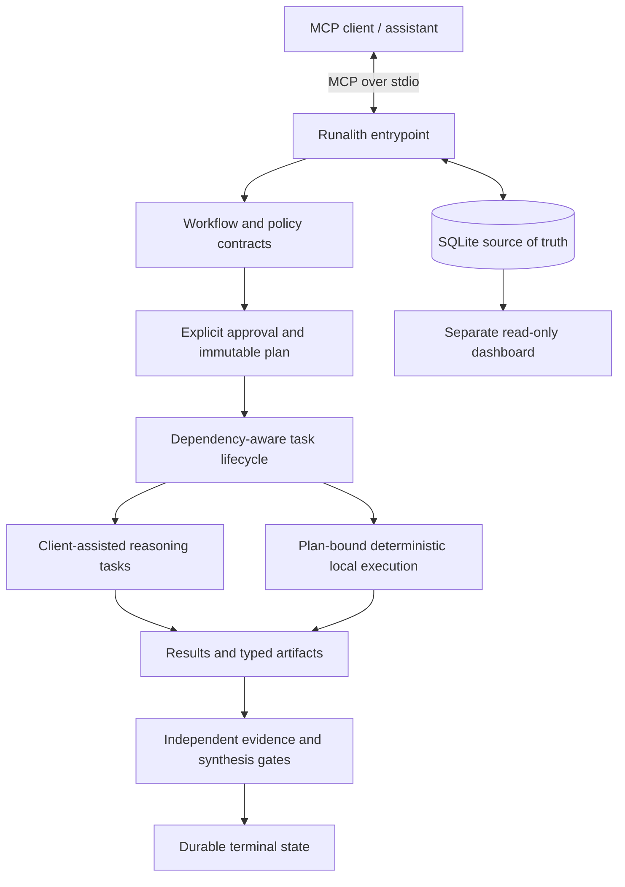
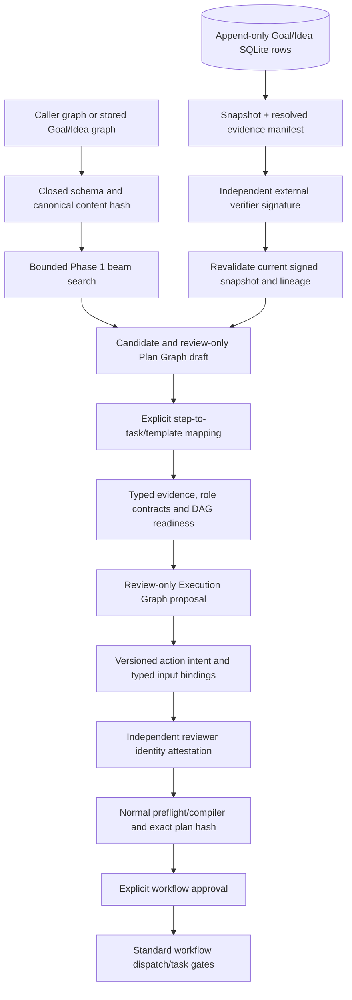

# Architecture

Runalith is a local-first MCP workflow runtime. It exposes tools over stdio, persists workflow state in SQLite, enforces explicit approvals and immutable task plans, and validates durable evidence before a workflow can finish successfully. It is not a hosted model service or remote execution fleet.

## Runtime overview

The exact reasoning experience depends on the connected client. The diagram describes the runtime boundary, not a claim that every MCP client implements all optional role-handoff conveniences. The dashboard reads the existing database and does not participate in workflow decisions or mutations. The [architecture illustrations](diagrams/README.md) provide supplementary views.

## Adaptive Goal Graph (AGG) subsystem

AGG is a planning/evidence subsystem layered above existing workflow contracts; it does not replace the workflow engine or create an alternate general-purpose execution path. The current RC.11 source separates candidate generation, persistent knowledge, external verification, reviewable Plan/Execution Graph proposals, and the normal immutable-plan approval/dispatch lifecycle.

### AGG trust and state boundaries

- **Candidate versus source knowledge:** a search candidate is a heuristic route through a graph; it is not a verified claim or executable plan. A caller-supplied shadow graph remains unverified. The store's append-only node revisions, memberships and edges preserve identity/history, but caller-created content remains unverified until a trusted external verifier adjudicates the exact current snapshot and evidence manifest.
- **Source verification:** the runtime validates the Ed25519 signature, domain/scope, provider/root, freshness, nonce and exact snapshot/evidence hashes, then re-resolves durable source/artifact and producer lineage. The verifier's truth/independence decision is external authority; content hashes alone do not establish either.
- **Reviewer verification:** a separate identity provider signs a decision bound to the exact candidate, action-intent semantics, typed-input contracts, role contracts and immutable plan hash. Source-verifier and reviewer providers/roots must be independently administered and distinct. Reviewer attestation only says the candidate was reviewed; it is not workflow approval.
- **Workflow approval:** compatibility, readiness, Execution Graph proposal, candidate creation, reviewer attestation, compiler preflight, immutable-plan pinning, `workflow_approve`, and dispatch/task preparation are separate gates. Candidate and proposal tools do not create executable contracts or task rows on their own.
- **Execution boundary:** the current supported AGG path projects typed action intents into existing built-in workflow task contracts. It is not an arbitrary natural-language-to-shell executor. `adaptive_goal_sandbox_action_execute` is experimental test-only functionality for one fixed fixture action, not production execution.
- **Experimental algorithm phases:** the Phase 2 learned discriminator and Phase 3 MCTS tools are disabled by default and only exposed with explicit shadow-test environment flags; Phase 4 terminal-workflow capture is similarly opt-in. They return shadow/review data and do not open execution gates. These algorithmic phase names are distinct from Runalith's formal Phase 2 deployment-readiness audit.
- **Telemetry:** planner-run telemetry is a separate observation record. A completed telemetry row means the MCP invocation returned; it is not evidence of goal success, plan acceptance, trusted claim truth or execution completion. The Dashboard uses read-only database access.

For schemas, all AGG tools, storage details, search options, benchmark caveats, and operator steps, use the [AGG system guide](adaptive-goal-graph.md). The [RC.11 acceptance record](goal-plan-execution-acceptance-rc11-20261026.md) is the source of the current candidate identity and activation blockers. At the 2026-10-26 observation, production remains blocked on administrator-provisioned trust, an independently protected external monotonic checkpoint, and reconciliation of active workflows/tasks; see [Known issues](KNOWN_ISSUES.md).

## Trust and state boundaries

### MCP entrypoint

The versioned entrypoint named by `package.json` is `server/index-v1.0.9-rc.11.js` for this RC.11 checkout. It uses newline-delimited JSON-RPC over stdin/stdout and does not open an HTTP listener. `server/index.js` is retained as a historical/compatibility input, not the entrypoint named by the current package metadata. Diagnostic output belongs on stderr so it does not corrupt the MCP transport.

### Proposal, approval and plan

`workflow_create` records a proposal. It does not authorize execution. Explicit approval compiles an immutable plan whose task IDs, dependencies, role contracts, supported success predicates, and pinned policy/role snapshots constrain later execution. Changing the intended topology or pinned snapshots requires a new proposal rather than in-place edits to an approved plan.

### Durable store

SQLite is the source of truth for workflow state, tasks, approvals, results, artifacts, execution records and audit events. A UI projection or model-generated narrative does not replace these records. Integrity hashes detect content mismatch; they are not proof that content is correct or that a local database is tamper-proof against unrestricted filesystem access.

### Reasoning and deterministic execution

Reasoning tasks are handled by the connected assistant/client using role-specific instructions and input evidence. Deterministic local commands are available only through a plan-bound execution contract. Callers cannot turn a reasoning task into an arbitrary shell command by supplying executable details to an execution tool. Execution results and task artifacts are persisted and checked against the planned contract.

Existing-workspace edits are a separate capability from artifact creation and command execution. Only built-in `engineer`/`writer` tasks in an approved `standard-engineering` v3+ plan with `workspace.write` and explicit relative path scopes can use `workflow_write_files`. Each file is compare-before-replace with a SHA-256 precondition and append-only receipt/event provenance. Multi-file requests can partially apply; the receipt table supports same-request reconciliation after a crash between filesystem mutation and SQLite receipt. This is not an atomic transaction across files or an OS sandbox, and external concurrent writers are not locked out by the plugin.

### Mandatory batch route

For deterministic local tasks whose immutable execution contract selects `ExecutionManager`, route enforcement is separate from the success-predicate catalog. New schema-v2 plans pin a versioned `batch_execution_policy` into the canonical plan hash. Its route, grouping, durable-evidence requirement, validation task IDs, workspace-fingerprint setting, and exemption reason are plan data; absence of a policy is not an exemption.

At runtime, the coordinator groups only pending, dependency-ready, compatible tasks and dispatches them through `execute_batch`. The API accepts 1–32 task IDs, so a single eligible item still uses a batch. The approved plan remains the source of command, argv, cwd, timeout and task membership. Direct single-task execution and direct completion are rejected for tasks marked batch-required. An explicit not-applicable exemption is only valid when no deterministic local task and no workspace-write operation is in scope.

Schema-v1 plans are not rewritten to inject the new policy; their stored plan hash must remain stable. Legacy deterministic work fails closed to the batch route, but legacy tasks previously completed outside a batch may require a fresh approved schema-v2 run because old direct-execution evidence cannot be retroactively converted into genuine batch records.

### Completion gates

Completion is not a free-form model decision. The runtime checks task state, typed artifact validity, successful producer lineage, reviewer/QA requirements, declared success predicates, and batch evidence where applicable. The success assessment supplied at synthesis is evidence for evaluation, not authority to override it. Missing or mismatched evidence leaves the workflow blocked or failed.

The batch-evidence gate binds required tasks to durable batch/item/session/attempt/exit data and checks a current source fingerprint. The verifier checks initial creation, contiguous retry events, terminal outcomes for each attempt, and completed earlier-attempt items; fingerprint roots include `protocol/` and root-level JS/MJS/CJS/JSON modules. Direct completion now requires an exact child-to-plan binding, and safe idempotent denial audits cover MCP and low-level routes. Regressions now cover missing/mismatched bindings, root `job-store.js` drift, and a same-ID retry followed by the actual synthesis path. These fixtures remain unexecuted; a separately approved exact-command validation plan is still required before release acceptance.

### Dashboard

The optional dashboard is a separate loopback-only process. It opens the workflow database read-only and offers inspection, not approval, dispatch, retry, or mutation. Loopback binding reduces network exposure but is not user authentication; it is not a remote admin console.

## Recovery model

Recovery reconciles durable intent and result records with actual task/execution state. Stale work may be diagnosed, retried through an authorized recovery path, or left blocked. A retry must preserve the immutable plan and relevant provenance. Recovery must not fabricate a successful result, erase historical evidence, or infer exactly-once external side effects from local task completion.

For batches, a retry reuses the durable batch ID and reconciles existing item/session/process records. A completed item may remain tied to an earlier batch attempt while unresolved items run under the current attempt. The hybrid MCP integration fixture now exercises failure, retry on the same durable batch ID and the real synthesis route; it remains unexecuted. Schema-v1 prior direct-execution history without genuine batch provenance is blocked with migration-required guidance; do not rewrite approved plan hashes or invent a migration event.

## Scope and non-goals

- The shipped runtime is local-first; its MCP entrypoint does not dispatch to a cloud worker or remote runner.
- The dashboard is a local read-only observer, not a second workflow engine.
- Structured execution and workspace checks are defense-in-depth, not an OS/container sandbox.
- Passing tests does not by itself establish production readiness, autonomous specialist quality, live integration, or exactly-once external delivery.
- Experimental distributed-worker and integration work elsewhere in the repository is separate unless the shipped entrypoint and tests prove it is enabled here.

## Implementation starting points

| Concern | Starting point |
|---|---|
| MCP tool surface for this RC.11 checkout | `server/index-v1.0.9-rc.11.js` and `docs/MCP_REFERENCE.md` |
| Runtime lifecycle and persistence | `src/runtime/` |
| Workflow contracts and artifact schemas | `src/runtime/workflow/` |
| Structured execution protocol | `protocol/` |
| MCPB packaging | `scripts/package-runalith-mcpb.sh` |
| Regression and acceptance evidence | `tests/` |

Use the [documentation index](README.md) for user guides and [known issues](KNOWN_ISSUES.md) for current limitations and release blockers.
