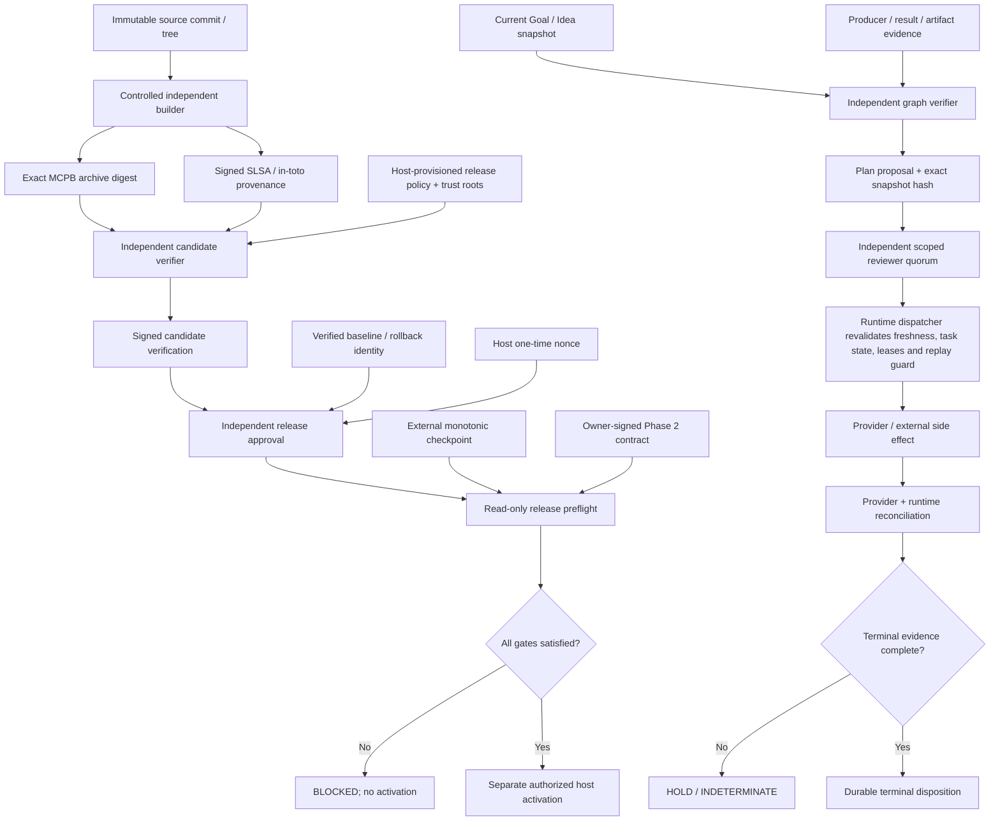
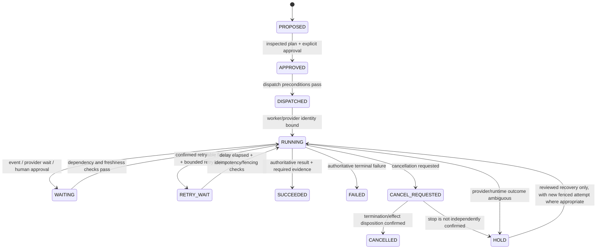

# Runalith production readiness and workflow engineering decision record

**Record date:** 2026-10-28\
**Scope:** RC.31 release gates, trust/evidence architecture, workflow recovery and the decision whether to adopt a separate durable-workflow engine.\
**Decision status:** architecture baseline and implementation roadmap; not a production authorization, not a security certification, and not evidence that any release gate has closed.

## Executive decisions

1. **Do not replatform the workflow engine as the first response to the current release blockers.** Runalith already has durable workflow state, approval/immutable-plan gates, lease and dispatch-identity controls, recovery/reconciliation tooling, artifact lineage, and several versioned evidence-verifier contracts. Close the observed trust and lifecycle evidence gaps before considering a new engine.
2. **Use the existing release-evidence contract as the initial path for an authenticated build receipt.** The repository already has a narrow DSSE/in-toto/SLSA contract and hosted-builder/verifier workflow source. The remaining distinction is between *implemented verifier/workflow code* and a builder/authority that has actually run and been independently trusted. Do not create an attestation inside a dirty checkout and call that an independently authenticated build.
3. **Keep trust establishment separate from policy evaluation.** Host-owned trust roots and a monotonic external checkpoint are separate from an OPA decision. OPA may be added where policy complexity benefits from Rego, but it cannot mint custody authority or make an untrusted contract authoritative.
4. **Preserve the Phase 2 71-path contract as an owner-authorized object.** A policy engine may enforce it; it does not silently replace it. Refreezing the contract requires the named custody authority and exact source identity.
5. **Treat workflow drain as a source-of-truth and operations problem, not a telemetry problem.** OpenTelemetry is for observability. Terminal disposition requires correlated, authoritative workflow/task/provider/runtime evidence and authorized lifecycle transitions. Missing lease rows, old timestamps, absent telemetry, and a local hash chain are not proof that an external worker stopped.
6. **Design external side effects for at-least-once attempts with idempotency and fencing.** Do not claim exactly-once remote effects unless the remote system supplies a suitable atomic/idempotent contract. Ambiguous post-send outcomes must be reconciled, not blindly retried.
7. **Add reliability signals without granting recovery authority.** This patch versions the read-only workflow reconciliation report to schema v2 and adds explicit operability metrics. The metrics are diagnostic-only; they do not prove drain, authorize terminalization, or close release gates.

## 1. Current evidence baseline

The following is the candidate-specific state recorded for 2026-10-28. It must be refreshed by the appropriate read-only checks before any later go/no-go decision.

| Item | Observed state | What it proves / does not prove |
|---|---|---|
| RC.31 candidate | `dist/runalith-1.0.9-rc.31-structured-plan-readback-20261028.mcpb`; SHA-256 `ea807c3fb71c5cf9f826fa7d6e0dc69693a9c4d6027e2462b92294db2ba6dfe6`; 869,921 bytes | Identifies the local candidate. It is not a host-authorized release. |
| Source-to-bundle alignment | Exact archive-entry byte alignment passed | The bundle matches the measured local source bytes. The source state remains `DIRTY_GIT_TREE_BYTES_MATCHED_NO_AUTHENTICATED_BUILD_RECEIPT`. |
| Local validation | Unit/E2E suite, package reproducibility, packaged-candidate checks, documentation checks and no-overwrite test passed in the recorded run | Evidence about the tested local state only; it does not authenticate the builder or provision production trust. |
| Installed runtime | Host remains on RC.26; RC.31 not installed or activated | No activation has been performed by this work. |
| Goal/Idea evidence | `runalith-agg-e2e-20261026-clean`: 7 nodes, 7 edges, 7 memberships, 0 evidence manifests; not verified/attestation-eligible | A graph snapshot and a candidate plan are not independent claim verification. |
| Plan/Execution Graph | 3 proposal records / 22 steps; supporting evidence missing for all 22; no authenticated current-snapshot binding and no Execution Graph proposals; 9 older planner source-hash mismatch records | The planning evidence path remains incomplete. |
| Live workflow observation | 138 jobs, 5,309 events, 1,277 tasks, 908 results, 867 artifacts, 982 attempts, 0 task-lease rows, 119 approvals | Aggregate counts are triage context, not terminal dispositions. A count alone cannot identify which worker/provider still owns an effect. |
| Lifecycle reconciliation | 60 jobs require owner/provider/runtime reconciliation; 61 running tasks lack lease rows | Every affected record needs exact, authoritative reconciliation. Missing leases do **not** prove worker death. Keep ambiguous records on `HOLD`. |

### Current release gates

All six gates below remain **OPEN/BLOCKED** until their required evidence is supplied and independently verified for the exact release scope:

1. `PHASE2_FROZEN_71_PATH_CONTRACT_UNRESOLVED`
2. `INDEPENDENT_RELEASE_EVIDENCE_NOT_VERIFIED`
3. `PRODUCTION_AGG_TRUST_CONFIGURATION_NOT_VERIFIED`
4. `PRODUCTION_AGG_TRUST_LEDGER_EXTERNAL_ANCHOR_NOT_VERIFIED`
5. `ACTIVE_EXECUTING_WORKFLOWS_MUST_DRAIN`
6. `RUNNING_TASKS_MUST_DRAIN`

The latest recorded rollout preflight is read-only, `BLOCKED`, `canActivateNow: false` and reports all six gates. No local code or test may alter that conclusion without the gate's specified external evidence and authority.

## 2. Blocker-to-evidence contract

| Gate | Required evidence | Authority / source of truth | Verification and negative acceptance tests |
|---|---|---|---|
| Phase 2 frozen 71-path contract | Exact 71-path canonical manifest, source repository/commit/tree binding, schema/version and owner signature; build receipt binds the manifest digest to the exact source and bundle | Designated custody owner plus separately controlled builder; host/security admin provisions the verifier roots | Reject 70/72 paths, duplicate or normalized-path collisions, source/tree drift, wrong signer/scope, signature tampering and a self-signed caller manifest. Preserve old signed records unchanged. |
| Independent release evidence | Builder-signed SLSA provenance for the exact `.mcpb` bytes; independent candidate-verification attestation; release approval bound to candidate, exact envelope digests, policy/version, environment, baseline/rollback digest, validity interval and host one-time nonce | Controlled builder identity, separately administered verifier identity, release authority | Verify exact subject digest/name, repository and immutable source commit/tree, builder/workflow identity, test identities/exit statuses, disjoint signing roots, freshness/revocation and one-time nonce. Candidate, policy, source, rollback or envelope byte drift must fail. |
| Production AGG trust configuration | Effective host-loaded verifier and reviewer trust configurations; exact scopes, distinct providers and disjoint public-key roots; key IDs, validity/revocation, versions and change record | Host/platform security administrator; runtime observes effective configuration, not caller-supplied claims | Missing/empty config, wrong scope, same provider or same SPKI root across domains, expired/revoked key, stale config and downgrade/reuse must fail closed. Test rotation with a version increment and independent approval. |
| External monotonic trust anchor | Signed fresh checkpoint response and independently signed store observation/commit receipt; candidate and rollback digests, trust-domain versions/fingerprints, ledger identity, high-water sequence, previous digest and one-time nonce bound to an atomic external CAS | Independently administered monotonic store and host-provisioned verification keys/adapter | Missing/stale/malformed signature, wrong candidate or rollback, stale sequence, replayed nonce, reused sequence, incorrect previous digest, whole-ledger restore and an unknown-after-commit response must never be interpreted as success. On uncertain commit, query by nonce before retry. |
| Active executing workflows drain | Per-job exact owner identity; host process and provider run/session identity; job/plan/task IDs; active attempt and lease/fencing epoch; correlated event/result/artifact hashes; authoritative provider/runtime status and owner-approved disposition | Each responsible workflow owner plus the appropriate provider/runtime operator | Contradictory or missing sources remain `HOLD`. No bulk reset, terminalize, retry, kill, restart or redispatch. After an authorized normal transition, reread from a fresh connection and verify the resulting lifecycle lineage. |
| Running task disposition | Per-task authoritative runtime/provider query, exact attempt lineage, lease/fencing status, side-effect/request identity and result/artifact/completion-event linkage. For an unknown send outcome, provider reconciliation or an idempotent status lookup is required. | Task owner and provider/runtime operator; durable DB is one source, not the only source | Missing lease, PID absence, old heartbeat, absent trace, or an event named `completed` alone cannot terminalize. Simulate delayed acknowledgement, worker pause/resume, lease expiry, duplicate callback, cancellation race and provider timeout after accepting a request. Unknown cases stay `HOLD/INDETERMINATE`. |

The contract deliberately distinguishes **who may assert a fact** from **which tool validates the fact**. A cryptographic verifier can authenticate a signature or hash binding; it cannot manufacture the missing owner decision, external process observation, production key provisioning or historic custody manifest.

## 3. Existing implementation inventory and gaps

Use these current repository locations as the implementation baseline. Verify each location against code/tests before assuming it is present in another branch or package.

| Concern | Existing implementation surface | Current gap / decision |
|---|---|---|
| Candidate release evidence | `scripts/lib/runalith-release-trust-contract.mjs`, `scripts/verify-release-evidence.mjs`, `scripts/lib/hosted-builder-attestation.mjs`, `scripts/lib/hosted-verification-predicate.mjs`, `docs/runalith-release-evidence-verifier.md` | Local DSSE/in-toto/SLSA verification contract and hosted workflow source exist; a successful local test is not evidence of a real independently controlled hosted run. The trusted key/policy provisioning and exact host release approval still matter. |
| Phase 2 custody | `scripts/lib/phase2-custody-evidence.mjs`, `scripts/verify-phase2-custody-evidence.mjs`, `tests/test-phase2-custody-evidence.mjs` | The verifier profile can validate supplied evidence. It cannot supply the designated owner's actual 71-path manifest or prove that the host policy was independently provisioned. |
| Trust configuration | `src/runtime/adaptive-goal-trust-configuration.js`, `scripts/validate-agg-trust-config.mjs`, `docs/agg-production-trust-provisioning-runbook.md` | Local append-only/high-water checks are defense-in-depth. A restorable SQLite file is not an independent monotonic anchor. Real host values, key custody and an independently operated checkpoint remain prerequisites. |
| External checkpoint | `scripts/lib/external-trust-checkpoint-contract.mjs`, rollout preflight/adapter contract and corresponding tests | Contract verification code is not the same as a configured host adapter, a live independent store, or a verified commit receipt. Do not run a checkpoint-advancing command without the explicit authority required by its runbook. |
| Read-only workflow reconciliation | `scripts/reconcile-active-workflows-v2.mjs`, `tests/test-reconcile-active-workflows-v2.mjs` | Correlates local jobs/tasks/attempts/results/artifacts/events/leases and emits a `HOLD` recovery plan. The local schema does not authenticate owner/provider identity or prove remote effects stopped. The report schema v2 added by this patch gives clearer operational metrics without changing lifecycle state. |
| Leases and dispatch identity | `src/runtime/task-lease-manager.js`, `src/runtime/provider-dispatch-identity.js`, `tests/test-execution-lease-fencing.js` and provider-dispatch identity tests | Preserve lease attempt/owner-epoch binding and final pre-send checks. Confirm every external provider path uses stable idempotency or has a safe reconciliation path after ambiguous outcomes. |
| Planner observability | `src/runtime/adaptive-goal-planner-telemetry.js`, `tests/test-adaptive-goal-planner-telemetry-runtime.mjs` | Useful traces/events for diagnosis; telemetry tables do not replace authoritative execution state or signed external evidence. |

## 4. Trust and execution architecture

The release and workflow planes share digest-bound evidence conventions, but must not share implicit authority. Release approval authorizes a particular artifact and environment; a graph verifier validates Goal/Idea claims; a reviewer authorizes a narrowly scoped plan; the dispatcher independently enforces current execution preconditions.



### Approval envelope baseline

Before adding an approval library or policy service, make the signed envelope explicit and versioned. Its digest should bind at least:

- candidate archive SHA-256, canonical artifact name and target environment;
- repository identity, immutable commit/tree/snapshot digest, and build-provenance envelope digest;
- canonical Phase 2 contract digest and trust-metadata version/checkpoint sequence;
- Goal/Idea snapshot hash and its independent verifier attestation digest;
- Plan Graph ID/hash, evidence manifest digest, and exact Execution Graph proposal hash;
- policy bundle/decision policy digest and version;
- action scope, maker identity, reviewer identities/roles and quorum policy version;
- issued-at/expiry, nonce or approval ID with one-use semantics, and revocation/high-water reference.

The verifier checks identities and signatures; the policy engine decides whether verified facts satisfy policy; the dispatcher repeats freshness/revocation/plan/task/lease checks immediately before the side effect. No caller-supplied `verified`, `approved`, or `eligible` boolean is authoritative.

## 5. Workflow reliability contract

### State model

Use explicit lifecycle states and preserve an `INDETERMINATE`/`HOLD` *disposition* for cases where the system cannot prove either success or safe retry. Do not coerce uncertainty into a terminal success or failure merely to drain a queue.



### Required invariants

1. **Immutable workflow definition and plan.** Store a versioned workflow/template ID, schema version and canonical plan hash. A material plan change creates a new proposal/version; it does not rewrite the approved plan in place.
2. **At-least-once safe execution.** Treat a worker callback or step invocation as repeatable after crash. Use a stable side-effect idempotency key derived from the business operation and immutable input identity, not just the attempt number. A new attempt gets a new fencing epoch while retaining the same logical operation key when the provider supports deduplication.
3. **Fenced ownership.** Every task attempt must bind job/task/lease/attempt/owner epoch and provider request identity. A stale worker with an older epoch must not commit or start a newer external operation. Check fencing at the final commit/send boundary, not only when a task is first claimed.
4. **Intent before effect.** Persist a durable dispatch intent before calling an external provider. Record request digest and idempotency identity, then persist provider acknowledgement/run identity. If the process crashes between provider acceptance and local acknowledgement, query/reconcile the provider by stable identity; do not blindly resend.
5. **Cancellation is a protocol.** `cancel_requested` is not `cancelled`. Keep the task in a nonterminal/hold state until the runtime/provider acknowledges termination or a separately reviewed disposition proves the side effect can no longer occur.
6. **Bounded retry policy.** Define retryable error classes, max attempts, exponential backoff with jitter, deadline, and dead-letter/quarantine path. Do not retry authorization failures, invalid immutable inputs, revoked trust, or unknown external-effect outcomes as ordinary transient failures.
7. **Terminal state needs evidence.** Check task/attempt/result/artifact/completion-event identity and schema/hash lineage. Synthesis text, a valid JSON schema, stale lease, missing event or local process disappearance is not enough by itself.
8. **Reconciliation is idempotent and read-first.** A report binds IDs plus row-content/event fingerprints. Before a permitted recovery, re-read the source, compare the fingerprint, recheck owner/provider state and record the authorized transition. If anything drifted, discard the stale plan and reconcile again.
9. **Keep observability separate.** OpenTelemetry traces, metrics and logs help explain execution; the durable workflow state and authoritative provider/runtime queries establish lifecycle facts. Signed logs add tamper evidence but do not make false/missing events true/complete.
10. **Test crash windows explicitly.** Include timeout after provider acceptance, crash after local completion but before event append, duplicate delivery, stale worker after lease expiry, delayed provider callback, restore from old DB backup, and cancellation racing with completion.

### Prioritized workflow mechanisms

| Priority | Mechanism | Runalith decision |
|---|---|---|
| Now | Idempotency keys, dispatch-intent/outbox-like state, provider request digest | Retain and audit the existing provider-dispatch identity and intent path. Every provider adapter must state how ambiguous acceptance is reconciled. |
| Now | Lease attempt + owner-epoch fencing | Retain; add/keep negative tests proving stale owner epochs cannot commit or dispatch. A lease is an ownership signal, not proof of task outcome. |
| Now | Read-only liveness + per-record owner/provider reconciliation | Use existing reconciliation first. Add metrics for missing runtime identity, missing active lease rows, conflicting lineage and oldest activity; never auto-repair from this report. |
| Now | Versioned plan/schema and immutable approval snapshot | Preserve exact source/snapshot/plan digests across approval, execution proposal and effect authorization. Changed snapshots require fresh assessment. |
| Next | Transactional outbox/inbox where state DB and external provider cannot share a transaction | Define operation IDs and idempotent receipt handling to close crash windows. Do not claim cross-system exactly-once semantics. |
| Next | Retry/backoff/deadline/dead-letter policies per provider/step | Retry only classified transient failures with attempt limits and jitter. Put unknown external outcomes in reconciliation/hold. |
| Next | Signed audit checkpoints with an independent witness | Add only after event schema and source authority are clear; a hash chain and local signing key alone cannot prevent wholesale rewrite by the log operator. |
| Later | OTel trace context across task, attempt, provider and artifact | Useful observability and SLOs. Keep sensitive prompts, tokens and private result bodies out of telemetry attributes. |
| Later | Saga/compensation for irreversible multi-step work | Define compensation and its authorization explicitly. Compensation is a new side effect and must itself be idempotent/audited; not every action is reversible. |
| Later / evidence-dependent | New durable-workflow engine | Run a comparative PoC only if measurable reliability requirements cannot be met safely with current engine and targeted changes. |

## 6. Durable workflow-engine options

This is a decision screen, not a claim that all vendors were benchmarked in the Runalith deployment. Product capabilities, licensing, pricing, hosting modes and security advisories must be re-checked against the target deployment before selection.

| Option | Best-fit shape | Main trade-off for Runalith | Current recommendation |
|---|---|---|---|
| Existing Runalith workflow runtime | Local MCP-driven, SQLite-backed jobs/tasks and immutable plan/evidence contracts | Current workflow engine and data model remain under Runalith's control, but Runalith must own crash recovery, schema evolution, scheduling, operations and correctness tests | **Keep for now.** Fix measured gaps and close current release gates before replatforming. |
| Temporal | Long-running code workflows with durable histories, timers/signals, activity retries and replay/versioning discipline | Adds a Temporal service/operational model and migration/versioning work; existing SQLite records and MCP tools would need a bridge or migration. Remote side effects still need idempotency/reconciliation | Candidate for a future PoC if long-lived histories, worker orchestration and replay are the main unmet requirements. [Docs](https://docs.temporal.io/) |
| Restate | Durable handlers/services and event-driven workflows, with a strong durable execution model for application code | Adds Restate runtime/deployment and introduces a new state model; must verify integration with current MCP host lifecycle, audit export and deployment constraints | Candidate PoC where TypeScript-native durable functions and explicit handler recovery are attractive. [Docs](https://docs.restate.dev/) |
| DBOS | Durable functions/jobs using a database-backed model, with TypeScript support | Database/runtime conventions may fit local durable execution, but existing schema, transactions, authorization and lineage would not transfer automatically | Candidate PoC if minimizing new infrastructure is more important than adopting a separate workflow service. [Docs](https://docs.dbos.dev/) |
| Inngest | Event-triggered durable functions, persisted step results, waits and retries | Attractive JavaScript/TypeScript developer model, but requires deciding hosted/self-hosted control plane, stable step IDs, data residency, and external provider reconciliation semantics | Candidate only for event-centric workflows; do not assume saved step results provide exactly-once provider effects. [Docs](https://www.inngest.com/docs/durable-execution) |
| AWS Step Functions Standard | Managed AWS state machines, durable orchestration and execution history | Operational burden shifts to AWS, but creates cloud lock-in and IAM/state-machine deployment dependency; current local plugin semantics and evidence objects need adapters | Strong option only if Runalith's production environment is already AWS-centric and cloud dependency is acceptable. [Workflow types](https://docs.aws.amazon.com/step-functions/latest/dg/choosing-workflow-type.html) |
| Argo Workflows | Kubernetes-native DAG/steps, container jobs, artifacts and cluster scheduling | Excellent for infrastructure/data jobs; a different abstraction from an embedded MCP agent runtime and human approval/evidence graph | Use for containerized batch/CI workloads if Kubernetes is the operating platform, not as a drop-in local workflow library. [Docs](https://argo-workflows.readthedocs.io/) |
| Prefect | Python-oriented data/automation workflows with state, retries and orchestration | Python ecosystem/control plane adds another runtime boundary for a Node.js-first MCP app; migration may solve orchestration while leaving Runalith's trust protocol untouched | Consider only where Python data pipelines already dominate. [Docs](https://docs.prefect.io/) |

### Migration decision rule

Do not migrate because another engine advertises “durable execution.” First define and measure three representative workload classes:

1. human-in-the-loop approval with a long wait and a plan snapshot that may go stale;
2. a dependency DAG with worker crash, retry and resume after schema/code deployment;
3. an external side effect whose response is lost after the provider might have accepted it.

Run the same failure-injection suite against the current engine and one or two candidate engines. Compare correctness under crash/restore, stale-worker fencing, idempotency handling, history/audit export, schema/version migration, human approval/revocation, operational dependencies, security controls, local developer loop, and cost. A new engine is justified only if it demonstrably removes a measured risk without weakening Runalith's evidence/authorization boundaries.

## 7. Technology choices and limitations

| Technology / standard | Recommended use | Important limit |
|---|---|---|
| SLSA provenance + in-toto Statement | Bind exact archive bytes to source and build platform; use a controlled builder to generate provenance | A signed statement is only as trustworthy as builder isolation, identity and provenance correctness. A local repository-generated receipt is not independent evidence. |
| DSSE + Ed25519 / Sigstore verification | Use the existing strict verifier profile first; verify exact envelope bytes and authorized signer identity | Key/signature validity alone does not prove trust-root provisioning. The current local verifier does not replace the missing host-authorized policy/checkpoint. Cosign verification semantics depend on the exact signing mode and command. |
| TUF principles or full TUF | Versioned role metadata, threshold signatures, expiration, rotation and rollback/freeze resistance | Keep clients' trusted-root/high-water state outside the source being verified. If Runalith only needs host-administered static trust, full TUF may be unnecessary complexity; choose based on distribution/update requirements. |
| SPIFFE/SPIRE | Workload identity between independently deployed services where node/workload attestation and SVID rotation are useful | Does not grant human approval authority; adds a trust domain/server and deployment complexity. Not required for a single local MCP process by default. |
| OPA/Rego | Evaluate complex, independently versioned policy from verified input facts; optional signed bundle distribution | OPA is a decision point, not an identity provider, custody owner or enforcement point. Application/dispatcher must enforce the decision and reject unauthenticated facts. |
| OpenTelemetry | Correlated traces, logs and metrics across workflow/task/attempt/provider steps | Observability data may be incomplete, sampled, delayed or forged. OTel alone does not prove complete lifecycle history or terminal disposition. |
| Hash-chained/signed audit log + external checkpoint | Detect editing/reordering and anchor checkpoints outside the operator's mutable database | A privileged signer/log operator can rewrite a whole unanchored chain. A signature authenticates the assertion, not the truth or completeness of its inputs. Add witness/checkpoint only with a real threat model and independent key custody. |

For a single local process, prefer the smallest architecture that satisfies a tested contract: strict signed artifacts and approvals, host-owned trust configuration, monotonic external anchor, durable dispatch intent/lease fencing, and independent lifecycle reconciliation. Add OPA, SPIRE or a workflow engine only when a specific policy, identity or orchestration requirement cannot be met cleanly otherwise.

## 8. Implementation roadmap and exit criteria

Effort estimates are relative engineering sizes, not time promises. Steps that require external owner/security/host authority cannot be completed by repository code alone.

| Phase | Change / owner | Size | Acceptance / exit criteria |
|---|---|---:|---|
| 0 — Baseline | Dev: preserve current dirty worktree, re-run relevant unit tests and diff checks; release owner refreshes read-only preflight/dossier for exact RC.31 candidate | S | Exact candidate/source hashes recorded; no writes to live DB/config/ledger/checkpoint, no install/activation, no dispatch. Current six blockers reproduced. |
| 1 — Build evidence | Release engineering + independent builder/verifier | M | Real hosted builder run produces provenance for exact `.mcpb`; separate verifier rebuilds exact source and matches bytes; signed verification attestation validates under host-approved identity. Candidate/policy/source drift negative tests fail. |
| 2 — Phase 2 and trust | Custody owner + platform security | M/L | Owner-signed canonical 71-path manifest/receipt supplied; production verifier/reviewer roots provisioned out of band with disjoint SPKI fingerprints/scopes; key rotation/revocation tests pass. No synthetic key is used as production authority. |
| 3 — External anchor | Host/platform security + independent store operator | L | Live signed observation and atomic CAS commit receipt from independent monotonic store; freshness/nonce/sequence/previous digest validated; restore/replay/freeze tests fail closed. Requires separate authorization before any advancing operation. |
| 4 — Lifecycle reconciliation | Each workflow/task owner and provider/runtime operator; developer supplies read-only tooling and evidence schema | M/L | All 60 jobs and 61 running tasks have per-record dispositions with exact source identities and lineage; contradictory/missing evidence remains HOLD; authorized transitions are followed by fresh rereads. Never bulk-close to satisfy the gate. |
| 5 — Workflow hardening | Dev: dispatch outbox/idempotency, lease fencing, cancellation/unknown-outcome behavior and failure injection | M | Crash-window tests pass; duplicate callbacks do not duplicate effects where provider idempotency is available; stale epochs cannot commit; unknown provider outcomes quarantine for reconciliation; recovery report preserves exact DB bytes. |
| 6 — Go/no-go | Release authority, host admin and operations owner | M | Fresh read-only preflight has all gates closed for exact candidate, rollback artifact/hash and environment; independent reviewer approves exact envelope. Activation/rollback remains a separate host-authorized operation. If any evidence is stale, missing or ambiguous: **NO-GO**. |

### Required negative tests

- altered archive bytes with unchanged attestation; correct hash but wrong subject name; wrong repository or commit; dirty source snapshot; untrusted builder workflow identity;
- wrong/expired/revoked signer; same key root across independent reviewer/verifier domains; duplicate JSON keys or unexpected fields; stale approval, stale policy and replayed nonce;
- stale/replayed/reverted trust metadata; missing host checkpoint; changed rollback hash; unknown external checkpoint result after commit attempt;
- changed Goal/Idea snapshot or Plan/Execution Graph hash after approval; missing evidence manifest; requester self-approval; insufficient quorum; revoked reviewer before dispatch;
- provider accepts a request then client times out; worker resumes with a stale owner epoch; duplicate callback; process exits before local acknowledgement is written; cancellation races with completion;
- missing lease, missing PID, stale heartbeat, absent telemetry, conflicting provider/runtime state, cross-job artifact lineage and event references to non-existent attempts/results/artifacts;
- crash/restart at each transaction boundary; backup restore to an older DB; migration from each supported workflow schema; corruption or disk-full during audit/receipt persistence.

## 9. Operational metrics

The schema-v2 read-only reconciliation report exposes a starter set of metrics suitable for dashboarding and trend analysis. Treat them as diagnostic telemetry, never as authorization or production proof.

- `oldestObservedActivityAgeMs`: oldest visible job activity age in the snapshot;
- `jobsWithUnverifiedOwnerIdentity` and `jobsWithProviderIdentityNotPersisted`;
- `runningTasksWithoutActiveLeaseRows` and `runningTasksMissingExecutionMetadata`;
- `tasksWithReconciliationFlags`, `tasksWithConflictingEventReferences` and `tasksWithUnverifiedOwnerOrProvider`;
- `terminalDispositionProof.status`, explicitly indicating that the local DB report did not assess authoritative terminal proof;
- existing `summary.byClassification`, `jobsFlaggedForReconciliation`, `staleCandidates` and `jobsWithRunningTasksButNoActiveLeases`.

After separately authenticated provider/runtime evidence is introduced, add coverage metrics by source and freshness rather than relabeling local observation counts as proof. Useful future SLOs include oldest unresolved workflow age, percentage of active tasks reconciled to an authenticated owner/provider identity, percentage of terminal dispositions with complete evidence, duplicate side-effect rate, ambiguous provider outcome age, expired-lease recovery correctness, stale approval rejection rate, and provenance/evidence completeness. Set thresholds only after measuring a representative baseline.

## 10. Risk register and non-goals

| Risk / anti-pattern | Why it is unsafe | Required control |
|---|---|---|
| Signing evidence from the same dirty checkout that creates the artifact | Self-attestation does not independently authenticate the builder or source snapshot | Controlled builder, immutable source identity, independent verifier and trusted signing identity |
| Making OPA bundle equal to the frozen custody contract without owner approval | Changes the authorization root and may permit a different path set | Preserve canonical owner-signed contract; treat policy as enforcement, not origin of authority |
| Treating SVID as a human approval | Workload identity is not human intent/authority | Separate reviewer identity/signature and role/scope/quorum policy |
| Treating a signed hash chain as proof events are true/complete | Signer may omit or fabricate records; unanchored history can be rewritten by a privileged operator | Independent data sources, key separation, external checkpoint/witness and explicit completeness checks |
| Inferring worker death from no lease, PID or telemetry | External worker/provider may still be active | Per-record provider/runtime reconciliation, fencing and owner-authorized disposition |
| Automatic retry after a timeout | The remote side effect may have already happened | Stable idempotency key plus provider lookup/reconciliation; otherwise quarantine ambiguous outcome |
| Claiming exactly-once side effects from a durable workflow engine | Durable orchestration cannot atomically transact with arbitrary remote systems | State the delivery semantics and use idempotency/compensation/reconciliation |
| Replatforming before mapping existing contracts | Migration can lose approval, graph, artifact and workflow lineage while not closing trust gates | Three-workload comparison PoC only after requirements and baseline failure tests exist |
| Treating local tests or synthetic fixtures as production evidence | They prove contract behavior under test conditions, not real key custody/provider state | Keep test and production identities separate; require real external attestation and host evidence |

Out of scope for this patch: provisioning production secrets/keys, producing the missing owner-signed contract, advancing the external checkpoint, mutating live workflows, cancelling or retrying tasks, installing/activating RC.31, changing the production host, committing or pushing the worktree.

## References

Standards and vendor documentation (re-check versions and deployment requirements before implementation):

- [SLSA v1.2 specification](https://slsa.dev/spec/v1.2/) and [provenance](https://slsa.dev/spec/v1.2/provenance)
- [in-toto Attestation Statement](https://github.com/in-toto/attestation/blob/main/spec/v1/statement.md)
- [Sigstore Cosign verification](https://docs.sigstore.dev/cosign/verifying/verify/)
- [The Update Framework metadata roles](https://theupdateframework.io/docs/metadata/) and [security threats](https://theupdateframework.io/docs/security/)
- [SPIFFE/SPIRE concepts](https://spiffe.io/docs/latest/spire-about/spire-concepts/)
- [Open Policy Agent bundles](https://www.openpolicyagent.org/docs/management-bundles)
- [OpenTelemetry signals](https://opentelemetry.io/docs/concepts/signals/)
- [Temporal documentation](https://docs.temporal.io/)
- [Restate documentation](https://docs.restate.dev/)
- [DBOS documentation](https://docs.dbos.dev/)
- [Inngest durable execution](https://www.inngest.com/docs/durable-execution)
- [AWS Step Functions workflow types](https://docs.aws.amazon.com/step-functions/latest/dg/choosing-workflow-type.html)
- [Argo Workflows documentation](https://argo-workflows.readthedocs.io/)
- [Prefect documentation](https://docs.prefect.io/)

Repository implementation notes:

- [Release-evidence verifier](runalith-release-evidence-verifier.md)
- [AGG production trust provisioning runbook](agg-production-trust-provisioning-runbook.md)
- [Workflow lifecycle and recovery](workflow-lifecycle.md)
- [Durable batch execution](batch-execution.md)
- [Adaptive Goal Graph system guide](adaptive-goal-graph.md)
- [Known issues and release blockers](KNOWN_ISSUES.md)

---

## RC.32 integrated hardening and current evidence addendum (2026-10-28)

This addendum supersedes earlier candidate-specific *observations* only where new timestamped read-only evidence is cited. It does not supersede historical candidate bytes, freeze contracts or authority decisions. The branch and working tree remain uncommitted; no push, host activation, registry/config/trust-ledger mutation, checkpoint transition or live workflow mutation was performed.

### Implementation integrated this round

- `WorkflowStore.cancelExecutionBatch()` inspects every child task's durable execution and attempt status before aggregate cancellation. A stale child item marked `FAILED`/`CANCELLED` no longer hides a task still marked running or a durable attempt still `started`; unresolved external execution remains non-terminal until the owner/manager establishes cleanup or authoritative recovery.
- The read-only remediation-plan builder accepts reconciliation schema v1/v2, but schema v2 must explicitly retain `DIAGNOSTIC_ONLY_NOT_RELEASE_EVIDENCE`, no automatic lifecycle authority, no automatic recovery, and no terminal-disposition proof. Negative tests reject a schema-v2 report that claims automatic action authority.
- The operator trust-config validator separates missing files, schema/config version errors, structural schema errors and a configuration that is not effective in the exact current host process. Optional process inspection pins the absolute versioned entrypoint, checks the host parent, compares fingerprints/version/provider identifiers and avoids printing configuration/key values. It does not claim ledger continuity or external checkpoint verification.
- The package closure now includes the operator trust validator actually exercised by the extracted-package trust tests. Reproducibility and no-overwrite tests explicitly enforce that validator's inclusion; current-schema remediation and package tests remain diagnostics/test evidence, not production authority.
- Benchmark source identities advance through `recovery-verifier-v74.json`, which records the current input hashes and preserves the previous hash for changed pins. Historical v71/v72/v73 fixture bytes remain unchanged; v73 SHA-256 remains `9213fa11782b80b14165042997ffbaad8b88228da1f3813ec761f0fa8a4d50ad`.

### Exact RC.32 evidence and local validation

Candidate `dist/runalith-1.0.9-rc.32-workflow-recovery-trust-preflight-20261028.mcpb` is 876,858 bytes, SHA-256 `4e6a63f24e5cd2c66eb7cf54c246f623c163dee6876f1ce177127c93c37831e5`, 96 entries and 74 MCP tools. Package reproducibility reports two independent validated builds with that exact digest, stable input SHA-256 `c738a39797dbf3dde3f01589ce2be8bffbfc9eeb9b42ab7a5f4690c7401ee635`, and 96 ordered entries byte-verified. Full `npm test`, the extracted MCPB fast test, packaging no-overwrite, package reproducibility and both documentation/link checks passed on the final implementation. Detailed command/exit/hash records are stored at `artifacts/adaptive-goal-graph/validation-summary-rc32-final-20261028.json`; final source alignment is `artifacts/adaptive-goal-graph/source-alignment-rc32-final-20261028.json`.

Current read-only observations:

- Preflight `artifacts/adaptive-goal-graph/rollout-preflight-rc32-final-20261028T122927Z.json`, SHA-256 `5156aaf965195db22f71aacf079c1f188965affca1f0f3a1f0d69ed08d079f7a`, exit 3, `BLOCKED`; it records no live/external mutation and no checkpoint transition request. Host-managed serving runtime remains RC.26.
- Graph-integrated reconciliation `artifacts/adaptive-goal-graph/live-reconciliation-v1-rc32-20261028T122452Z.json`, SHA-256 `a5261cda500b133b185b8572fdefafa24f98b81474ec55959e995830d08d024d`, has the current snapshot hash `80001cbece6811f7e3a0c187662393f05393ed11421767b23d76548c77c32bf3`, 7 nodes/7 edges/7 memberships, 3 Plan Graph proposals, 22 steps missing evidence, 3 proposals without authenticated snapshot binding, and 0 Execution Graph proposals.
- Detailed schema-v2 reconciliation `artifacts/adaptive-goal-graph/live-reconciliation-v2-rc32-final-20261028T122931Z.json`, SHA-256 `6486e11722ca1a682336442b098984ea2f6d5bd6b8522ad03e880b8097b75093`, reports 138 jobs, 5,309 events, 1,277 tasks, 908 results, 867 artifacts, 982 attempts, no lease rows and 119 approvals; among 86 considered jobs, 60 need reconciliation. There are 61 running tasks without active lease rows and 61 without execution metadata. No local terminal-disposition proof is established.
- Process-environment observation `artifacts/adaptive-goal-graph/live-trust-status-rc32-final-20261028.json`, SHA-256 `2648c2250fae16ea3a7dd25420e177f85a7b5b62dc881731273b6d09f12a10f0`, confirms the serving RC.26 process has neither authority config JSON, provider IDs nor legacy public-root environment values. This is not a substitute for the append-only active trust ledger or external anchor receipt.

The generated readiness dossier and repair plan are `artifacts/adaptive-goal-graph/agg-readiness-dossier-rc32-final-20261028.json` and `artifacts/adaptive-goal-graph/agg-live-remediation-plan-rc32-final-20261028.json`. Both preserve all six RC.23 blockers. Keep unresolved jobs/tasks in `HOLD`; per-item owner/provider/runtime/fencing evidence is required before any lifecycle action. The Phase 2 owner must provide the canonical signed 71-path contract; the controlled builder/independent verifier/release authority must issue candidate-bound provenance and approval; host security must provision separately administered trust and ledger continuity; the independent checkpoint-store authority must prove external monotonic anchor continuity. No test pass or local digest closes those gates.

## RC.38 dual-reconciliation and packaging-closure addendum (2026-10-28)

This addendum records local implementation and validation behavior only. The candidate-specific [RC.38 rollout dossier](runalith-rollout-rc38-20261028.md) carries the exact candidate and report digests; it is a separate operator evidence record, not an authority to install or activate.

- The remediation compiler now requires an explicit schema-v2 lifecycle report when the graph-integrated report is schema v1. It retains both reports as distinct path/SHA-256 inputs, rejects noncanonical/different workflow DB paths, requires explicit no-mutation markers, limits the source-report separation to ten minutes, and refuses observations stale relative to plan generation.
- Schema-v2 diagnostic/recovery job identities must be complete, unique and one-to-one; task identities must be present, unique and agree across the task row and lineage assessment. The output remains `BLOCKED_NEEDS_OWNER_AUTHORITY_RECONCILIATION`; every task recovery action is `HOLD_FOR_OWNER_RECONCILIATION` and all mutation/activation authorization stays false.
- Schema-v2 read-only output now explicitly asserts no live, workflow-database or external-security-store mutation. The recovery idempotency fingerprint binds complete job-event payload identities; bounded scans disclose truncation instead of silently presenting partial lineage as complete.
- A new benchmark-fixture successor preserves the previous fixture bytes and ground-truth semantics while advancing local source identity. Such hashes detect drift but are not authenticated builder provenance or independent release approval.
- The package inventory contract now enumerates the shipped schema-v2 reconciler, its regression test, external checkpoint contract/adapter and its tests. The no-overwrite fixture constructs a source tree with the full required preflight inventory before testing a deliberately substituted symlink. This fixes stale test inventories; it does not weaken package-membership assertions.
- Fresh schema-v1 graph and schema-v2 lifecycle observations are captured against the same canonical workflow DB. The observed inventory remains 138 jobs, 5,309 events, 1,277 tasks, 908 results, 867 artifacts, 982 attempts, zero task-lease rows and 119 approvals; 60 jobs require reconciliation and 61 running tasks have no active lease. There are 22 Plan Graph steps missing supporting evidence, three proposals without authenticated snapshot binding and no persisted Execution Graph proposal.
- The current candidate remains `1.0.9-rc.38`, byte-aligned to the local dirty source tree but without an authenticated controlled-builder receipt. The serving host remains on RC.26. All six production/rollout gates remain open; missing leases and local event/hash lineage do not prove workers have stopped or authorize terminalization.

Do not mutate, reset, retry, cancel, kill, restart or redispatch unresolved work to make a metric go green. Only the responsible owner/provider/runtime plus the appropriate release, custody and host-security authorities can supply the missing facts and approvals. Keep all candidate archives, historical fixtures and current evidence records immutable; no installation, activation, checkpoint advancement, commit or push was performed for RC.38.

## RC.39 explicit external-store non-mutation contract addendum (2026-10-28)

RC.39 tightens one schema-v2 input contract in the read-only AGG remediation compiler: a separate lifecycle reconciliation is rejected unless it explicitly attests `liveMutationPerformed: false`, `workflowDatabaseMutationPerformed: false`, **and** `externalSecurityStoreMutationPerformed: false`. A report that omits the external-store assertion is not treated as equivalent to a negative assertion. The regression tests cover omission as well as the existing lifecycle-authority and diagnostic-only policy failures.

This change improves the integrity of the *input contract*; it does not authenticate the report author or prove that the external store was actually untouched. Independent host evidence and authority are still required. No live database, trust ledger, external checkpoint, registry or host runtime is touched by the compiler. Candidate RC.39 is a new local test candidate; it does not alter the preserved RC.38 bytes or close any of the six release gates.

## RC.40 manifest launch-argument identity addendum (2026-10-28)

The RC.39 candidate exposed a second packaging invariant during read-only rollout preflight: the manifest `server.entry_point` and package `main`/`scripts.start` matched the versioned RC.39 runtime, but `server.mcp_config.args` still named the RC.38 entry point. Runtime smoke alone did not detect this manifest-config mismatch; the stricter rollout preflight correctly rejected it before evaluating release gates. RC.39 archive bytes are preserved as a failed candidate and are not overwritten.

RC.40 fixes the manifest argument and adds two guards: `scripts/package-runalith-mcpb.sh` now checks the exact MCP launch-argument array before staging/building, and `tests/test-runalith-plugin.js` asserts that manifest launch arguments use the same versioned entry point as package metadata. This ensures the mismatch fails before publishing a candidate. It does not make the local source tree an authenticated build and does not close any production gate. Host/live workflows, trust ledger and external checkpoint remain untouched.

## RC.53 current-state follow-up (2026-10-29)

This entry records a fresh local validation pass against the exact RC.53 candidate and a new read-only preflight. It supplements, but does not replace, the candidate-specific [RC.53 rollout decision](runalith-rollout-rc53-20261029.md). No archive was overwritten, no new package candidate was minted for a documentation-only update, and no production install/activation or live-state mutation was performed.

### Candidate-bound read-only preflight

- Candidate: `dist/runalith-1.0.9-rc.53-phase2-inventory-acceptance-20261029.mcpb`, SHA-256 `54826a658193f8b876756dd6cb1b6e1cd6a0693c4abe09a387e91b677f6b2a81`, 937,012 bytes, 103 archive entries and 74 MCP tools.
- Rollback baseline: `artifacts/runalith-1.0.9-rc.26-solo-graph-20261028.mcpb`, SHA-256 `72941422ee790e9ca602305bf1ec08abfde222b40d1e54e9026856934cc43d9a`.
- Fresh preflight report: `artifacts/adaptive-goal-graph/rollout-preflight-rc53-current-check-20261029.json`, SHA-256 `ed62d1ebfa6a687caa06f8db04179c26fc64234d8b5e356e2ac3cc0a05550c35`. The command returned the expected blocker exit code `3`; the report says `readOnly: true`, `decision.status: BLOCKED`, `decision.canActivateNow: false`, `liveMutationPerformed: false`, `workflowDatabaseMutationPerformed: false`, `externalSecurityStoreMutationPerformed: false`, and external checkpoint transition `NOT_REQUESTED`.
- The same six authority gates remain open: `PHASE2_FROZEN_71_PATH_CONTRACT_UNRESOLVED`, `INDEPENDENT_RELEASE_EVIDENCE_NOT_VERIFIED`, `PRODUCTION_AGG_TRUST_CONFIGURATION_NOT_VERIFIED`, `PRODUCTION_AGG_TRUST_LEDGER_EXTERNAL_ANCHOR_NOT_VERIFIED`, `ACTIVE_EXECUTING_WORKFLOWS_MUST_DRAIN`, and `RUNNING_TASKS_MUST_DRAIN`. The 103-entry archive still does not satisfy the frozen 71-path contract; do not trim the bundle or synthesize its owner-signed path list.

### Validation after the RC.53 handoff

- `npm test`: exit `0`; log `/tmp/runalith-rc53-followup-npm-test-20261029.log`, SHA-256 `898acf49c150ae44f1281707a3101c9b61be379206145ed16eeac16726029a72`.
- `npm run test:phase2-security-regressions`: pass; the current-candidate inventory subtest retains `frozen_inventory_count_mismatch` (103 vs 71) as an explicit blocker and does not change the acceptance contract.
- `npm run test:package-reproducibility`: pass; two independent validated builds are byte-for-byte identical to RC.53 (`54826a658193f8b876756dd6cb1b6e1cd6a0693c4abe09a387e91b677f6b2a81`), stable package-input SHA-256 `084b872e1c6b5011103b253d8a69449182cccbbe9c94b0f67b96e1878440aba0`, 103 ordered entries verified.
- `node tests/test-package-no-overwrite.js`: pass; output confirms refusal to overwrite an existing file/dangling symlink or publish after a validation failure.
- Focused lifecycle/recovery tests passed: execution-batch terminal recovery, provider pre-send recovery and quarantine reconciliation, task-lease expiry race, lease fencing, graph/lifecycle reconciliation v1/v2, remediation-plan fail-closed checks, and direct-MCPB CLI tests (37/37 Node tests in the combined invocation, plus the preceding executable regression scripts).
- `npm run docs:check`: pass, 156 Markdown files and 359 local links; `node tests/test-doc-link-parser.js` and `git diff --check` pass. Combined follow-up release-check log: `/tmp/runalith-rc53-followup-release-checks-20261029.log`, SHA-256 `c250715519f09082e867fb5b78ed19601791864f2f51f4ad97cf25c329a39bad`.
- `codegraph sync .` reported the index already current: 508 files, 23,824 nodes and 119,980 edges.

### Direct invocation through the packaged bundle — scope limitation

Using `scripts/mcpb-tools.mjs` with RC.53 successfully enumerated the packaged tool catalog and called `orchestrator_health`, `workflow_catalog`, `workflow_liveness_diagnostics`, and `workflow_access_diagnostics`. The health result identified `1.0.9-rc.53` and `local-only-mcp`. The direct caller starts the bundle with a private temporary database, workspace, home and minimal environment; therefore the liveness result with zero jobs and the empty allowlist in access diagnostics describe only that isolated invocation. They are **not** current production-host or production-database observations, and no trust-ledger-writing operation was invoked. The default side-effect-name heuristic blocked catalog/liveness/access calls until the exact tool was explicitly allowed after schema inspection; this is a CLI guardrail, not a reason to weaken policy globally.

The latest independently recorded local-host/live observations remain the candidate-bound RC.53 records above. A passing local suite or direct packaged-tool invocation proves neither host trust provisioning nor worker drain. **Release remains `BLOCKED`; do not install or activate RC.53 until the six gates are closed with evidence issued by their named authorities.**

## RC.58 trust-boundary, reconciliation and acceptance-consistency addendum (2026-10-29)

RC.58 is a versioned successor built for three implementation corrections and a reusable cross-artifact acceptance verifier. This addendum supersedes prior *live observations* only where a newer read-only artifact below explicitly supplies the observation. It does not supersede the Phase 2 frozen contract or any independent authority requirement.

### Implementation corrections

- `adaptive_goal_knowledge_search` now calls `getVerifierConfigurationStatus({ recordObservation: false })`. Search is read-only; only the explicitly state-changing trust-status operation may append the trust-config high-water observation. The producer E2E test checks both snapshot GET and knowledge search leave the isolated trust ledger unchanged before an explicit observation.
- `validate-agg-trust-config.mjs` no longer accepts caller-supplied `--proc-root` through its production CLI. Effective host inspection uses kernel `/proc`; fixture roots are injectable only through the imported test API. The regression test proves a CLI caller cannot nominate an ordinary directory as live host evidence.
- Schema-v2 reconciliation now retains nonterminal provider-run rows with `NULL task_id` as unbound/ambiguous instead of silently excluding them. A nonterminal provider run whose lease ID has no matching active task lease is flagged even when the active-lease set is empty. Owner epoch comparisons are restricted to the exact matching lease, avoiding cross-task false positives.
- Bounded recursive event-correlation truncation is attributed to a task only when that task ID was actually discovered in the truncated event. Unattributed truncation remains a job-level finding; it no longer marks every task as individually truncated or claims task-specific incompleteness without a correlation.
- Added `scripts/verify-agg-acceptance-consistency.mjs` and regression tests. It checks actual MCPB ZIP/manifest/entrypoint bytes against acceptance index, source alignment, preflight, dossier, remediation plan and rollback hashes; verifies the six required gates remain represented; checks no-mutation assertions; verifies every embedded evidence hash/size; and blocks stale live observations. It is a local integrity/freshness verifier, not a release-authority verifier.

### Candidate and current read-only evidence

- Candidate: `dist/runalith-1.0.9-rc.58-acceptance-reconciliation-hardening-20261029.mcpb`, SHA-256 `3e0ae97e4fcf953833ce15c126c4e75b5ef135756c30392b0f1269f9e58d6a36`, 949,275 bytes, 105 archive entries, 74 MCP tools. Entry point: `server/index-v1.0.9-rc.58.js`, SHA-256 `15d64416436160150a6c6d9fb50fda08fec5a1310a4d1aa678f53e2261bd839d`.
- Source alignment: `artifacts/adaptive-goal-graph/source-alignment-rc58-current-20261029.json`, SHA-256 `b82c589b02b4a58b55fd76eb7a84e27b7057a7edf36460de2d289fa24b76cef3`. Archive bytes match the local source, but authenticated builder provenance is absent. The 105-entry archive does not satisfy or redefine the canonical 71-path contract.
- Live Goal/Idea snapshot was read through the current host-connected read-only `adaptive_goal_knowledge_snapshot_get` tool and normalized without changing the graph or trust ledger: `artifacts/adaptive-goal-graph/live-snapshot-rc58-current-20261029.json`, SHA-256 `05e62bcb90978611e0c0ef0f92bed0b047e93b3f73ac13877eae5a7e2e146818`. It reproduces snapshot hash `80001cbece6811f7e3a0c187662393f05393ed11421767b23d76548c77c32bf3`, but remains `verified=false`, `eligibleForAttestation=false`, with zero evidence-manifest entries and no configured verifier.
- Fresh paired read-only reconciliation: `artifacts/adaptive-goal-graph/live-reconciliation-v1-rc58-current-20261029.json` (SHA-256 `98aa80a3044cbbfe8f6db634144dd5c6920dd0c932d080dabe43177c55a71aaa`) and `artifacts/adaptive-goal-graph/live-reconciliation-v2-rc58-current-20261029.json` (SHA-256 `41caa267d889de1a879832edc1274a865431c50a55435197723cb498aa91d55e`). The observed DB still has 138 jobs, 1,277 tasks, 5,309 events, 908 results, 867 artifacts, 982 attempts, 119 approvals and no active lease rows; 60 jobs require individual reconciliation and 61 tasks are running without active lease rows. These are observations, not worker-death proof or lifecycle authority.
- Read-only host environment diagnostic: `artifacts/adaptive-goal-graph/trust-diagnostic-rc58-current-20261029.json`, SHA-256 `001159b87758144cb4eaa49077dd00175a302a4a90236cfea8c098c9b11a1419`. It pins host/parent PID start times while checking the effective environment; both verifier and reviewer JSON configs are present-but-empty, provider IDs and legacy roots are absent. It does not validate trust-ledger history or external checkpoint continuity.
- Preflight: `artifacts/adaptive-goal-graph/rollout-preflight-rc58-current-20261029.json`, SHA-256 `237579e3073262f11c2856f40bd8eae42390d3e4410bad5b903dedcc394eb71b`, exit code 3 as expected. Dossier: `artifacts/adaptive-goal-graph/agg-readiness-dossier-rc58-current-20261029.json`, SHA-256 `591aa84dab02510fae439ef83c9231cf11398b67d6825fa138f59969ed2336cd`. Remediation plan: `artifacts/adaptive-goal-graph/agg-remediation-plan-rc58-current-20261029.json`, SHA-256 `f9bb592816b6b3be79656426c649777a97aae40e85ac2673aa7d48015cca70cc`.

### Production decision and authority handoff

Preflight and dossier remain `BLOCKED`, `canActivateNow=false`; all six RC.53 gates remain open. The source/acceptance changes do not produce a signed 71-path manifest, independent builder receipt, independent release approval, host nonce, authority-owned trust roots, external monotonic checkpoint receipt or per-record job/task disposition. Do not call the trust-status MCP operation as a diagnostic because it writes to the local trust ledger. The direct RC.58 `mcpb-tools.mjs` health/catalog/liveness/access results used a private temporary database and are sandbox-only; current live observations are from the host-connected read-only snapshot and direct workflow-DB reconciliation.

**RC.58 was not accepted as the final validated successor.** The first full `npm test` run exited `1` because fixture v95 still pinned the prior `package.json` bytes; package reproducibility and no-overwrite tests then failed at the same provenance check. The frozen oracle was not weakened and v95 was not rewritten. RC.59 creates a new v96 fixture with refreshed current-source pins, records the v95 hash in migration history, and is the candidate for the final validation pass. RC.58 archive bytes remain preserved as a failed intermediate candidate.

The reusable consistency check is now bound to RC.59 and its candidate-specific reports:

```sh
node scripts/verify-agg-acceptance-consistency.mjs \
  --candidate dist/runalith-1.0.9-rc.59-trust-reconciliation-acceptance-20261029.mcpb \
  --acceptance artifacts/adaptive-goal-graph/acceptance-evidence-rc59-20261029.json \
  --alignment artifacts/adaptive-goal-graph/source-alignment-rc59-current-20261029.json \
  --preflight artifacts/adaptive-goal-graph/rollout-preflight-rc59-current-20261029.json \
  --dossier artifacts/adaptive-goal-graph/agg-readiness-dossier-rc59-current-20261029.json \
  --remediation artifacts/adaptive-goal-graph/agg-remediation-plan-rc59-current-20261029.json
```

This verifier can detect digest drift, mismatched candidate identities, missing embedded evidence, absent blocker codes and stale observations. It cannot close a gate. The release remains `BLOCKED` until the appropriate custody, release, host-security, checkpoint-store, workflow-owner and task-owner authorities supply verifiable evidence for the exact candidate and runtime state.

## RC.59 provenance-fixture correction and acceptance follow-up (2026-10-29)

RC.59 supersedes RC.58 after the full suite caught a genuine benchmark provenance mismatch caused by package-version advancement. A versioned fixture successor was created rather than rewriting v95: `benchmarks/adaptive-goal-graph/fixtures/recovery-verifier-v96.json`, SHA-256 `5e5839bc6f47201426eaf66906ad5c8ac24c55f32722c8f3f12ff64da449b7f0`. Historical v95 remains SHA-256 `228d515e7f117b01401be5cbef89b843fc9299ecfb8d11625ec27d4a5c4a3a1e`. The v96 oracle preserves the graph/task/evidence/path scoring semantics; only explicit source-byte pins and migration metadata advance.

- RC.59 candidate: `dist/runalith-1.0.9-rc.59-trust-reconciliation-acceptance-20261029.mcpb`, SHA-256 `d06324fe7de3db0b7af1c2a7443fd4ddfa91598058b8907b9a97d97a54ab4d63`, 949,502 bytes, 105 entries, 74 MCP tools. Entrypoint `server/index-v1.0.9-rc.59.js`, SHA-256 `15d64416436160150a6c6d9fb50fda08fec5a1310a4d1aa678f53e2261bd839d`.
- Source alignment: `artifacts/adaptive-goal-graph/source-alignment-rc59-current-20261029.json`, SHA-256 `d99e8e2f749e6c7e2e542f1d3b933fffbf6c47f5de4225386a3eecffeeb44c9a`; exact local archive-entry bytes match, but the tree remains dirty and no authenticated builder receipt exists.
- Current host-connected snapshot envelope: `artifacts/adaptive-goal-graph/live-snapshot-rc59-current-20261029.json`, SHA-256 `eaa1cb96e1e0664f5d87314cd6a4e11ad812db25b980db4aaa19433f076b69e6`; same snapshot hash `80001cbece6811f7e3a0c187662393f05393ed11421767b23d76548c77c32bf3`, still unverified/ineligible with empty evidence manifest.
- Paired live reconciliations: v1 `artifacts/adaptive-goal-graph/live-reconciliation-v1-rc59-current-20261029.json`, SHA-256 `52427ce8ee82c03c36e66748d178a894bb181fb44ff09d1664d64e5c9d8590cd`; v2 `artifacts/adaptive-goal-graph/live-reconciliation-v2-rc59-current-20261029.json`, SHA-256 `4572e5908bed01462e2719560f4162d3158930752abcd627289f0d2a572e0973`.
- Host trust diagnostic: `artifacts/adaptive-goal-graph/trust-diagnostic-rc59-current-20261029.json`, SHA-256 `09e158c6dd31e41c6620f436cf3b380d55efc96c8795a0fd157ef9d9c7a707dc`. Both JSON configs are present-but-empty; provider IDs and legacy roots are absent. This diagnostic pins PID start times and writes no trust ledger.
- Preflight: `artifacts/adaptive-goal-graph/rollout-preflight-rc59-current-20261029.json`, SHA-256 `9bc1682a89ae29abefae10dd45811c7f471eca661a55142c804c7325a0a61bce`, exit 3 as expected. Dossier: `artifacts/adaptive-goal-graph/agg-readiness-dossier-rc59-current-20261029.json`, SHA-256 `f98c27706eff021b9f1467ede99a8ce828c63b3ce5bd80fc585e03c20b930b1a`, exit 3 as expected. Remediation: `artifacts/adaptive-goal-graph/agg-remediation-plan-rc59-current-20261029.json`, SHA-256 `bb445ca46bbb3edd457b6b07df8f4adff421aef54289552e4a7f36c8f29a10b6`, mutation authorization false.

The v96 provenance correction is a local source-integrity fix, not external provenance. All six RC.53 gates remain open; do not activate RC.59 based on local package success, fixture hashes, or isolated test-only trust.

**RC.59 validation follow-up:** full `npm test` exited `1` because `package.json.main` and `npm start` still named `server/index-v1.0.9-rc.57.js` while the manifest and `runtimeEntryPoint` named RC.59. The extracted-package test failed before its cleanup path; the isolated reproducibility harness was stopped and only its temporary extracted-package child was terminated. The no-overwrite command in that combined run was not reached. RC.59 remains immutable as an intermediate candidate; RC.60 below corrects the package metadata parity and creates fixture v97.

## RC.60 package-entrypoint parity and v97 provenance successor (2026-10-29)

- Candidate: `dist/runalith-1.0.9-rc.60-trust-metadata-provenance-fix-20261029.mcpb`, SHA-256 `dfa85988b22aa0a75ef27b1ef215bdb7dd24ae111f7242c73b1182dea7a62dd4`, 949,502 bytes, 105 entries, 74 tools. Entrypoint: `server/index-v1.0.9-rc.60.js`, SHA-256 `15d64416436160150a6c6d9fb50fda08fec5a1310a4d1aa678f53e2261bd839d`.
- Package metadata now has `main`, `runtimeEntryPoint`, `npm start`, manifest `server.entry_point` and manifest MCP launch args all pinned to the exact RC.60 entrypoint. The package build smoke test and extracted package checks are part of the RC.60 build.
- Fixture v97: `benchmarks/adaptive-goal-graph/fixtures/recovery-verifier-v97.json`, SHA-256 `d80b621e9390b9fa77e276f30a51f607586b7f606bee387a2145ea210951a0b6`. v96 remains SHA-256 `5e5839bc6f47201426eaf66906ad5c8ac24c55f32722c8f3f12ff64da449b7f0`; v95 remains SHA-256 `228d515e7f117b01401be5cbef89b843fc9299ecfb8d11625ec27d4a5c4a3a1e`. All three fixture files are distinct immutable source identities.
- RC.60 source alignment: `artifacts/adaptive-goal-graph/source-alignment-rc60-current-20261029.json`, SHA-256 `71b753dbad6df6e976b8df80d695a4961fa80a9f5807c6e755f979d5ccf79644`. MCP fast test log SHA-256 `36f686abfe75c18e464375f6dd967ceaa409815e7a114434a622b20b37fa377b`; archive integrity log SHA-256 `a36984080ef2c81b4070c10aa3c821da880a3418fb36c1453cd354cd8ec8d040`.
- Focused benchmark/source-alignment/evidence-pack/acceptance tests: `/tmp/runalith-rc60-focused-20261029.log`, SHA-256 `64ffb5e4b19fe3c7680fc5f9e8f89372ba5070245cfc17baf560ac98ea84bfad`, exit 0 (23/23 tests). Benchmark output: `/tmp/runalith-rc60-benchmark-20261029.json`, SHA-256 `956d4b99adbf9fa4cbee9b4a2d30857d44ab5413ee1497da556b8738658151ff`.
- The candidate is not production-authorized by the successful local checks. The final full suite, Phase 2 regressions, reproducibility/no-overwrite, current RC.60 preflight, dossier, remediation and acceptance-consistency results are recorded in `docs/runalith-rollout-rc60-20261029.md` and `artifacts/adaptive-goal-graph/acceptance-evidence-rc60-20261029.json` after those checks complete.

---

## RC.61 and RC.62 validation closure (2026-10-29)

RC.61 corrected package reproducibility/no-overwrite source inventories, but its full `npm test` exited 1 because the acceptance-consistency CLI fixture used a fixed historical timestamp and aged beyond the default one-hour freshness window. Phase 2 passed on RC.61. RC.61 is superseded and preserved.

RC.62 fixes only the test clock (`NOW = Date.now()`); stale-observation negative coverage remains unchanged. It advances the immutable fixture to v99, preserving v98 (SHA-256 `4b0f515b9ddb2eae4861e0d91eea2efa30403e64d1a818d2891433b9550549ca`), v97, v96, v95 and earlier historical fixtures. RC.62 archive SHA-256 is `2d1528594ad5c7a1b96e7e711e6fdd45d6415e31da1842219178d67c7cbac655` (949,580 bytes; 105 entries; 74 tools).

- Full `npm test`: exit 0, `/tmp/runalith-rc62-npm-test-20261029.log`, SHA-256 `bd6cab88e4740f387e1ff70bc6a7143c5c36929e3bbe542b9c309bcae71d8c2`.
- Phase 2 security: first run exit 1 from EOF/backpressure shutdown exceeding its 150 ms bound; isolated rerun exit 0, `/tmp/runalith-rc62-phase2-security-rerun-20261029.log`, SHA-256 `a4ef09934a470af7e5d84c7a9ad6d580573b4b7f574c5689208196d5260cd9ab`. Initial failure retained; timeout oracle unchanged.
- Focused suite 23/23, reproducibility (two identical 105-entry builds), no-overwrite, candidate fast test, ZIP integrity, benchmark, docs/link checks and `git diff --check` passed. Exact evidence is recorded in `docs/runalith-rollout-rc62-20261029.md` and the candidate-bound acceptance index.
- Current host still runs RC.26. Current read-only reconciliation still finds 60 jobs requiring individual reconciliation and 61 running tasks without active lease rows; 22 Plan Graph steps lack supporting evidence; 3 Plan Graph proposals lack authenticated current-snapshot binding; no persisted Execution Graph proposals. These facts do not authorize lifecycle changes.

RC.62 preflight remains `BLOCKED` / `canActivateNow=false`. All six release gates remain open. Local byte identity, tests, isolated test trust and read-only reports do not substitute for the signed 71-path custody contract, independent release provenance/approval, authority-provisioned production trust, external checkpoint continuity, or owner-authorized per-record workflow/task dispositions.

The final RC.62 task reconciliation is also captured per record in `artifacts/adaptive-goal-graph/running-tasks-without-active-leases-rc62-20261029.json` (SHA-256 `d17443bca747ff482b1b6c546ab943c872ddd78f7c1c170b294065ceb23ad736`). It includes 61 running tasks without active leases, attempt/result/artifact/event and historical lease lineage, and explicit no-mutation/unknown-worker-liveness dispositions. Owner identity is not established by task rows; no lifecycle action is authorized.
