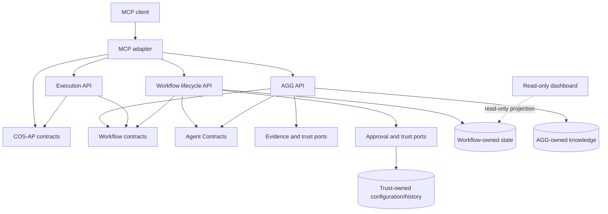

# Runalith subsystem map

**Status:** repository decomposition baseline, 2026-11-01. The target is one GitHub repository per bounded subsystem. [GitHub repository target map](github-repository-target-map.md) is canonical for repo names, ownership, dependencies and extraction order. This document summarizes observed source boundaries; it does not claim that every candidate is already independently deployable or safe to move to another database/process.

## Strategy

Use a modular monolith as the migration state, but make separate GitHub repositories the end state for each bounded subsystem. Give each domain a documented public API and explicit data owner first. Extract each subsystem only after its contract, tests, storage boundary and dependency direction are independently verified. Separate repository does not require a separate process or database. Do not use microservices or separate databases as a substitute for finding cohesive domain boundaries.

Four pure/public slices are extracted: [runalith-cos-ap](https://github.com/nplongx/runalith-cos-ap), [runalith-adaptive-goal-graph-core](https://github.com/nplongx/runalith-adaptive-goal-graph-core) , [runalith-workflow-contracts](https://github.com/nplongx/runalith-workflow-contracts) and [runalith-agent-contracts](https://github.com/nplongx/runalith-agent-contracts). COS-AP is mirrored in [`protocol/cos-ap-v1/`](../../protocol/cos-ap-v1/); AGG Graph Core is a curated six-module pure algorithm package with stable root API and Phase 2/3 experimental subpath; Workflow Contracts is the pure durable-artifact DTO/success-predicate kernel plus strict JSON parser. Each public repository has its own CI; npm publication and automated cross-repository host synchronization are not configured. [`public-repository-snapshots.json`](public-repository-snapshots.json) pins commits and file hashes, and an offline host test detects source drift. The host continues to use its own local source copies. The pure role/action-intent vocabulary is now also extracted; compiled AGG action-intent semantic verification, workflow compilation, policy persistence and all stateful knowledge, trust, proposal and execution adapters remain in the monorepo until their dependency/data/authority contracts pass extraction gates.

## Candidate subsystem catalog

| Candidate subsystem | Current source of truth | Boundary status | Target responsibility |
|---|---|---|---|
| COS-AP contracts | [Public GitHub repository](https://github.com/nplongx/runalith-cos-ap), [`protocol/cos-ap-v1/`](../../protocol/cos-ap-v1/) host mirror | **Public repo created; CI passed; npm package not published** | Versioned message envelopes, payload schemas and durable execution DTO validation. |
| Adaptive Goal Graph core | [Public GitHub repository](https://github.com/nplongx/runalith-adaptive-goal-graph-core) | **Public repo created; CI passed on Node 22/24; npm package not published** | Pure graph schema/validation/search, offline discriminator; Phase 2 dataset/beam search and Phase 3 MCTS under experimental API. No knowledge DB, trust, proposal service, host adapters or execution authority. |
| Agent Contracts | [Public GitHub repository](https://github.com/nplongx/runalith-agent-contracts), [`src/runtime/agent-contracts-public-api.js`](../../src/runtime/agent-contracts-public-api.js) | **Pure built-in role/action-intent vocabulary extracted; compiled AGG semantic validator remains host-bound.** | Immutable role capability/artifact declarations, operation allowlists, target vocabulary and generic intent normalization. No approval, permission grant, workflow compiler or AGG semantic authority. |
| Workflow evidence contracts | [Public GitHub repository](https://github.com/nplongx/runalith-workflow-contracts), [`src/runtime/workflow/artifacts.js`](../../src/runtime/workflow/artifacts.js), [`success-contract.js`](../../src/runtime/workflow/success-contract.js) | **Pure artifact/success kernel extracted; CI passed on Node 22/24.** Full workflow/compiler/role boundary remains coupled. | Typed artifact DTO validation, immutable content hashing, success-predicate normalization/evaluation and strict JSON evidence parser. No workflow DB, plan compiler, approval or execution authority. |
| Workflow compiler and policy adapters | [`src/runtime/workflow/`](../../src/runtime/workflow/) | Candidate; compiler/definitions and DB-backed custom policy stores remain host-bound | Workflow definitions, plan compilation/validation, custom-role profiles and policy adapters. |
| Workflow lifecycle and store | [`src/runtime/job-store.js`](../../src/runtime/job-store.js), coordinator and server handlers | Verifier and AGG candidate resolver injected; Agent Session construction moved to [`RunalithWorkflowStore`](../../src/runtime/runalith-runtime-composition.js); Workflow/Execution schema and transactions still mixed | Proposal, approval, immutable plans, tasks, artifacts, events and terminal lifecycle. Root `job-store.js` remains the compatibility import facade. |
| Workflow/Execution transition state API | [`src/runtime/workflow-state-port.js`](../../src/runtime/workflow-state-port.js), [`execution-persistence-store.js`](../../src/runtime/execution-persistence-store.js), [`execution-persistence-participant.js`](../../src/runtime/execution-persistence-participant.js), [API/transaction contract](workflow-state-port.md) | **WorkflowStatePort v2, ExecutionPersistenceStore v1 and ExecutionPersistenceParticipant v1 implemented; same-connection adapters only.** ExecutionPersistenceStore owns provider-run/dispatch-intent DDL, reads and provider-ledger-only writes; WorkflowStatePort retains compatibility methods and cross-domain send/result/lease fences. | Plan/approval, lease, provider intent/run, spawn authorization, batch, task/result/report and recovery operations; attempts/results/leases/batches/projections/events and M12 lifecycle still need physical ownership partitioning. |
| Execution runtime | [`execution-manager.js`](../../execution-manager.js), [`execution-evidence.js`](../../src/runtime/execution-evidence.js), provider and recovery modules | ExecutionManager, RecoveryManager, scheduler and provider adapters receive explicit named ports. Provider admission owns its own tables; ExecutionPersistenceStore owns provider-run/dispatch-intent schema and read models; WorkflowStore core reads those through the narrow participant. WorkflowStatePort v2 owns final spawn authorization atomically. WorkflowStore still owns attempts/results/batches/task execution projections and shared transactions; process/database extraction blocked. | Plan-bound local execution, provider adapters, lease/dispatch recovery and result verification. |
| Adaptive Goal Graph | [`src/runtime/adaptive-goal-*.js`](../../src/runtime/) | Split into graph core, knowledge and host adapters; not one independent service today | Goal/Idea graph, bounded search, knowledge snapshots and review-only Plan/Execution Graph proposals. |
| Trust and evidence | Trust, reviewer, approval, lineage and checkpoint modules under [`src/runtime/`](../../src/runtime/) | Security-critical cross-boundary coupling | Trusted-source verification, reviewer identity, approval evidence, lineage and monotonic checkpoint interfaces. |
| Workspace runtime | [`src/runtime/workspace-write-capability-service.js`](../../src/runtime/workspace-write-capability-service.js), [`case01-snapshot-service.js`](../../src/runtime/workflow/case01-snapshot-service.js), CASE-01 store and secure filesystem modules | Workspace Write and CASE-01 application services implemented in host; storage ownership/repo extraction remain blocked | Secure workspace mutation, receipts, snapshots and exact consumption acknowledgement. |
| Agent runtime | [`agent-session-store.js`](../../src/runtime/agent-session-store.js), [`agent-session-api.js`](../../src/runtime/agent-session-api.js), [`runalith-runtime-composition.js`](../../src/runtime/runalith-runtime-composition.js), LangGraph and adapters | AgentSessionStore owns session/ACL/message SQL; host exposes domain API v1 separately from an internal lifecycle transaction participant; WorkflowStore consumes private injected domain/lifecycle ports; legacy WorkflowStore method facade remains host-only; task references and shared Workflow event/DB dependency remain | Agent control loops, sessions, internal message queue and integration lifecycle; no approval or dispatch authority. Not independently extractable yet. |
| API adapters | [`server/`](../../server/) and [`server.js`](../../server.js), Slack/OpenClaw transport modules | Workflow/domain reads use named APIs; compound use cases remain embedded | MCP/HTTP protocols, Slack projection/delivery and external OpenClaw message transport. |
| Dashboard | [`dashboard/`](../../dashboard/) | Read-only UI; projection API boundary still required | UI and read-only projections; no domain writes or direct table access. |

## Dependency direction

The target dependency graph is intentionally one-way. The host composes domain APIs; domain packages do not import the host server or one another's persistence implementation.

This is a target, not a description of current imports. Current code has reverse dependencies and shared SQLite access; those are recorded in each boundary note.

## Ownership rules

1. Each stateful subsystem owns writes to its own tables/files and exposes queries or versioned events to other subsystems.
2. No subsystem reads or mutates another subsystem's private tables directly.
3. The public API never exposes `DatabaseSync`, raw SQL, a mutable DB handle, filesystem/process primitives or mutable internal authorization markers.
4. Cross-subsystem operations declare consistency semantics, idempotency identity, retry rules and failure/unknown-outcome behavior.
5. A process/repository split does not happen until the transaction boundary is explicit. The current workflow/execution/AGG flows rely on shared database transactions and therefore stay co-located for now.
6. Read-only projections, including the dashboard, do not become authority for workflow or trust decisions.

## Subsystem design notes

- [Agent Contracts](agent-contracts.md)
- [Agent Runtime and Session API](agent-runtime.md)
- [Workflow contracts](workflow-contracts.md)
- [Execution runtime](execution-runtime.md)
- [WorkflowStatePort API and transaction contract](workflow-state-port.md)
- [HTTP/MCP composition boundary and remaining domain stores](http-mcp-composition.md)
- [Adaptive Goal Graph](adaptive-goal-graph.md)
- [Trust and evidence](trust-evidence.md)
- [MCP adapter](mcp-adapter.md)
- [API, data ownership and compatibility rules](api-and-data-ownership.md)
- [Repository extraction sequence](repository-extraction.md)
- Milestone #2 authority and release remediation: `milestone-2-authority-remediation.md`.
- [GitHub repository target map](github-repository-target-map.md)
- [COS-AP package README](https://github.com/nplongx/runalith-cos-ap#readme), [public API](https://github.com/nplongx/runalith-cos-ap/blob/main/API.md), [local source mirror API](../../protocol/cos-ap-v1/API.md)
- [Adaptive Goal Graph Core README](https://github.com/nplongx/runalith-adaptive-goal-graph-core#readme), [public API](https://github.com/nplongx/runalith-adaptive-goal-graph-core/blob/main/API.md), [source package](https://github.com/nplongx/runalith-adaptive-goal-graph-core/tree/main/src)
- [Agent Contracts README](https://github.com/nplongx/runalith-agent-contracts#readme), [public API](https://github.com/nplongx/runalith-agent-contracts/blob/main/API.md), [host source mirror](../../src/runtime/agent-contracts-public-api.js)
- [Workflow Contracts README](https://github.com/nplongx/runalith-workflow-contracts#readme), [public API](https://github.com/nplongx/runalith-workflow-contracts/blob/main/API.md), [host source mirror](../../src/runtime/workflow/)

## Documentation model

Each extracted repository must own a root README, tutorial/quickstart, task-specific how-to guides, API/schema reference, architecture explanation, ADRs, contribution/security policies and changelog. Apply the current Runalith documentation principles: one canonical explanation per topic, Diátaxis page purpose, C4 context/container/component views only where they add information, and ADRs for hard-to-reverse decisions.

Documentation links are bidirectional:

- The host catalog links to the subsystem repository README, API reference, releases and support policy; the four pure public packages are the first examples.
- Each subsystem README links back to this host architecture map and explains the consumer integration contract.
- API schemas and versioned examples live beside the subsystem implementation; host docs link to them rather than copying their definitions.

Until public repositories are created, relative links in this catalog are canonical. Proposed repository names are not reserved and no GitHub repository is claimed to exist unless its link appears here as a verified destination.
