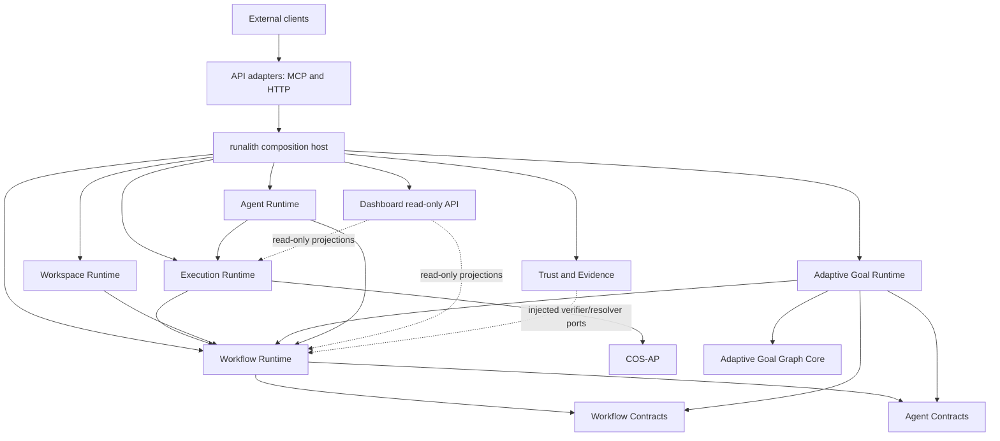

# GitHub repository target map

**Status:** target architecture baseline, 2026-10-31. Existing repositories are verified facts; proposed repository names are targets, not repositories already created. This map supersedes ad-hoc repository lists in extraction notes.

## 1. Target

Runalith will be decomposed into bounded subsystems, with **one GitHub repository per subsystem**. The existing [`nplongx/runalith`](https://github.com/nplongx/runalith) repository remains the product application and composition host: packaging, deployment, configuration, integration tests and dependency wiring. It must not remain the owner of every domain implementation.

Repository separation is required. Separate processes and databases are not implied. During migration, subsystem repositories may still be composed in one Node.js process and use the current SQLite database through explicit owner APIs. A repository split must not silently change transaction, approval, evidence, lease, recovery or filesystem semantics.

The source tree is not the boundary. Some current files contain multiple ownership concerns and must be split by responsibility before extraction. In particular, `job-store.js`, `workflow-state-port.js`, trust/approval modules and the active MCP entrypoint are not safe folder-level moves.

## 2. Verified GitHub inventory

Inventory checked with the authenticated GitHub CLI on 2026-10-31. These five repositories exist; the four subsystem repositories are public MIT packages at `0.1.0` and currently have no npm publication or automated host synchronization.

| Repository | Current responsibility | State |
|---|---|---|
| [`runalith`](https://github.com/nplongx/runalith) | Product host, MCP application, composition, packaging and deployment | Existing host repository; retain as composition root |
| [`runalith-cos-ap`](https://github.com/nplongx/runalith-cos-ap) | COS-AP message envelopes, schemas and durable execution DTO validators | Existing public subsystem repository |
| [`runalith-agent-contracts`](https://github.com/nplongx/runalith-agent-contracts) | Pure agent-role and generic action-intent vocabulary | Existing public subsystem repository |
| [`runalith-workflow-contracts`](https://github.com/nplongx/runalith-workflow-contracts) | Pure artifact DTOs, content hashes, success predicates and strict JSON parser | Existing public subsystem repository |
| [`runalith-adaptive-goal-graph-core`](https://github.com/nplongx/runalith-adaptive-goal-graph-core) | Pure AGG graph validation/search, discriminator and experimental Phase 2/3 algorithms | Existing public subsystem repository |

`docs/subsystems/public-repository-snapshots.json` pins the public commits and source hashes. `npm run test:public-subsystem-alignment` verifies the local source snapshots; it does not fetch updates, publish packages, or make the host consume packages from npm. See [the snapshot manifest](public-repository-snapshots.json) and [alignment test](../../tests/test-subsystem-public-repo-alignment.mjs).

## 3. Target subsystem repositories

The following repositories do not currently exist in the verified inventory. Names are proposed; create each repository only when its extraction gates pass.

### 3.1 `runalith-workflow-runtime`

**Responsibility:** workflow definitions/catalogs, compilation, immutable plans, policy and role-profile evaluation, workflow proposal/approval lifecycle, tasks, artifacts, events and manual-intervention audit.

**Initial source ownership:**

- `src/runtime/workflow/**` for definitions, catalogs, schema, compiler, plan, policy, role profiles, custom roles/workflows, evidence and verification. Pure `artifacts.js`, `success-contract.js` and `strict-json.js` remain in Workflow Contracts.
- `src/runtime/job-store.js`, `src/runtime/workflow-state-port.js`, `src/runtime/workflow-state-predicates.js` after their mixed Workflow/Execution/session responsibilities are separated.
- `src/runtime/manual-intervention-store.js`; the intervention record and its Workflow event form one audit operation.

**Owns:** authoritative workflow proposal, approval, immutable plan, task, artifact, event, policy and custom workflow/role lifecycle state. A valid approval remains a Workflow decision; Trust/Evidence only verifies the supplied evidence.

**Extraction blockers:** `job-store.js` still contains Execution lease/provider ledgers and Workflow state in one store; `WorkflowStatePort v2` includes Execution/provider operations backed by that same store. Agent Session DDL/SQL and public domain API are moved to their owner, with a separate internal lifecycle participant, but Workflow/Agent transitions still share the same connection and transaction. Direct Workflow-to-AGG implementation dependencies have been removed: candidate hash/reviewer verification and compiled action-intent semantic verification enter through fail-closed composition ports. AGG candidate-event interpretation and source-evidence lineage validation now live in `adaptive-goal-action-intent-binding-resolver.js` and consume read methods from `WorkflowStatePort`; Workflow no longer parses AGG candidate events. AGG consumers now use Workflow Plan API v1 and Agent Contracts public API instead of deep plan/role modules. WorkflowStatePort v2 owns final spawn authorization as one atomic command. Remaining blockers include mixed Workflow/Execution schema and lifecycle transactions, host-owned AGG proposal/candidate/sandbox transactions and incomplete public Workflow lifecycle API. Split state ownership and publish the needed Workflow query/command contracts before extracting this repository.

### 3.2 `runalith-execution-runtime`

**Responsibility:** plan-bound execution, batch scheduling, provider dispatch, lease fencing, provider-run lifecycle, result verification and recovery.

**Initial source ownership:** `execution-manager.js`, `execution-contract.js`, `execution-verifier.js`, `distributed-scheduler.js`, `task-lease-manager.js`, `recovery-manager.js`, `provider-dispatch-identity.js`, `provider-admission.js`, `github-actions-provider.js`, `m11-runner-provider.js`, `m12-native-specialist-bridge.js`, `runner-admission-broker.js` and `gateway-runner-admission.js`.

**Owns:** execution attempts, dispatch intents/claims, provider runs, execution leases, provider-admission leases and execution recovery state. Workflow owns the approved plan and canonical task lifecycle; Execution may change these only through explicit Workflow commands.

**Extraction blockers:** execution and Workflow currently share SQLite tables and writer transactions. `WorkflowStatePort v2` is a same-process facade over `WorkflowStore`, not an independent execution store or remote API. `DistributedScheduler`, GitHub Actions, M11 and M12 consumers use named WorkflowStatePort methods; `ProviderAdmissionController` receives a private provider-owned DB handle and uses the port for Workflow task/event interactions. Provider-run/dispatch DDL/SQL remains in WorkflowStatePort; WorkflowStore core now reads those ledgers only through `ExecutionPersistenceParticipant` v1 inside existing transactions. WorkflowStore still owns physical DDL/SQL for attempts, results, reports/delivery, execution batches/items and task execution projections. Final spawn authorization is now one atomic Workflow-owned command; remaining work is to split execution-owned tables from Workflow-owned schema and define cross-repository atomicity/idempotency/unknown-outcome/reconciliation contracts before package consumers can bypass the current transaction unit. M12 `STARTING` intents also lack automated external lookup/reconciliation.

### 3.3 `runalith-trust-evidence`

**Responsibility:** trust-root/configuration validation, signed source verification, reviewer identity verification, approval-evidence verification, evidence-lineage appraisal and checkpoint protocol contracts.

**Initial source ownership:** `adaptive-goal-trust-configuration.js`, `adaptive-goal-trust-domains.js`, cryptographic verification portions of `adaptive-goal-knowledge-verifier.js`, `adaptive-goal-reviewer-identity.js`, `adaptive-goal-approval-subsystem.js`, `adaptive-goal-source-evidence.js`, `adaptive-goal-evidence-lineage.js` and `agg-checkpoint-jcs-v2.js`.

**Owns:** trust configuration/history and verification decisions. It does not own Workflow approval rows, mutate workflow plans, create AGG proposals, or grant execution authority. Workflow persists the approval decision and its exact binding; Trust/Evidence verifies evidence through injected read-only Workflow/AGG resolver ports. External verifier, reviewer identity provider, trust administrator and checkpoint custodian remain separate authorities.

**Extraction blockers:** several modules mix cryptographic verification with Workflow event/transaction writes or AGG knowledge reads. Split verifier logic from persistence and define resolver/recorder ports. **D-01 is open:** the active MCP entrypoint still opens `agg-trust-configuration.db` separately from `WORKFLOW_DB`, while the V2 normative spec requires one physical database selected by canonical `WORKFLOW_DB` and two separately managed connections to that same database. Do not migrate or consolidate production state as part of repository extraction; require the owner-approved migration, writer fencing, crash/restore proof and external continuity evidence specified by the normative contract. See [V2 normative spec](../agg-external-checkpoint-v2-normative-spec-20261030.md) and [acceptance evidence](../goal-plan-execution-acceptance-rc23-20261028.md).

### 3.4 `runalith-adaptive-goal-runtime`

**Responsibility:** stateful AGG knowledge and planning capabilities above the already-extracted graph core: Goal/Idea knowledge, capture, planning projections, review-only proposals, candidates, readiness and sandbox execution.

**Initial source ownership:** `adaptive-goal-knowledge-store.js`, `adaptive-goal-knowledge-capture.js`, the AGG-specific snapshot orchestration in `adaptive-goal-knowledge-verifier.js`, `adaptive-goal-plan-adapter.js`, `adaptive-goal-compatibility.js`, `adaptive-goal-execution-readiness.js`, `adaptive-goal-execution-graph-proposal.js`, `adaptive-goal-execution-plan-candidate.js`, `adaptive-goal-reviewed-task-inputs.js`, `adaptive-goal-action-intent-policy.js`, `adaptive-goal-action-intent-binding-resolver.js`, `adaptive-goal-sandbox-executor.js`, `adaptive-goal-planner-telemetry.js` and `adaptive-goal-phase2-plan-shadow.js`. The current sandbox executor is fixture-only; it is not a production arbitrary-code sandbox.

**Owns:** Goal/Idea knowledge, revisions, memberships, edges, AGG planner telemetry and AGG proposal/candidate lifecycle. Proposals remain review-only; Workflow alone compiles/approves an immutable execution plan and authorizes dispatch. Pure algorithms stay in `runalith-adaptive-goal-graph-core`; generic agent/workflow contracts stay in their existing repositories; signature/trust verification belongs to Trust/Evidence.

**Extraction blockers:** AGG candidate interpretation/evidence resolution is now outside WorkflowStore and uses WorkflowStatePort reads. AGG candidate/readiness/approval/reviewer/sandbox modules now consume Workflow Plan API v1 and Agent Contracts public API rather than private Workflow plan/agent-contract modules. MCP still builds proposals/candidates and performs sandbox claims inside WorkflowStore transactions. `AdaptiveGoalTransactionBoundary` is only a set of named transaction controls over `workflowStore.db`, not an extracted application service. Move proposal/candidate/sandbox use cases behind AGG application APIs and give AGG-owned records/events explicit persistence and reconciliation semantics.

### 3.5 `runalith-workspace-runtime`

**Responsibility:** secure workspace file access, plan-authorized writes, filesystem receipts, CASE-01 snapshots and exact downstream consumption acknowledgements.

**Initial source ownership:** `secure-filesystem.js`, `workflow/workspace-write-contract.js`, `workspace-write-capability-service.js`, `workspace-write-receipt-store.js`, `workflow/case01-artifact-acceptance.js`, `workflow/case01-snapshot-store.js` and `workflow/case01-snapshot-service.js`.

**Owns:** safe filesystem mutation, workspace write receipts, snapshot reservations and snapshot/consumption records. Workflow remains authority for approval, task ownership and event lineage; Workspace consumes those through narrow ports. Filesystem bytes are not atomically committed with SQLite, so the API must preserve explicit partial/unknown outcomes and byte readback.

**Extraction blockers:** Workspace Write and CASE-01 now have application services composed by the active MCP host. CASE-01 snapshot creation/compensation, reservation recovery, Workflow lineage checks, consumed-byte SHA-256 verification and acknowledgement are no longer orchestrated in the active MCP adapter. This is still source-level extraction inside the monolith: receipt/snapshot/ack transactions use the WorkflowStore database and injected Workflow APIs are in-process facades. Before creating this repository, define the cross-owner consistency/reconciliation contract and decide how Workspace owns receipt/snapshot state without moving Workflow approval/task tables. Verify the older `server/index.js` compatibility path separately before deleting or redirecting it.

### 3.6 `runalith-agent-runtime`

**Responsibility:** agent control loops, coordination/session lifecycle, model/tool interaction adapters and agent-facing runtime integrations.

**Initial source ownership:** `agent-session-store.js`, `coordinator-workflow.js`, `langgraph-control-loop.js`, `langgraph-orchestrator.js`, `autonomous-delivery.js`, `cdp.js`, `session-transport.js` and agent skill/guidance runtime modules after separating policy declarations from execution behavior. The three Agent session tables now have a dedicated source owner; internal session/message lifecycle moves with this subsystem. External OpenClaw message transport/receipt adapters move to API Adapters.

**Owns:** agent session/control-loop state and integration lifecycle. It consumes Workflow tasks/plans and Execution commands; it does not approve workflows, bypass role constraints, or authorize provider dispatch independently. Generic role vocabulary remains in Agent Contracts. Internal session queue/ack state stays with Agent Runtime; external channel send/receipt protocols do not.

**Extraction blockers:** `AgentSessionStore` now owns schema and SQL for `agent_sessions`, `session_access` and `session_messages`; `RunalithWorkflowStore` host composition constructs the store and exposes a temporary compatibility facade. Its constructor verifies exact `DatabaseSync` identity through `WorkflowStatePort.assertSharedConnection(database)`, preventing split-connection row/event transactions. `WorkflowStore` core no longer constructs the store or declares public Agent Session delegators. `tasks.openclaw_run_id` / `tasks.openclaw_session_key` and `attempts.openclaw_run_id` remain cross-owner identity projections read/written by Workflow/Execution. Define task/session reference semantics through a stable owner API, then remove the compatibility facade before creating an independent Agent Runtime repository or database. Preserve durable message delivery/ack idempotency and restart recovery.

### 3.7 `runalith-api-adapters`

**Responsibility:** external protocol and channel transport, MCP tool registration/schema, legacy HTTP request mapping, Slack projection/delivery and OpenClaw message-send/receipt adapters, DTO validation and response/error mapping.

**Initial source ownership:** active versioned stdio MCP entrypoint under `server/`; legacy OpenAI-compatible HTTP adapter `server.js`; transport modules `openclaw-message-send.js` and `openclaw-message-receipt.js`; Slack channel/projection handlers and projection state currently composed in the server/WorkflowStore. Split MCP, HTTP and channel integrations into transport-specific modules within this repository.

**Owns:** transport protocols, channel configuration, delivery intent/status and Slack projection/delivery state. It must not own Workflow/Execution domain tables, approval logic, proposal/candidate orchestration, filesystem policy or execution lifecycle. Agent Runtime owns internal agent session and message-queue semantics; API Adapters owns external channel transport and acknowledgements. The `runalith` host composes implementations and configuration and injects subsystem APIs.

**Extraction gate:** last among backend subsystems. The current active MCP entrypoint composes stores and still contains AGG proposal/candidate/sandbox use cases; `server.js` is a distinct HTTP composition path and retains legacy CASE-01 orchestration. Slack projection tables and OpenClaw message transports are also coupled to WorkflowStore/Agent sessions. Extract only after adapters call versioned subsystem APIs and are thin transport shells. Preserve MCP tool names, schemas, HTTP behavior and delivery idempotency during migration.

### 3.8 `runalith-dashboard` (read-only application subsystem)

**Responsibility:** dashboard UI and presentation-only read models.

**Initial source ownership:** `dashboard/**`.

**Owns:** no Workflow, Execution, Trust or AGG authority state. It reads versioned projections from host/subsystem APIs and cannot write tasks, approvals, artifacts, trust configuration or dispatch state. Extract after the read-only projection API is stable; it can proceed independently of some backend extractions but must not query private tables directly.

## 4. Composition and dependency direction

`runalith` composes repositories. Dependencies point from consumers to stable contracts/APIs; subsystem implementations do not import the host or another subsystem's database/store implementation.

Trust integration is by neutral, injected ports: Workflow, AGG and Workspace request a typed verification decision; Trust/Evidence does not import their stores or write their records. Workflow owns final approval persistence. The host wires implementations and may keep all components in one process.

### 4.1 Current SQLite table ownership (target owner)

This is a source-schema inventory, not permission to split the production database. `job-store.js` currently creates several ownership groups in one connection; subsystem stores add further tables to that same connection. Move schema and writes only after foreign-key, transaction, recovery and event-authority contracts are tested.

| Current table(s) | Target owner | Important split |
|---|---|---|
| `jobs`, core columns of `tasks`, `approvals`, `workflow_events`, `workflow_runtime_state`, `workflow_plans`, `artifacts`, `reports` | Workflow Runtime | Remove provider/session/execution-specific task and job columns. Workflow retains canonical task and approval decisions. |
| `attempts`, `results`, `execution_batches`, `execution_batch_items`, `task_leases`, `task_checkpoints`, `provider_runs`, `provider_dispatch_intents`, `m12_native_specialist_runtime`, `m12_native_specialist_start_intents`, `provider_admission`, `provider_admission_leases` | Execution Runtime | `job-store.js` owns much of the DDL and transition SQL; `workflow-state-port.js` creates provider-run/dispatch and M12 start-intent schemas but delegates/uses the same DB. ExecutionManager now consumes named port methods; RecoveryManager and internal Workflow transactions remain coupled. Preserve lease/attempt/task/event transaction groups while moving schema/write ownership. |
| `agent_sessions`, `session_access`, `session_messages` | Agent Runtime | **SQL owner: `src/runtime/agent-session-store.js`; construction owner: `runalith-runtime-composition.js`; public domain API: `agent-session-api.js` v1; separate internal lifecycle participant.** WorkflowStore no longer imports/constructs AgentSessionStore or declares compatibility delegators; it consumes private injected domain/lifecycle ports within same-DB atomic transitions. Task lock/event dependencies, shared foreign keys/DB, delivery hooks and task/session reference contract still block standalone extraction. |
| `events` | Shared event journal, initially Workflow-owned | Contains Workflow, Execution, AGG approval/reviewer security, Agent Session lifecycle and snapshot acknowledgement events. Keep writer/trigger semantics until per-domain append APIs, event namespaces and anti-replay controls are preserved. Do not let consumers issue raw SQL. |
| `slack_threads`, `slack_projections`, `slack_projection_uncertain`, `slack_job_views` | API Adapters (Slack channel adapter) | Projection/uncertain-delivery state is transport-owned, not Workflow authority. Rebuild projections from versioned Workflow event/read APIs. |
| `workspace_write_receipts`, `case01_snapshot_reservations`, `case01_consumption_acks` | Workspace Runtime | Already have dedicated stores/services in source, but use WorkflowStore's shared DB and writer transactions. |
| `manual_interventions`, custom workflow/role versions, workflow policy versions/attachments/events | Workflow Runtime | Keep manual intervention and associated Workflow event atomic. Separate pure DTO/schema from DB-backed registry lifecycle. |
| `adaptive_goal_knowledge_nodes`, `adaptive_goal_knowledge_memberships`, `adaptive_goal_knowledge_revisions`, `adaptive_goal_knowledge_edges`, `adaptive_goal_knowledge_verifications`, `adaptive_goal_planner_*` | Adaptive Goal Runtime | Knowledge is append-only/unverified by default; planner telemetry has separate append-only lifecycle and needs its own retention/backup policy. |
| `adaptive_goal_trust_configuration_history`, `adaptive_goal_trust_configuration_events` | Trust/Evidence | D-01 currently conflicts with the normative single-physical-DB identity. Resolve owner-approved migration and continuity proof before moving these tables or changing DB connection configuration. |

Several `tasks` and `jobs` columns are transitional denormalized projections: `tasks.execution_*`, `tasks.openclaw_run_id`, `tasks.openclaw_session_key`, `jobs.provider_waiting`, `jobs.provider_retry_at`. `attempts.openclaw_run_id` binds one Workflow task attempt to an external OpenClaw run; it is not the same identity as `provider_runs.provider_run_id`, M12 native `run_id`, or a local `execution_session_id`/PID. Keep task/run identities as typed owner references and read models; do not move/drop these columns until recovery, AGG lineage and task/attempt completion use stable reference APIs. The `events` journal and shared foreign keys make table splitting a multi-stage migration; copying rows into new databases before command ownership and replay/reconciliation exist would break invariants.

Required reverse-dependency removals:

- `job-store.js` must stop importing AGG candidate/reviewer implementation modules. Inject a typed candidate/approval verifier at the Workflow boundary.
- `workflow/agent-contracts.js` must stop importing AGG action-intent implementation. Put the neutral semantic-verification contract in a lower-level contract and inject the AGG verifier.
- AGG planning must stop importing deep Workflow paths. Depend on Workflow Contracts and a narrow Workflow query/command API.
- Execution, Workspace and Agent Runtime must not query Workflow-owned tables directly. Use Workflow commands/read models.
- MCP/HTTP adapters must not import private domain stores or issue domain SQL.

## 5. Extraction order

| Order | Repository / milestone | Why this order | Acceptance gate before next stage |
|---:|---|---|---|
| 0 | Four existing pure repositories | Low-coupling foundations already exist | Keep public source snapshots aligned; add npm/release consumption only through an explicit versioning decision |
| 1 | `runalith-workflow-runtime` | Workflow defines plans, task ownership and approval API required by other subsystems | Separate Workflow tables/API from Execution state; complete Agent lifecycle transaction contract and move compatibility delegators out of WorkflowStore; replace `tasks.openclaw_*`/`attempts.openclaw_run_id` projections with typed owner references; remove reverse AGG imports; standalone tests and compatibility fixtures |
| 2 | `runalith-trust-evidence` | Typed verification ports are needed by Workflow, Workspace and AGG | Resolve D-01 under the normative owner-approved process; split verification from Workflow persistence; independent authority/custody and negative tests |
| 3 | `runalith-execution-runtime` | Depends on stable Workflow authorization/lifecycle commands | ExecutionManager already uses named WorkflowStatePort methods; still migrate RecoveryManager/provider consumers, move DDL and transactional writes out of WorkflowStore without breaking lease/attempt/event atomicity, define task/attempt reference and event ownership, complete M12 unknown-outcome reconciliation, standalone crash/race tests |
| 4 | `runalith-workspace-runtime` | Uses Workflow and Trust APIs; Workspace Write and CASE-01 application services now exist in the host | Explicit file/SQLite partial-commit and recovery contract; move receipt/snapshot ownership behind Workspace APIs; no private Workflow imports; legacy adapter parity |
| 5 | `runalith-adaptive-goal-runtime` | Depends on graph core, Workflow, Trust and neutral contracts | Move proposal/candidate/sandbox use cases and AGG persistence behind owner API; no MCP orchestration or Workflow DB reads |
| 6 | `runalith-agent-runtime` | Consumes Workflow and Execution; Agent session SQL owner and host composition are implemented | Complete lifecycle/transaction contract; remove WorkflowStore delegators after consumer migration; replace shared Workflow DB/task/event dependencies with stable references and durable integration; split generic parsing/runtime dependencies; standalone clean-clone build/tests/docs/CI and delivery/restart tests |
| 7 | `runalith-api-adapters` | Last: adapters should compose already-extracted capabilities only | No domain SQL/use-case orchestration; stable tool/HTTP schemas; isolated transport contract tests |
| Parallel | `runalith-dashboard` | UI can split once a read-only projection API exists | No direct table access or authority writes; standalone build and API contract tests |

This is repository extraction order, not a production rollout or database-migration authorization. Workflow and Trust work may need coordinated contract design; do not force an import cycle to satisfy the table order.

## 6. What remains in `runalith`

Keep application-level concerns in the host unless a separate bounded subsystem is demonstrated:

- composition root, local plugin/bootstrap, configuration, dependency wiring and graceful shutdown;
- MCPB/package build, deployment/rollout, release provenance and host-specific operations;
- cross-subsystem integration tests, compatibility matrix and end-to-end fixtures;
- repository catalog, product docs and static site publishing;
- generated artifacts, local data, runtime databases and test temporaries are not source repositories.

Do not create a generic `runalith-common` repository to hide uncertain ownership. Pure helpers belong with their semantic owner or in an existing contract repository. `observability`, packaging helpers and one-consumer utilities remain with the host/domain that owns their lifecycle until a stable cross-subsystem API is justified.

## 7. Repository completion criteria

A subsystem is complete as a separate repository only when all conditions hold:

1. The repository has one named owner and a bounded responsibility/data-ownership statement.
2. It has a root public API, versioned DTOs/schemas, stable error codes, idempotency and unknown-outcome semantics where applicable.
3. It has no imports from the host, sibling private implementation paths, or another subsystem's store/database handle.
4. A clean clone can install, build, test and run its contract suite without the parent repository.
5. It owns source, tests, fixtures, docs, ADRs, CI, security/contribution policies and changelog.
6. Consumers use the public API/release; the old host implementation is removed or retained only as a tested compatibility facade during a documented migration window.
7. A cross-repo consumer/provider compatibility test and rollback path exist.

Separate process/database deployment is a later, distinct decision requiring exclusive state ownership, outbox/inbox or equivalent coordination, retries, compensation, reconciliation, backup/restore and measured operational value.

## 8. Completed application-service slice and next extraction gate

`src/runtime/workflow/case01-snapshot-service.js` now owns snapshot create/compensation, reservation lifecycle, exact Workflow lineage checks, consumed-byte SHA-256 verification, idempotent consumption acknowledgement and recovery. The active versioned MCP entrypoint composes it through Workflow and `Case01SnapshotStore` ports. The service retains the existing SQLite writer reservation and filesystem partial-commit behavior. Boundary, transaction and active MCP E2E tests cover restart/crash before/after acknowledgement, recovery, byte and lineage binding, duplicate acknowledgement and event consistency.

This does **not** create `runalith-workspace-runtime` yet: state still lives in the host's WorkflowStore database and other adapters may still use the legacy CASE-01 implementation. The next repository-extraction slice is Workflow Runtime: split Workflow/Execution/session persistence ownership and remove Workflow-to-AGG implementation imports before publishing the Workflow application API. Do not migrate the trust database or split processes as part of this slice.
