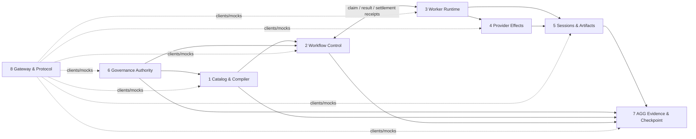

# Eight parallel workstreams under the three-deployable architecture

**Status:** Planning decomposition only. Documentation change; no source, schema, database, manifest, service or deployment change is authorized by this plan.

**Architecture authority:** [ADR 0003](../docs/adr/0003-three-part-rust-deployment.md) remains the accepted deployment decision. It defines **three deployables**, not eight. This document divides their implementation into eight independently ownable workstreams so teams/agents can develop in parallel behind versioned contracts. It does not supersede ADR 0003, resolve D-01, approve a database split or authorize cutover.

## 1. Deployment grouping

| Deployable (unchanged) | Parallel workstreams | Authoritative store |
|---|---|---|
| **A. Workflow Control** | **1. Workflow Catalog & Plan Compiler**; **2. Workflow Control & Lifecycle** | Control DB; workstreams 1 and 2 own different domains in the same deployable/store. |
| **B. Execution Workers** | **3. Worker Runtime & Sandbox**; **4. Provider Effects & Reconciliation**; **5. Sessions & Artifacts** | Execution DB plus Execution-owned artifact storage. Workstreams 3–5 own separate domains in the same deployable boundary. |
| **C. Governance & Interface** | **6. Governance Authority**; **7. AGG Evidence & Checkpoint Custody**; **8. Gateway & Protocol** | Governance DB for workstreams 6–7. Workstream 8 has no authoritative business database; it uses the service APIs and owns wire contracts/gateway configuration. |

The quota helper remains a host-security component, not a fourth application deployable or a ninth business workstream. Its root-owned quota registry and privileged service retain their separate host-security ownership.

**Legacy document mapping:** the former Part 1 (Workflow Control) is now workstreams 1–2; former Part 2 (Execution Workers) is workstreams 3–5; former Part 3 (Governance & Interface) is workstreams 6–8. Existing `PART1_ACCEPTANCE_STATUS.md` and dated Part 1/2/3 reports retain their historical labels; those labels do not define the new ownership boundaries.

## 1.1 Provisional Rust crate map

This maps current crate entrypoints to the future workstream responsibilities. It is **not** a claim that the current dependency graph or file ownership is already isolated.

| Current crate | Proposed workstream | Important caveat |
|---|---|---|
| `runalith-domain` | 1 and 2 | Domain types/compiler and lifecycle contracts currently share the crate. Split modules/API ownership; do not assign the whole crate to either workstream. |
| `runalith-control-api` | 2 | Control-side service API and lifecycle commands. Gateway presentation remains workstream 8. |
| `runalith-recovery` | 2 | Control's recovery classification/orchestration; it consumes verified observations and cannot invent Execution facts. |
| `runalith-execution`, `runalith-sandbox` | 3 | Process supervision and sandbox ports; keep provider/session/artifact persistence outside their private implementation. |
| `runalith-linux-quota` | 3 + host-security helper | Worker-facing quota integration; privileged root helper/registry remain host infrastructure, not another business store. |
| `runalith-worker` | 3–5 composition root | Worker binary composes runtime, provider and session/artifact ports. It is not exclusive ownership of workstreams 4 or 5. |
| `runalith-providers` | 4 | Provider adapter and observation semantics. |
| `runalith-artifacts` | 5 | Content bytes, digest, manifest and reference APIs. |
| `runalith-execution-persistence` | 4/5 extraction seam | Current persistence abstraction must be divided by owned records (provider intents vs session/artifact references); no whole-crate owner until that split is specified. |
| `runalith-trust` | 6 | Trust/reviewer/decision authority contracts and verification. |
| `runalith-agg` | 7 | AGG graph/evidence/checkpoint algorithms and repository ports. |
| `runalith-protocol` | 8 | Persistence-free wire schemas/envelopes; each producer workstream still owns its message semantics. |
| `runalith-mcp` | 8 | Gateway composition only; it must call public service APIs, not private domain modules or DBs. |
| `runalith-store` | Cross-cutting legacy Store to extract | Schema v20 mixes Control, Execution and Governance records. No workstream owns the entire crate; keep it read-only for planning and split only after Owner approval. |
| `runalith-runtime` | Cross-cutting legacy composition to extract | Current runtime composes Control, Execution, Provider, Trust and Recovery behavior. No workstream owns the entire crate; replace cross-domain dependencies with ports incrementally. |

The three cross-cutting packages (`runalith-domain`, `runalith-store`, `runalith-runtime`) and `runalith-execution-persistence` require a file/module/record-level ownership inventory before parallel source edits. A Cargo crate boundary is not a database or service boundary.

## 2. Workstream contracts and ownership

### Workstream 1 — Workflow Catalog & Plan Compiler

**Mission:** Turn user intent and versioned definitions into a validated, immutable, reproducible workflow plan. No execution or lifecycle mutation.

**Owns:** built-in/custom role and workflow definitions; catalog versioning; role capability/input/output contracts; trusted-skill references and pins as compiler inputs; DAG validation; normalization; policy/success-contract *schema and composition* used by a workflow plan; immutable plan snapshots, canonicalization and plan digests; plan migration compatibility rules.

**Does not own:** approval truth or signing keys; workflow instance lifecycle; claims/leases; scheduling; process/provider execution; trust roots/reviewer registry; AGG verification; user-facing MCP handlers.

**Current code starting points:** `runalith-domain` workflow/catalog types and compiler; catalog/plan paths in `runalith-store`; relevant parts of `runalith-runtime`; Node oracle scripts/fixtures. `runalith-domain` and `runalith-store` are currently shared/mixed crates: workstream ownership applies to named modules and contracts only, not to those entire crates.

**Publishes:** `WorkflowDefinitionV1`, `RoleDefinitionV1`, `SkillPinRefV1`, `CompiledPlanV1`, `PlanDigestV1`, typed task DAG and stable compiler error vocabulary. Every compiled plan is immutable and binds definition versions, dependencies and typed input/output contracts.

**Consumes:** a read-only trusted-skill resolution result from workstream 6; workflow-instance and policy-attachment requests from workstream 2. Missing/invalid trust data must fail closed; the compiler must not mint trust.

**Parallel work allowed now:** Node differential fixtures, catalog normalization, typed DAG validation, canonical hash behavior and plan-schema documentation using deterministic fixtures. Use fake resolver implementations for tests only.

**Acceptance:** Node public-API differential for valid/invalid definitions; version pinning and byte/hash reproducibility; duplicate/cycle/unknown-dependency/type mismatch rejection; immutable plan replay; no hidden DB access to Governance/Execution; clean package build and property/fuzz tests for parser/canonicalization boundaries.

### Workstream 2 — Workflow Control & Lifecycle

**Mission:** Decide whether a workflow/task may advance, issue fenced work, and preserve authoritative workflow history.

**Owns:** workflow instance lifecycle; task state and attempt ledger; dependency/concurrency admission; coordinator and fairness policy; lease IDs/owner epochs/renewal; Control event journal; approval receipt references and exact subject binding; workflow-local policy attachment/enforcement and success evaluation; task-result inbox and idempotent event application; cancellation requests; recovery evidence projection and authoritative disposition orchestration; synthesis over Control-owned facts.

**Does not own:** trust roots/reviewer/nonce/approval decision signing; worker process termination; provider-run truth; session delivery; artifact bytes; AGG truth/checkpoint signatures; northbound MCP presentation.

**Current code starting points:** `runalith-control-api`, `runalith-recovery`, Control-owned modules to be extracted from `runalith-store` and `runalith-runtime`. `runalith-store` schema v20 is currently a compatibility aggregate and is not yet a Control-only store. `runalith-control-api` is the Control service boundary, not permission for Gateway or another part to open its DB.

**Publishes:** `WorkflowCommandV1`, `WorkflowViewV1`, `TaskClaimV1`, `LeaseRenewalV1`, `TaskResultEnvelopeV1`, `CancellationRequestV1`, `RecoveryQueryV1`, `RecoveryDispositionV1`, and append-only lifecycle event contracts. Control alone issues claim identity and changes workflow/task/lease state.

**Consumes:** `CompiledPlanV1` from workstream 1; signed approval/authorization receipt from workstream 6; execution observations, process-stop proof and artifact references from workstreams 3–5; evidence/attestation references from workstream 7.

**Parallel work allowed now:** transaction/CAS behavior, lifecycle differential, scheduler fairness, result inbox replay, read-only recovery projection and fake-verifier tests against the existing test Store. Cross-part cancellation settlement, retry takeover and terminal recovery remain blocked until owners approve exact receipts and fencing semantics.

**Acceptance:** exact Node lifecycle/error compatibility within declared scope; independent-connection races; transaction rollback and crash/reopen replay; stale attempt/lease/owner-epoch rejection; idempotent duplicate/out-of-order event handling; missing authority remains UNKNOWN/UNRESOLVED; no worker/provider/AGG table reads after extraction; migration/import/restore only after a ratified ownership decision.

### Workstream 3 — Worker Runtime & Sandbox

**Mission:** Execute an already-authorized claim within its exact scope and report local process facts without deciding Control lifecycle.

**Owns:** worker admission and claim verification; command execution supervisor; process tree start/stop/wait; sandbox namespace/mount/environment/resource policy; per-claim workspace; process stdout/stderr/exit/timeout observations; local crash containment; worker service lifecycle; host quota-helper integration and worker-side quota evidence.

**Does not own:** task approval, workflow/task state, lease epochs, provider truth, session authorization, artifact provenance decisions, Governance keys or workflow recovery disposition.

**Current code starting points:** `runalith-worker` composition root, `runalith-execution` process execution, `runalith-sandbox`, `runalith-linux-quota`, `deploy/worker`. The Worker binary composes workstreams 3–5; it must call their public ports rather than absorb their private stores.

**Publishes:** `WorkerClaimAcceptedV1`, `ProcessObservationV1`, `ProcessStopReceiptV1`, `WorkerHealthV1`, and execution-local diagnostics. A process-stop receipt must distinguish local process-tree quiescence from provider-side no-more-side-effects proof.

**Consumes:** Control-issued `TaskClaimV1` plus exact `CommandRequestV1`; provider/session/artifact ports from workstreams 4–5. It must reject expired, replayed, mismatched, incorrectly signed or scope-widened claims.

**Parallel work allowed now:** supervisor/process isolation; sandbox escape/race tests; timeout and signal handling; workspace containment; host quota preflight/harness hardening; fake Control/Provider/Artifact adapters. Do not claim production quota enforcement until a dedicated project-quota mount and privileged helper evidence exist.

**Acceptance:** claim signature/audience/subject validation; process crash/timeout/kill injection; no process surviving accepted local stop receipt; adversarial filesystem/sandbox tests; exact workspace and resource accounting; no automatic rerun after ambiguous process/provider outcomes; clean Worker-only build and independent service identity.

### Workstream 4 — Provider Effects & Reconciliation

**Mission:** Make external provider effects observable, idempotent and ambiguity-safe.

**Owns:** provider adapters; immutable request payload bytes/digests; dispatch intents and idempotency keys; provider run IDs; send/accept/reject/unknown states; poll/lookup/status observations; provider terminal proof; dispatch replay prevention; provider-side outbox/inbox and retention policy.

**Does not own:** Control task state or lease release; process supervisor lifecycle; session message delivery; artifact content storage; trust roots or approval; workflow recovery disposition.

**Current code starting points:** `runalith-providers`, `runalith-execution-persistence`, provider-related modules currently in `runalith-runtime` and Node `execution-persistence-store`. The existing Node atomicity test is useful behavioral evidence, not a permission to share its SQLite transaction with Control.

**Publishes:** `ProviderDispatchRequestV1`, `ProviderDispatchObservationV1`, `ProviderRunRefV1`, `ProviderTerminalProofV1`, and explicit `NOT_SENT` / `ACCEPTED` / `REJECTED` / `UNKNOWN` semantics, bound to task, attempt, owner epoch, lease, provider account and payload digest.

**Consumes:** a valid claim/fence from workstream 3 and Control's idempotency identity from workstream 2; artifact collection from workstream 5; Governance verifier material only through workstream 6 interfaces.

**Parallel work allowed now:** per-provider adapter contract fixtures; exact request digest tests; pre-send reservation, post-send observation, retry/duplicate guard; status lookup and ambiguous-send fault injection using fake providers.

**Acceptance:** no duplicate send for one idempotency identity; timeout-after-send remains UNKNOWN; exact provider run identity and account binding; terminal proof is independently verifiable and replay-safe; observations cannot mutate Control lease/task state; crash/restart and reordered poll results preserve truth.

### Workstream 5 — Sessions & Artifacts

**Mission:** Own execution-side conversation/session delivery facts and immutable result/evidence bytes.

**Owns:** runtime session identity and binding; session ACL/grants; message enqueue/delivery/ACK/UNCERTAIN state; session expiry observations; content-addressed artifact bytes and metadata; integrity verification; artifact references, producer/attempt lineage and collection/retention; execution result packaging.

**Does not own:** workflow/task lifecycle; claim issuance; provider terminal truth; approval or reviewer identity; deciding that an artifact is trusted/verified; AGG candidate/attestation status.

**Current code starting points:** `runalith-artifacts`, session-related modules currently in `runalith-store`/`runalith-runtime`, `runalith-execution-persistence` only where it owns result references, plus Node `agent-session-store.js` and artifact persistence. The Rust aggregate Store session tables are temporary compatibility state, not a final Execution-owned store.

**Publishes:** `SessionRefV1`, `SessionDeliveryRequestV1`, `SessionDeliveryReceiptV1`, `ArtifactRefV1`, `ArtifactManifestV1`, `ArtifactLineageV1`, and read-only artifact/session observation APIs. Artifact references bind content digest, media/schema type, producer, workflow/task/attempt and creation identity.

**Consumes:** exact task claim/session scope from workstream 3; provider result references from workstream 4; content verification/trust requirements from workstreams 6–7.

**Parallel work allowed now:** immutable artifact store; digest and schema checks; session ACL/delivery queues; ACK/uncertain replay; artifact lineage and orphan collection with disposable local stores.

**Acceptance:** exact-byte digest/readback; no content overwrite under an existing content ID; producer and attempt binding; ACL and delivery idempotency; crash/reopen/duplicate ACK tests; incomplete or unverifiable lineage remains untrusted; Control and Governance cannot read the Execution DB directly.

### Workstream 6 — Governance Authority

**Mission:** Decide who is trusted and whether a specific action is authorized; issue verifiable receipts.

**Owns:** trust roots and key/domain separation; administrator provisioning; key rotation/revocation/anti-rollback; reviewer identities and quorum; approval policy versions; authenticated decision requests; nonce consumption; approval and authorization decision receipts; signer/key custody and canonical receipt verification; trusted skill authority.

**Does not own:** workflow lifecycle or claims; worker execution facts; AGG graph/candidate truth; public gateway business logic; Control's local plan/success predicates.

**Current code starting points:** `runalith-trust`, Governance-related `runalith-protocol` contracts, trust/reviewer/decision modules currently embedded in `runalith-store`, and `docs/rust-part3-governance-interface-contracts.md`. The current `StoreGovernanceDecisionBackend` is a single-file D-01 compatibility adapter, not a deployable Governance DB/backend.

**Publishes:** `ApprovalRequestV1`, `ApprovalDecisionReceiptV1`, `TrustSnapshotRefV1`, `ReviewerAttestationV1`, `TrustedSkillResolutionV1`, `NonceConsumptionReceiptV1`, and signer/verifier key-version policy.

**Consumes:** exact workflow candidate/plan/action references from workstreams 1–2; source-evidence manifest references from workstream 7; authenticated Control caller identity and canonical request digest.

**Parallel work allowed now:** pure signature/canonicalization vectors; trust lifecycle validators; reviewer quorum algorithms; receipt schema and verifier tests; test-key-only local backends. No production keys, reviewer roots or trust configuration may be provisioned by parallel implementation.

**Acceptance:** exact subject/audience/action/plan binding; signature and canonicalization golden vectors; nonce single-consumption under concurrency; quorum/maker-checker enforcement; rotation/revocation/anti-rollback; exact replay and changed-request conflict; missing authority fails closed; Control validates receipt without direct trust-table reads.

**Policy boundary:** Governance owns global trust, reviewer, approval and security policy. Workstream 1–2 own workflow-local policy packs, success predicates and immutable enforcement snapshots. A workflow policy may reference a Governance policy version/digest but cannot redefine trust, reviewer quorum or approval authority. This split is a proposed workstream boundary and must be ratified by the architecture/contract owners before any persistence ownership changes.

### Workstream 7 — AGG Evidence & Checkpoint Custody

**Mission:** Build and verify evidence/knowledge graphs and maintain externally anchored checkpoint continuity without granting workflow execution authority.

**Owns:** AGG knowledge graph revisions/memberships/edges; immutable source snapshots and evidence manifests; provenance/producer lineage validation; candidate search and ranking; review-only Plan Graph and Execution Graph proposals; source-verification request/receipt contracts; checkpoint operation journal, external anchor/status/head continuity, quarantine and attestation assembly.

**Does not own:** canonical trust roots or reviewer keys; approval decisions; workflow/task/lease state; process/provider state; artifact bytes; direct Gateway authorization.

**Current code starting points:** `runalith-agg`, AGG modules in `runalith-trust` only where receipt verification is a shared authority contract, Node AGG stores/verifier/benchmark fixtures, `docs/agg-external-checkpoint-v2-decision-register-20261030.md`, and `docs/rust-part3-governance-interface-contracts.md`.

**Publishes:** `EvidenceSnapshotV1`, `EvidenceManifestV1`, `ProducerLineageV1`, `SourceVerificationRequestV1`, `SourceVerificationReceiptV1`, `CheckpointOperationV1`, `CheckpointHeadV1`, and review-only AGG graph proposals. VERIFIED requires an independently authenticated verifier and exact source bytes/hash/lineage; a locally assembled manifest is not a signature.

**Consumes:** `ArtifactRefV1`/lineage from workstream 5; trust/verifier and signer contracts from workstream 6; read-only candidate/plan/workflow references from workstreams 1–2.

**Parallel work allowed now:** pure evidence schema/canonical digest tests; source-manifest generation; deterministic graph search; non-authoritative benchmark reproduction; checkpoint saga state-machine tests using fake authority. No checkpoint advance, attestation signing or production AGG provenance repin without its owner.

**Acceptance:** source-byte and provenance lineage binding; stale/missing evidence remains UNKNOWN; independent signature verification; nonce/replay/expiry and checkpoint monotonicity; anchor crash/retry and restore/fork tests; complete writer/reader inventory and global writer barrier evidence; review-only proposals never trigger execution or mark evidence VERIFIED by themselves.

### Workstream 8 — Gateway & Protocol

**Mission:** Expose a stable, authenticated northbound interface while preserving service ownership and side-effect boundaries.

**Owns:** versioned cross-part wire DTOs and event envelope metadata; schema/version negotiation; MCP tool/resource/prompt schemas; public HTTP/API facade and CLI/operator interface; capability discovery/filtering; principal propagation; error vocabulary/mapping; request limits; mutation idempotency propagation; read-only diagnostics and service routing.

**Does not own:** workflow or execution business rules; approval decisions; provider/sandbox execution; evidence truth; any service's authoritative database. Gateway must never perform cross-service SQL or bypass service authorization.

**Current code starting points:** `runalith-protocol`, `runalith-mcp` Gateway composition, MCP semantic parity inventory and transport adapters. `runalith-control-api` is the Control service API (workstream 2); workstream 8 owns the northbound Gateway/client surface, not the Control DB or its lifecycle handlers.

**Publishes:** stable wire schemas, compatibility/error contracts, MCP tool definitions and client-facing service routes. Protocols are persistence-free shared contracts; contract ownership does not grant access to another part's private module or store.

**Consumes:** public APIs from workstreams 1–7; host-issued caller principal and capabilities; service discovery and compatible contract versions.

**Parallel work allowed now:** OpenAPI/JSON schema and examples; MCP tool inventory/differentials; version negotiation; fake HTTP clients and gateway tests; auth/capability negative tests. Gateway can be developed against mocks while the service parts evolve.

**Acceptance:** no database dependency; every mutation routed to owning service with idempotency key; authenticated principal cannot be caller-spoofed; read-only routes cannot invoke mutation methods; capability filtering is exact; unknown/newer schema fails closed; duplicate/out-of-order response handling; per-service error mapping and compatibility-window tests.

## 3. Contract dependency graph

The graph below describes **contract dependencies**, not a synchronous call chain. A team may develop against the published schema and a mock provider before the upstream implementation exists.

Rules:

1. P1 publishes the immutable plan contract early; P2 can implement lifecycle against fixtures before P1's compiler implementation is complete.
2. P2 is the only issuer of task claims/lease epochs. P3 verifies claims and emits observations; P3/P4/P5 never write Control lifecycle rows.
3. P4 owns provider-effect truth; P3's local process exit is not provider terminality. P5 owns artifact/session records; artifact presence is not evidence verification.
4. P6 owns trust and approval truth. P2 validates a signed, exact, current decision receipt; it does not open Governance storage.
5. P7 may consume evidence references and produce verification/checkpoint receipts. It cannot authorize workflow execution or settle leases.
6. P8 routes requests to public service APIs. It never becomes a privileged shared-data layer. No circular synchronous calls; use immutable requests, durable outbox/inbox and reconciliation.

## 4. Shared contract envelope

Every cross-workstream message or event must define, as applicable:

| Field | Rule |
|---|---|
| `schema_version` | Explicit major/minor contract version; incompatible shape/meaning requires a new major version. |
| `message_id` / `event_id` | Stable unique identity; immutable across retries. |
| `producer_id` | Authenticated service identity, not caller-supplied display text. |
| `created_at` | Canonical UTC timestamp; never used as sole ordering/fencing proof. |
| `correlation_id` | Stable workflow/request trace identity. |
| `idempotency_key` | Required for mutations and external side effects; same key with changed body conflicts. |
| `subject` | Exact subject binding: workflow/task/plan digest/attempt/lease/owner epoch/provider run/artifact digest/candidate/action as relevant. |
| `payload_digest` | Canonical digest of exact immutable request or evidence bytes. |
| `sequence` / predecessor | Required when source authority defines an ordered journal/checkpoint chain. |

Consumers authenticate the producer, validate schema and exact subject, persist inbox identity before acknowledging, and handle duplicate, delayed, missing, conflicting and out-of-order messages. No contract may claim a distributed transaction across the three databases.

## 5. Parallel-development protocol

### Workstream isolation

- Give each workstream a named owner and a bounded file/crate ownership list before assigning implementation. No named owner is inferred by this planning document.
- Work independently in separate branches/worktrees or explicitly disjoint file ownership. Do not concurrently edit a shared source file, `Cargo.toml`, lockfile, schema migration or root manifest.
- Prefer new workstream-owned modules/crates and public traits over edits to `runalith-store`/`runalith-runtime` shared internals. A shared-file change requires one coordinating owner and a reviewed integration patch.
- Every workstream maintains its own `README`/design note, contract version, Node oracle/fixtures, acceptance matrix, test commands, known gaps and owner sign-off.
- Integrators consume only published public contracts. No dependency on another workstream's private structs, SQL, transaction or filesystem path.

### Contract-first delivery sequence

1. **Discovery:** inventory Node source behavior, Rust implementation and authoritative data for that workstream. Mark facts vs assumptions; do not edit adjacent workstreams.
2. **Contract draft:** publish typed schemas, state/error semantics, ownership, idempotency, ordering, deadlines and negative cases. Use fixtures and mocks. Contract changes are reviewed by producer and consumer owners.
3. **Independent implementation:** implement only the owned domain behind its ports; add Node differential and fault-injection tests.
4. **Local composition:** run cross-workstream integration against fake services first, then the real public ports; record schema compatibility and crash/replay results.
5. **Deployable integration:** combine workstreams 1–2, 3–5 and 6–8 into the three ADR 0003 deployables. Do not create eight runtime services merely because there are eight workstreams.
6. **Independent release:** each of the three deployables gets its own clean-checkout build/test, identity/secrets, health, observability, store backup/restore, compatibility window and rollback evidence.

### Change and review rules

- No shared DB, cross-service SQL, borrowed SQLite transaction, direct filesystem access to another service's store, or implicit distributed transaction.
- No silent contract widening. Keep old readers compatible during a declared migration window; publish version and golden fixtures before implementation rollout.
- Breaking contract/schema changes require producer + every consumer owner approval, migration plan, compatibility tests and rollback proof.
- A missing signature, stale version, absent inventory, ambiguous provider effect or incomplete history remains UNKNOWN/UNRESOLVED; no synthetic receipt or inferred absence.
- Node remains a read-only compatibility oracle. No Node runtime import into Rust production services.
- A green crate test suite is not a deployable acceptance result. Acceptance includes process/network fault, DB isolation, auth, crash/replay, clean build, operations and rollback evidence.

## 6. Current blockers and decisions that remain external

| Gate | Status | What must happen before affected workstreams integrate or migrate |
|---|---|---|
| ADR 0003 deployment target | Accepted: exactly 3 deployables | Keep 8 as workstreams inside 3 deployables. A proposal for 8 independently deployed services would require a separate architecture decision. |
| D-01 vs separate DB topology | **BLOCKED** | Project/architecture Owner must issue a versioned superseding decision or explicit bounded compatibility exception. No DB split, projection cutover or transaction rewrite before that. |
| Control/Governance projection | **BLOCKED** | Ratify exact signed fields, freshness, revocation, replay, ordering, transaction and restore/epoch rules. Workstreams 2 and 6 cannot finalize their shared authority boundary without this. |
| Worker claim issuer / authority | **BLOCKED** | Ratify claim signer, service identity, audience, expiry, plan/lease/attempt/owner-epoch binding and key rotation. P2/P3 use test mocks only until then. |
| Cancellation and settlement | **BLOCKED** | Define request ACK vs signed process-stop/no-more-side-effects receipt, provider-side terminality, settlement CAS and late-result behavior. P2/P3/P4 cannot mark cancelled/release lease from local cgroup evidence alone. |
| Recovery disposition | **BLOCKED** | Define authoritative inventory and provider/session evidence composition, disposition issuer/verifier, exact fence and atomic Control settlement. P2/P3/P4/P5/P7 remain read-only/UNKNOWN until accepted. |
| Same-task retry | **BLOCKED** | Define takeover authority, session owner, cross-store reservation/settlement, durable event/outbox/inbox, fencing, idempotency and UNKNOWN recovery. Current Node one-SQLite savepoint cannot be copied across deployables. |
| Deterministic local-step contract | **BLOCKED** | Define typed `TaskSpec`/`CommandRequest` mapping, `timeout_ms` precedence, effective deadline/error semantics, scope and artifact binding. No command may be inferred from free-form metadata. |
| Governance/AGG production authority | **BLOCKED** | Provision owner-controlled roots, reviewer identities, signers, nonce authority, independent checkpoint provider and complete reader/writer inventory. Local test keys are not production credentials. |
| AGG provenance successor | **BLOCKED** | AGG owner must issue a versioned source/fixture successor with exact current pins and predecessor lineage. Do not locally repin dirty source/manifest. |
| Kernel project-quota proof | **BLOCKED** | Provision a dedicated exact-mountpoint ext4/XFS `prjquota`/`pquota` test root and privileged helper evidence; `/` is never a valid destructive test target. |
| Independent deployment / rollback | **NOT PROVEN** | Three clean-checkout build/test jobs, real separate processes and stores, partition/restart/duplicate tests, metrics/health, staged release and rollback rehearsal required. |

These gates do not prevent parallel work on pure validators, schemas, mock adapters, differential fixtures, read-only projections or isolated local tests. They prevent claims of shared-authority correctness, destructive migration, production credentials, dispatch, terminal settlement and cutover.

## 7. Definition of independently developable

A workstream is independently developable when all are true:

1. Its bounded responsibility, non-goals, data owner and public contract are documented.
2. It can build/test using only its declared dependency closure or mock ports; it does not require another workstream's private database/module.
3. It has versioned fixtures and negative tests for invalid, unauthorized, duplicate, stale and ambiguous inputs.
4. It can merge without overwriting another workstream's files or schemas; shared contract changes use explicit review.
5. Its output can be integrated behind a public port without changing another workstream's authoritative state directly.

A workstream is not independently deployable merely because it satisfies these conditions. Independent deployment is evaluated at the three deployable boundaries in ADR 0003, with all six criteria in that ADR and the production gates above.

## 8. Status and next planning actions

This decomposition is documentation-only. The repository still has a cross-cutting `runalith-runtime`, mixed schema-v20 compatibility Store, and no production Governance host. Current full-workspace tests and local process tests are evidence for the current combined workspace, not proof that these eight ownership boundaries or the three deployment boundaries are already implemented.

Before assigning parallel coding work:

1. Confirm each of the eight scopes and assign one accountable owner per workstream.
2. Resolve the proposed policy boundary in workstreams 1–2 vs 6 and the D-01 database decision with the Project Owner.
3. Freeze first contract versions for `CompiledPlanV1`, `TaskClaimV1`/`TaskResultEnvelopeV1`, `ProviderTerminalProofV1`, `ArtifactRefV1`, `ApprovalDecisionReceiptV1`, `EvidenceManifestV1` and the common envelope.
4. Approve file/crate ownership and branch/worktree layout; keep shared manifests and `runalith-store` integration under one coordinator.
5. Start parallel development with mock ports and read-only evidence only. Revisit persistence and migration after the owners ratify the authority and data boundaries.

Related documents: [ADR 0003](../docs/adr/0003-three-part-rust-deployment.md), [three-part implementation history/status](THREE_PART_IMPLEMENTATION_PLAN.md), [Node/Rust parity matrix](PARITY_MATRIX.md), [Control DB ownership analysis](docs/control-db-ownership-analysis.md), [Worker Control API v1](docs/worker-control-api-v1.md), [Part 3 Governance contracts](../docs/rust-part3-governance-interface-contracts.md).
